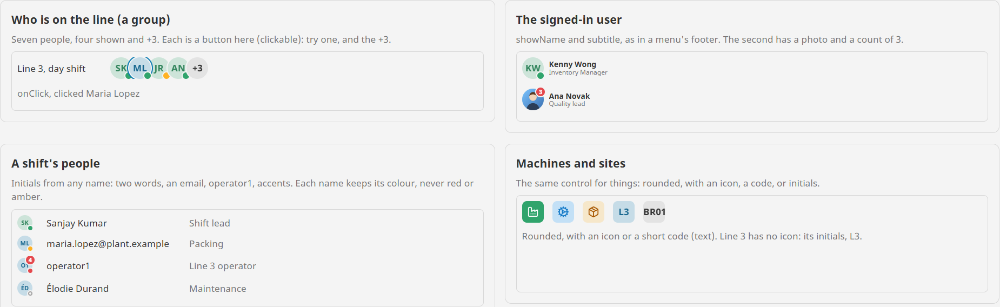
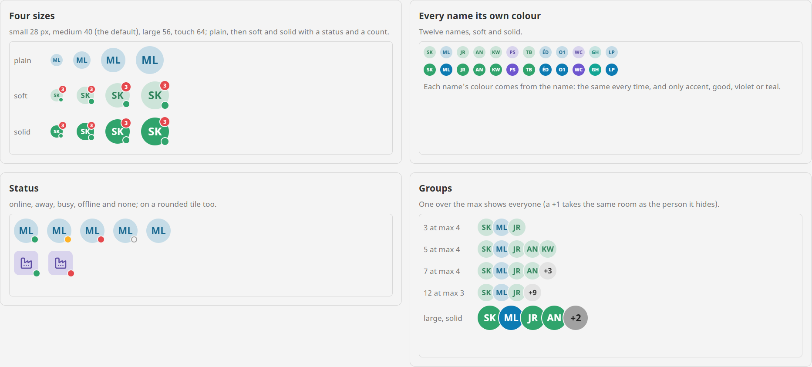

# Avatar

**⬇ [Download the Ectobox Perspective Component Suite](https://github.com/Ectobox/EctoboxIgnitionModules/releases/download/modules/Ectobox-Perspective-Component-Suite-8.3.modl)**, which includes the Avatar.

A person as a circle: their picture, or initials from their name in their own colour. Or a machine, a line or a site
as a rounded tile with an icon.

- **A name is enough.** "Sanjay Kumar" is SK, "maria.lopez@plant.example" is ML, "operator1" is O1. The same name
  always gets the same colour, picked only from blue, green, violet and teal, so a person never reads as an alarm.
- **A picture that fails to load** falls back to the initials, never a broken image.
- **Status and a count**: a dot (online, away, busy, offline) and a count of unread notes or open tasks.
- **The name beside it**, with a quieter line under it, as the signed-in user at the foot of a menu.
- **A group**: an overlapping row that folds to "+3", for the crew on a line or who is logged in.



## Install

The Avatar comes in the **[Ectobox Perspective Component Suite](PerspectiveComponentSuite.md)**, one module with all of
Ectobox's Perspective controls.

1. Download **`Ectobox-Perspective-Component-Suite-8.3.modl`** from the [Releases](https://github.com/Ectobox/EctoboxIgnitionModules/releases/download/modules/Ectobox-Perspective-Component-Suite-8.3.modl) list.
2. In the gateway's web interface, open the **Modules** page → **Install or Upgrade a Module** → pick the file (accept
   the Ectobox certificate on first install), and restart the gateway when it asks.
3. Open a project in the Designer; **Avatar** and **Avatar group** appear in the component palette under the **Ectobox**
   category.

## Quick start

### One person

```json
"name": "Sanjay Kumar",
"status": "online"
```

Bind `name` to the user (`{session.props.auth.user.userName}`, or a full name from your user source) and `image` to
their picture if you have one.

### The signed-in user

```json
"name": "Kenny Wong",
"subtitle": "Inventory Manager",
"showName": true
```

### A machine or a site

```json
"name": "Filler 1",
"icon": "lucide/factory",
"shape": "rounded",
"tone": "good"
```

`text` puts your own short code in instead of initials: "BR01" for a site.

### A group

```json
"people": [
  { "name": "Sanjay Kumar", "status": "online" },
  { "name": "Maria Lopez" },
  ...
],
"maxPeople": 4
```

Seven people at `maxPeople` 4 show four and "+3". One more than the max shows everyone, since a "+1" would take the same
room as the person it hides. Bind `people` to a query or a script's list.

## Properties

| Property | What it does |
|---|---|
| `name` | Who it is. Gives the initials, the tooltip and the colour. Empty shows a person outline. |
| `text` | Your own initials or a short code instead of the name's. |
| `image` | A picture's address. It fills the shape; if it can't be loaded, the initials show. |
| `icon` | An icon instead of initials, for a machine or a line (a Lucide or any Ignition icon). A picture or `text` wins. |
| `tone` | The colour. Empty (default) picks from the name: accent, good, violet or teal, the same for that name every time. Set it to use any colour, red and amber included. |
| `color` | A colour of your own instead of `tone`. On solid, the initials are white or dark, whichever reads better. |
| `appearance` | `soft` (default): a tint with initials in a deeper shade. `solid`: filled, white initials. |
| `shape` | `circle` (default) for people, `rounded` for machines, lines, sites and teams. |
| `size` | `small` 28 px, `medium` 40 (default), `large` 56, `touch` 64. |
| `status` | `none` (default), `online` (green), `away` (amber), `busy` (red) or `offline` (an empty ring), as a dot on the bottom-right edge. |
| `badge`, `max` | A count on the top-right edge; 0 or empty shows none, past `max` (99) it says 99+. The component's box takes in the part that sticks out, so nothing is cut off and the face stays centred in a row. |
| `showName`, `subtitle` | The name beside the avatar, and a quieter line under it. |
| `people`, `maxPeople` | A group: each person takes `name`, `text`, `image`, `icon`, `tone`, `status` and `tooltip`; `maxPeople` (4) before "+n". |
| `tooltip` | Shown on hover and read by screen readers. Empty uses the name (and the status). |
| `clickable` | A button: a hand cursor, in the Tab order with a focus ring, and onClick. In a group, every face and the "+n" are buttons. |

Initials are centred on their capitals in the theme's own font, measured on a live Perspective page at every size; the
status dot and the count sit on the face's edge (on a rounded tile, its rounded corner). In a group the faces overlap by
an eighth, so even wide initials (ML, AN) stay clear of the next face. Light, dark and custom themes work through
Perspective's theme variables.



## Events

| Event | When | Payload |
|---|---|---|
| `onClick` | With `clickable` on: the avatar, a person in a group, or the "+n" was clicked (or Enter or Space pressed on it) | `name` (empty for +n), `index` (the person's place in `people`, -1 otherwise), `more` (true for +n) |

## See it working

Every example runs live on the [Public Demo Server](https://proveit.ectobox.com/data/perspective/client/ModuleDemos/avatar),
each beside exactly how it is built:

| Page | Shows |
|---|---|
| Examples | Who is on a line (a clickable group), the signed-in user with a role and with a photo, a shift's people with status and a count, machines and a site as rounded tiles, and a photo that won't load. |
| Looks | Four sizes, soft and solid; twelve names in their own colours; every status; groups of 3, 5, 7 and 12. |
