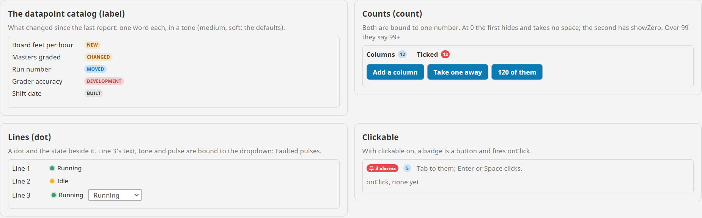
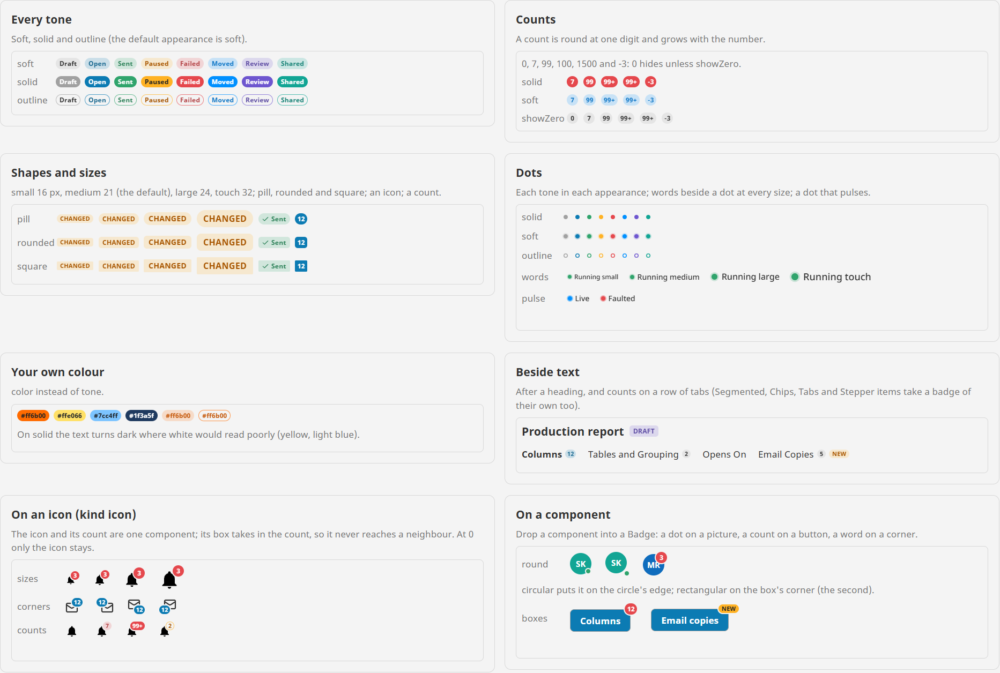

# Badge

**⬇ [Download the Ectobox Perspective Component Suite](https://github.com/Ectobox/EctoboxIgnitionModules/releases/download/modules/Ectobox-Perspective-Component-Suite-8.3.modl)**, which includes the Badge.

A small status label or count, or a status dot: NEW, CHANGED, Paused, 12, 99+, or a green dot beside "Running".

- **label** says a word or two, with an icon if you like: what changed in a catalog, the state of an order.
- **count** shows a number, "99+" past its `max`, and hides at 0 (taking no space) unless `showZero` is on.
- **dot** is a status dot, with words beside it if `text` is set. `pulse` makes it breathe for live or alarm states.
- **icon** is an icon with the count on its corner: a bell with 3. At 0 the count goes and the icon stays.
- **On anything.** Drop a component into a Badge (a button, a picture, a label, an embedded view) and the badge rides on
  its corner.
- **Clickable when asked.** With `clickable` on, a badge is a button: a hand cursor, in the Tab order, and onClick.



## Install

The Badge comes in the **[Ectobox Perspective Component Suite](PerspectiveComponentSuite.md)**, one module with all of
Ectobox's Perspective controls.

1. Download **`Ectobox-Perspective-Component-Suite-8.3.modl`** from the [Releases](https://github.com/Ectobox/EctoboxIgnitionModules/releases/download/modules/Ectobox-Perspective-Component-Suite-8.3.modl) list.
2. In the gateway's web interface, open the **Modules** page → **Install or Upgrade a Module** → pick the file (accept
   the Ectobox certificate on first install), and restart the gateway when it asks.
3. Open a project in the Designer; **Badge** appears in the component palette under the **Ectobox** category. Dropped on
   a view, it starts as an amber NEW tag.

## Quick start

### A tag

```json
"text": "CHANGED",
"tone": "warning"
```

### A count

```json
"kind": "count",
"count": 120,
"tone": "bad",
"appearance": "solid"
```

Shows "99+". Bind `count` to a number; at 0 the badge hides and takes no space, so a row of headings closes up. In the
Designer a hidden badge shows faintly, so it can still be picked.

### A status

```json
"kind": "dot",
"text": "Faulted",
"tone": "bad",
"pulse": true
```

Bind `text` and `tone` (and `pulse`) to the machine's state, for example with an expression:
`case({view.custom.state}, "Running", "good", "Idle", "warning", "Faulted", "bad", "neutral")`.

### On an icon

```json
"kind": "icon",
"icon": "material/notifications",
"count": 3,
"tone": "bad",
"appearance": "solid"
```

The icon and its count are one component. Its box takes in the part of the count that sticks out past the icon, so it
never reaches into a neighbour, and nothing clips it. The icon takes the component's text colour (`style.color`). The
palette has this as **Badge on an icon**.

### On a component

Drop any component into a Badge in the Designer (select the Badge, then drop, as for any Perspective container). The
component fills the Badge and the badge (`kind` label, count or dot) rides on its corner:

| Property | What it does |
|---|---|
| `corner` | `top-right` (default), `top-left`, `bottom-right` or `bottom-left`. |
| `overlap` | `rectangular` (default): on the corner of the box, as on a button. `circular`: on the edge of a round shape, as on a person's picture, where the box's corner would leave the badge floating off it. |

A status dot on a picture: `kind` dot, `corner` bottom-right, `overlap` circular. A count on a button: `kind` count on its
own. The Badge's box takes in what sticks out, measured once drawn, so it is never cut off by the container around it
(Perspective's containers scroll), and a badge that isn't clickable lets clicks through to the component under it. With
several components inside, each child's `position.grow` shares the width; one Flex inside holds a group.

Items in the Segmented Control, Chips, Tabs and Stepper take a badge of their own.

## Properties

| Property | What it does |
|---|---|
| `kind` | `label` (default), `count`, `dot` or `icon`. |
| `text` | label: what it says. dot: the words beside the dot; empty shows the dot alone. |
| `count` | count: the number. Empty hides the badge. |
| `max` | count: the most shown, 99 by default; above it the badge says 99+ (-99+ below minus 99). |
| `showZero` | count: show 0. Off (default) hides the badge at 0. |
| `icon` | label: an icon before the text. icon: the icon the count sits on. A Lucide or any Ignition icon. |
| `mark` | kind icon: `count` (default) or `dot`: a dot in the tone on the icon's corner (a bell with something new). The dot shows unless `count` is bound and says 0; `pulse` makes it breathe. |
| `tone` | `neutral` (default), `accent` (the theme's), `good`, `warning`, `bad`, `info`, `violet`, `teal`. |
| `color` | A colour of your own instead of `tone`. On solid, the text is white or dark, whichever reads better on it. |
| `appearance` | `soft` (default): a tint with text in a deeper shade. `solid`: filled. `outline`: a line in the colour. |
| `shape` | `pill` (default), `rounded` or `square`. |
| `size` | `small` 16 px, `medium` 21 (default), `large` 24, `touch` 32. A dot's words are 12, 14, 16 and 18 px. With kind icon, the icon is 20, 24, 32 or 40 px and its count 16 px (small, medium) or 21 (large, touch). |
| `pulse` | dot: a ring breathes out of the dot. Still when the operating system asks for reduced motion. |
| `tooltip` | Shown when the pointer rests on the badge; also what a screen reader hears for a dot alone. |
| `clickable` | The badge is a button: a hand cursor, in the Tab order with a focus ring, Enter or Space clicks. With kind icon, the whole icon is. |
| `corner`, `overlap` | With kind icon or a component inside: see above. |

Text is centred on its capitals and counts on their digits, in the theme's own font, and a dot sits on the middle of
the capitals beside it, measured on a live Perspective page at every size. Light, dark and custom themes work through
Perspective's theme variables.



## Events

| Event | When | Payload |
|---|---|---|
| `onClick` | The user clicks the badge, or presses Enter or Space on it, with `clickable` on | `kind`, `text` (as shown, e.g. 99+), `count` (the number itself, for a count) |

## See it working

Every example runs live on the [Public Demo Server](https://proveit.ectobox.com/data/perspective/client/ModuleDemos/badge),
each beside exactly how it is built:

| Page | Shows |
|---|---|
| Examples | A report builder's: the datapoint catalog's NEW and CHANGED tags, counts that hide at zero, the lines' states from a dropdown (Faulted pulses), clickable badges with onClick, a bell whose count is bound, and badges on a picture and a button. |
| Looks | Every tone in each appearance, counts, shapes and sizes, dots, colours of your own, badges beside text, kind icon at every size and corner, and badges on round and square components. |
