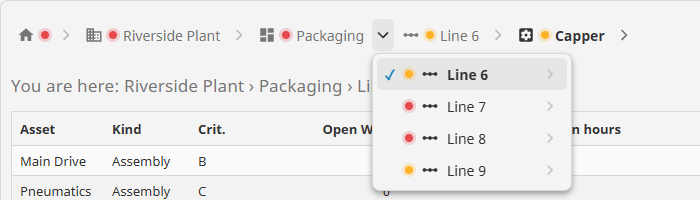
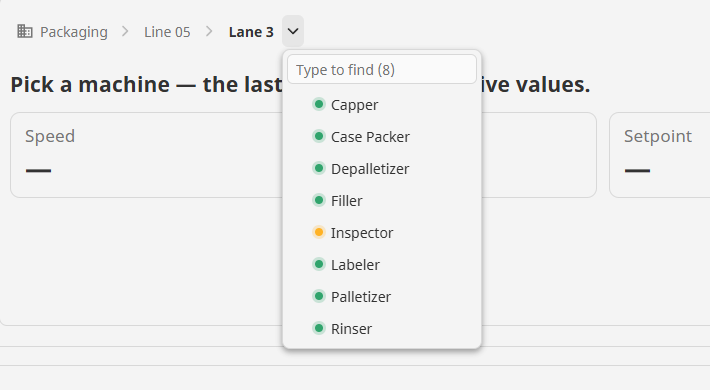
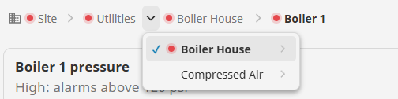
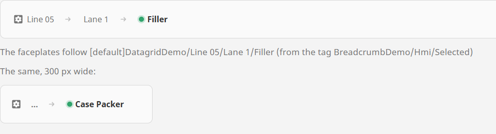
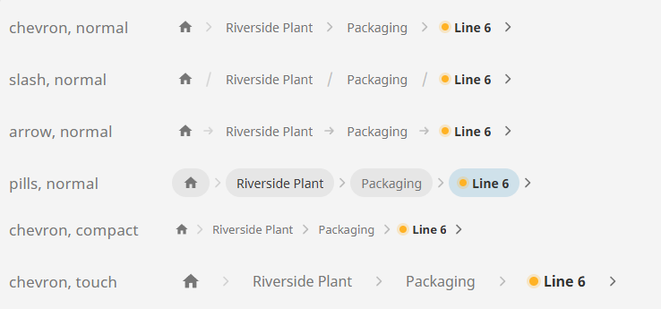

# Breadcrumb

**⬇ [Download the Ectobox Perspective Component Suite](https://github.com/Ectobox/EctoboxIgnitionModules/releases/download/modules/Ectobox-Perspective-Component-Suite-8.3.modl)**, which includes the Breadcrumb.

Pick an asset by its place in the plant. The Breadcrumb shows where you are — Site › Area › Line › Machine — and
every part of it does something:

- **Click a crumb** to go up to it.
- **Click a separator** to jump sideways: the separator before *Line 3* lists the area's other lines, so Line 3 → Line 4
  is one click, not up-and-back-down.
- **Click the arrow at the end** to go down: it lists what is inside the asset you are on.

Its main job is choosing the asset everything else on the screen follows — bind `selected` both ways to a tree, a
table, a trend or a page parameter. Opening a page, or writing the choice to a tag, are options you switch on.



It reads your trail from one of three places:

| `source.mode` | The trail comes from | Use it for |
|---|---|---|
| `hierarchy` (default) | Your own asset table: one row per asset, with its id and its parent's id. Bind it to a named query. | An equipment register, an ISA-95 asset model kept in a database, a material hierarchy. |
| `tags` | A folder of the tag tree: its folders and UDT instances are the levels. Browsed on the gateway, with the user's own tag permissions. | A plant model you already keep in tags (Enterprise/Site/Area/Line/Machine). Nothing to build in a database. |
| `items` | A list you give it, crumb by crumb. | A recipe's steps, a wizard, any trail a script works out. |

## Install

The Breadcrumb comes in the **[Ectobox Perspective Component Suite](PerspectiveComponentSuite.md)**, one module with
all of Ectobox's Perspective controls.

1. Download **`Ectobox-Perspective-Component-Suite-8.3.modl`** from the [Releases](https://github.com/Ectobox/EctoboxIgnitionModules/releases/download/modules/Ectobox-Perspective-Component-Suite-8.3.modl) list.
2. In the gateway's web interface, open the **Modules** page → **Install or Upgrade a Module** → pick the file (accept
   the Ectobox certificate on first install), and restart the gateway when it asks.
3. Open a project in the Designer; **Breadcrumb** appears in the component palette under the **Ectobox** category.

## Quick start: your asset table

1. Write a named query that returns one row per asset with at least an id, its parent's id and a name, sorted the way
   you want the menus listed (`ORDER BY Name`):

   ```sql
   SELECT e.ID, e.ParentID, e.Name, e.Kind
   FROM Equipment e
   ORDER BY e.Name
   ```

2. Drop a **Breadcrumb** onto a view and bind `source.hierarchy.data` to that query.
3. Pick `idField`, `parentField` and `labelField` from their dropdowns — they list the query's own columns.
4. Bind `selected` **both ways** to a custom property (say `view.custom.asset`), and bind whatever should follow the
   asset — a table's query parameter, an embedded view's parameter — to that same property.

A row whose parent is blank, or whose parent isn't in the data, is a top-level asset; they are listed in the home
crumb's menu. Ids are compared as text, so a parent id of `"10"` finds the asset with id `10`.

## Quick start: the tag tree

1. Set `source.mode` to `tags` and `source.tags.rootPath` to the folder the breadcrumb starts at, e.g.
   `[default]Enterprise`. Nothing above it can be reached.
2. Choose what counts as a level with `source.tags.include`: folders and UDT instances (the default), folders only, or
   UDT instances only. `source.tags.udtTypes` narrows it to instances of some UDT types (a dropdown of your UDTs).
3. `selected` holds the selected level's full tag path — ready to build tag paths from:
   `tag({view.custom.machine} + "/Speed")`.



Only what is on screen is browsed and watched — the crumbs and the menu you open — so a plant of 50,000 machines costs
no more than one of 50.

## Status dots

A crumb or menu row can show a coloured dot, so the trail shows where the trouble is while you navigate.

| Where the status comes from | Setting |
|---|---|
| A column of your asset table | `source.hierarchy.statusField` |
| A tag inside each level (in tags mode), e.g. a machine UDT's `State` or `Faulted` member | `source.tags.statusMember` |
| The worst active alarm anywhere under each level (in tags mode): High or Critical = red, Medium or Low = amber | `source.tags.statusFromAlarms` |
| An item's own value (in items mode) | `items[].status` |

`statusMap` says which value gets which colour. Rules are checked top to bottom and the first match wins; a value that
matches no rule but is itself `good`, `warning`, `fault`, `off` or `info` is used as it is. Anything else shows no dot —
never a guess.

```json
[
  {"value": "Running", "status": "good", "label": "Running"},
  {"value": "Slow", "status": "warning", "label": "Running slow"},
  {"value": "Faulted", "status": "fault", "label": "Faulted"},
  {"value": "Idle", "status": "off", "label": "Idle"}
]
```

A rule's value is compared in the rule's own type: a `true`/`false` rule also matches 1/0 and "true"/"false" (a PLC
bit read as a number); a number rule matches numbers and numeric text but never true/false; text matches ignoring
capitals. `label` is shown in the tooltip.

Your table can roll status up, so an area is red when anything under it is — the
[demo](#see-it-working)'s equipment query does it with a recursive `WITH` that walks from every asset to the top.



## What a click does

The `onNavigate` event fires on every pick — a crumb, a menu entry, the home crumb or the keyboard — after `selected`
has changed:

| Payload | Is |
|---|---|
| `event.value` | The asset now selected: its id (hierarchy), full tag path (tags) or value (items). |
| `event.label` | Its text. |
| `event.level` | How deep it is: 0 = a top-level asset (−1 = home). |
| `event.path` | The values from the top down to it. |
| `event.row` | Its row of data (hierarchy), its tag details (tags) or its item (items). |
| `event.how` | `crumb`, `sibling`, `child`, `home` or `keyboard`. |

Beyond that, `navigate.mode`:

| `navigate.mode` | Also |
|---|---|
| `none` (default) | Nothing: the breadcrumb picks an asset; bind to `selected`. |
| `page` | Opens a page made from `navigate.pageUrl`, with `{value}` replaced by the selected id or tag path and `{label}` by its text — e.g. `/asset/{value}` for a page `/asset/:id`. Pick the URL from the dropdown of your project's pages. A URL that matches no page shows a warning on the breadcrumb instead of going nowhere. The browser's Back button works. |
| `tag` | Writes the selected value to `navigate.tagPath`, with the user's tag permissions — an HMI's faceplates and trends can all read that one tag. A refused write is shown on the breadcrumb with the tag system's own reason. |

`trail` is written by the breadcrumb: the crumbs it shows, top first (`{value, label, level}`). Bind from it — a page
title, a "You are here" line.

## Fitting the space

When the trail doesn't fit, the middle collapses into **…** (itself a menu of the hidden crumbs). The home crumb and
the last `appearance.keepLast` crumbs always stay. If even that is too wide, the home crumb shows its icon alone (its
name stays in its tooltip), and only then is the last crumb's text cut short with …, the whole name in its tooltip.
Crumb text longer than `appearance.maxCrumbWidth` is cut the same way.

The arrow that goes down a level is never squeezed out: however narrow the breadcrumb, it keeps its space at the right.



## Looks

| Setting | Choices |
|---|---|
| `appearance.separator` | `chevron`, `slash`, `arrow`, or `pills` (each crumb drawn as a step — good for a recipe or a wizard). Whatever the look, every separator is a button. |
| `appearance.size` | `compact` for dense desktop screens, `normal`, or `touch`: every crumb, separator and menu row at least 44 px, for HMI screens and gloved fingers. |
| `appearance.showIcons` / `showStatus` | Show the assets' icons (`iconField`, an icon path per row) and the status dots. |
| `appearance.filterAt` | A menu with at least this many entries gets a box to type into. Typing narrows any menu. |
| `home` | The first crumb: `show`, `label` (blank = icon only), `icon`, `tooltip`. Its menu lists the top level; with status on, its dot is the worst of the top level (tags mode: the root's own). |

Colours come from the Perspective theme, so light, dark and your own themes just work.

The pointer is a hand only on things you can click and the arrow everywhere else; nothing on the trail can be text
selected, so a double-click never highlights it.



## Keyboard

The breadcrumb is a `nav` landmark ("Breadcrumb") with the current crumb marked for screen readers.

| Key | Does |
|---|---|
| Tab | Into the trail (one stop), and out of it. |
| ← / → | Along the crumbs and separators. Home / End: the first and last. |
| Enter or Space | On a crumb: go there. On a separator: open its menu. |
| ↓ | On a separator: open its menu. In a menu: the next entry. |
| ↑ / Home / End | In a menu: the previous, first and last entry (disabled entries are skipped). |
| Typing | In a menu: narrow it (Backspace to undo). |
| Enter | In a menu: choose. Escape closes it and returns to the separator. |

## When something is wrong

Data or settings the breadcrumb can't use are shown on it — an amber **!** at the end of the trail, its tooltip saying
what — and nothing is silently dropped:

- a field that isn't a column of the data, or `idField`/`parentField` not set;
- rows with no id, repeated ids (the first row is used) and parent links that go round in a circle (cut where they
  close, so the trail still ends);
- a `selected` that isn't an asset in the data, or isn't under `rootPath`;
- a tag folder that doesn't exist or that the user may not browse;
- a page URL that matches no page, or a tag write that was refused.

## See it working

Every example on these pages runs live on the [Public Demo Server](https://proveit.ectobox.com/data/perspective/client/ModuleDemos/breadcrumb),
each beside exactly how it is built:

| Page | Shows |
|---|---|
| Pick an asset | A 2,634-asset equipment register: a breadcrumb and a Datagrid sharing one selection, maintenance status rolled up. |
| Your plant model, from tags | 480 packaging machines as folders and UDT instances, each lit by its State tag; a faceplate that follows the pick. |
| Alarms on the trail | Raise a boiler's pressure alarm and watch the trail above it turn red. |
| An HMI header, at touch size | One line's operator header: 44 px targets, the pick written to a tag, and a narrow screen collapsing the middle. |
| A page for every asset | `navigate.mode = page`: each pick opens the asset's own page; Back works. |
| Looks, and a trail you give it | Every separator and size, and a batch recipe's steps as an items trail. |
