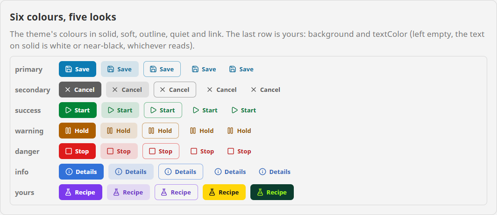
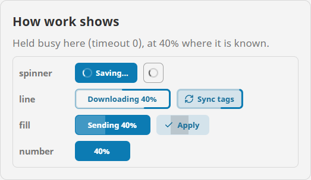

# Button

**⬇ [Download the Ectobox Perspective Component Suite](https://github.com/Ectobox/EctoboxIgnitionModules/releases/latest/download/Ectobox-Perspective-Component-Suite-8.3.modl)**, which includes Button.

A button that does more than click. Hold it to confirm, click it twice to confirm, toggle it, jog a conveyor while it is
held, fire it once, and watch the work happen in the button itself: a spinner, a line that runs around the border, a
percentage, then a tick or a cross.

- **Text, an icon, or both.** Lucide, Material or any Ignition icon library; the icon left, right or above the words
  for touch tiles; a count (Alarms 3) or a dot.
- **The theme's colours, or yours.** primary, secondary, success, warning, danger and info come from the Perspective
  theme, so light, dark and custom themes just work. Pick your own background and text colour in the Designer's colour
  picker; left empty, the text on a filled button is white or near-black, whichever reads.
- **Five looks, four sizes.** solid, soft, outline, quiet and link; 29, 34, 41 and 48 px, the same heights as the
  Dropdown and the Segmented Control, so they line up in a row.
- **Hold to confirm.** Press and hold: a thick line runs around the border, and it fires when the line closes. Let go
  early, or slide off, and nothing happens.
- **Momentary.** `pressed` is true while it is held and false on every way a press can end: let go, slid off, another
  window or tab, focus moved, too long held, the view closed.
- **It shows its work.** Busy at the click, progress from your script, then the result. The box never changes width
  while the words change.
- **It feels alive.** Under the mouse it leans a pixel or two toward the pointer, as on an iPad; it sinks a little when
  pressed. When the computer asks for reduced motion, it stays still.



## Install

Button comes in the **[Ectobox Perspective Component Suite](PerspectiveComponentSuite.md)**, one module with all of
Ectobox's Perspective controls.

1. Download **`Ectobox-Perspective-Component-Suite-8.3.modl`** from the [latest release](https://github.com/Ectobox/EctoboxIgnitionModules/releases/latest/download/Ectobox-Perspective-Component-Suite-8.3.modl).
2. In the gateway's web interface, open the **Modules** page → **Install or Upgrade a Module** → pick the file (accept
   the Ectobox certificate on first install), and restart the gateway when it asks.
3. Open a project in the Designer. **Button** appears in the component palette under the **Ectobox** category five
   times: a plain button, hold to confirm, progress, toggle and momentary.

## Quick start

Put your script on **`onActionPerformed`** (under the component events), not on the mouse `onClick`: the mouse event
fires on every press, including the first click of a confirm and a hold let go early.

### Show the work

```python
# onActionPerformed, with busyOnClick on: the button is busy already
def work():
    import time
    for i in range(1, 13):
        time.sleep(0.25)              # one block sent
        self.props.progress = i / 12.0
    self.props.result = 'success'     # or 'error'
system.util.invokeAsynchronous(work)
```



| Property | Set to | What it does |
|---|---|---|
| `busyOnClick` | true | Busy the moment it is clicked, before the gateway answers. |
| `progressStyle` | `line` | `spinner`, `line` (around the border), `fill` (the background fills) or `none`. |
| `busyText` | `Sending {p}` | The words while busy; `{p}` is the percentage. |
| `progress` | from the script | 0 to 1 (or 0 to 100). null: not known, the line runs round. |
| `result` | from the script | `success` shows a tick and `successText`, `error` a cross and `errorText`, for 1.5 s. |
| `timeout` | 30000 | Busy longer than this (ms) shows `timeoutText`, so it never spins for ever. |

### Behaviours

| `behavior` | What a person does | What it does |
|---|---|---|
| `click` | Clicks | `onActionPerformed`. |
| `hold` | Holds for `holdTime` (1200 ms) | The line runs around the border; `onActionPerformed` when it closes. |
| `confirm` | Clicks, then again within `confirmTime` (3 s) | The first click asks `confirmText` (in `confirmTone`, with `confirmIcon`); the second fires. An icon-only button asks with its icon alone, and a screen reader hears the question. Escape or a click elsewhere takes it back. |
| `toggle` | Clicks | `selected` flips (bind it both ways); `selectedText`, `selectedIcon` and `selectedLook` while selected. |
| `momentary` | Holds | `pressed` true, `onPress`; false when the press ends, `onRelease` with the reason. `maxHold` (10 s) lets go by itself. |
| `oneShot` | Clicks | `fired` goes true and it locks, saying `sentText`, until a script sets `fired` false, or `cooldown` passes. |

A momentary button can't write false if the browser loses its connection while it is held: keep a watchdog in the PLC
as well for anything that moves.

## Settings

| Property | What it does |
|---|---|
| `text`, `icon`, `iconPosition` | The words, the icon (`lucide/save`, `material/save`...), and where it sits: `left`, `right` or `top`. |
| `label` | What a screen reader says for an icon-only button. |
| `tone` | `primary`, `secondary`, `success`, `warning`, `danger`, `info`: the theme's colours. |
| `look` | `solid`, `soft`, `outline`, `quiet`, `link`. |
| `background`, `textColor` | Your own colours, from the Designer's colour picker. Empty uses `tone`. |
| `size` | `small` 29 px, `medium` 34, `large` 41, `touch` 48. |
| `shape` | `rounded` or `pill` (an icon-only pill is a circle). |
| `hover` | `nudge` (leans toward the pointer), `lift` (also grows and casts a shadow), `none`. |
| `followSystemMotion` | On: no lean, pulse or press when the computer asks for reduced motion. |
| `enabled`, `reason` | Off greys it; `reason` says why when it is pointed at. |
| `badge`, `dot` | A count or a word after the text; a small dot at the top right. |
| `attention` | A ring pulses out until it goes false (Acknowledge). |
| `href`, `newTab` | Makes it a link: a page of this project (`/orders/42`) or a web address (`http`, `https`, `mailto`, `tel`; a `javascript:` or `data:` link is ignored, so a bound value can't run script). A middle click opens a new tab. A link is always a click. |

The text sits centred on its capitals in the theme's font, and the icon's ink sits as far from the border as the text
does on the other side, at every size.

## Events

| Event | When | Payload |
|---|---|---|
| `onActionPerformed` | A click, a completed hold, a confirmed second click, a one-shot, a toggle, a link | `how` (mouse, touch, pen or key), `selected` (toggle) |
| `onPress` | momentary: pressed went true | `how` |
| `onRelease` | momentary: pressed went false | `reason` (release, leave, cancel, blur, window, hidden, maxHold, disabled, unmount), `heldMs` |

## Keyboard

Tab to it. Space or Enter clicks it, holds it (hold and momentary, for as long as the key is down), and answers a
confirm; Escape takes a confirm back.
