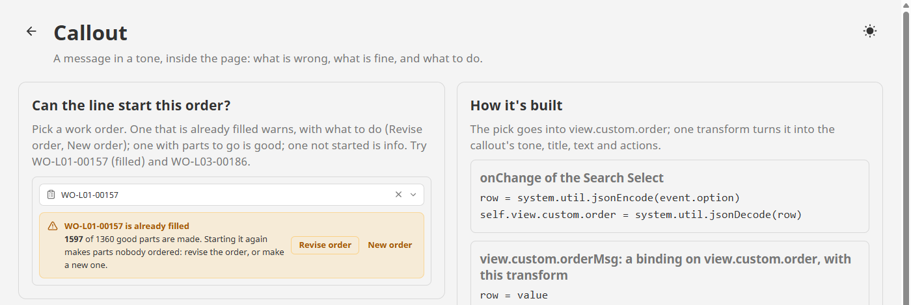
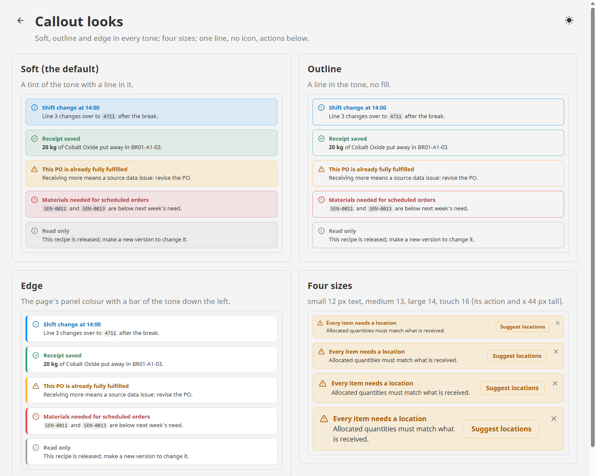

# Callout

**⬇ [Download the Ectobox Perspective Component Suite](https://github.com/Ectobox/EctoboxIgnitionModules/releases/download/modules/Ectobox-Perspective-Component-Suite-8.3.modl)**, which includes Callout.

A message inside the page, in a tone: what is wrong, what is fine, and what to do about it. "This PO is already fully
fulfilled", "Line 4 is over 1% rejects", "Receipt saved".

- **Five tones**: info, good, warning, bad and neutral, each with its own icon. A bad one is announced to screen readers
  at once; the others wait for a pause.
- **A title and text** with light markup: `**bold**` and `` `code` `` for an item number or a tag path, and line
  breaks.
- **Actions**: buttons or links that fire `onAction` with their id, at the right or under the text.
- **Closable**: an × folds it away, and `dismissed` binds both ways so a binding can bring it back.
- **Three looks**: a soft tint, an outline, or a bar of the tone down the edge of a plain panel. Four sizes up to touch.



## Install

Callout comes in the **[Ectobox Perspective Component Suite](PerspectiveComponentSuite.md)**, one module with all of
Ectobox's Perspective controls.

1. Download **`Ectobox-Perspective-Component-Suite-8.3.modl`** from the [Releases](https://github.com/Ectobox/EctoboxIgnitionModules/releases/download/modules/Ectobox-Perspective-Component-Suite-8.3.modl) list.
2. In the gateway's web interface, open the **Modules** page → **Install or Upgrade a Module** → pick the file (accept
   the Ectobox certificate on first install), and restart the gateway when it asks.
3. Open a project in the Designer; **Callout** appears in the component palette under the **Ectobox** category, twice:
   a warning, and a bad one with actions and an ×.

## Quick start

```json
"tone": "warning",
"title": "This PO is already fully fulfilled",
"text": "All line items have been received. Receiving **more** means a source data issue: revise `PO-2026-0033`."
```

Most callouts are driven by data. Bind each of `tone`, `title` and `text` to the same custom property, and work it out
in one transform:

```python
# a binding on view.custom.order (the row picked), with this transform, into view.custom.orderMsg
row = value
good, ordered = row['good'], row['ordered']
if good >= ordered:
    title = '{} is already filled'.format(row['label'])
    text = '**{}** of {} good parts are made.'.format(good, ordered)
    return {'tone': 'warning', 'title': title, 'text': text}
text = '{} of {} good so far: **{}** to go.'.format(good, ordered, ordered - good)
return {'tone': 'good', 'title': '', 'text': text}
```

Then `tone` = `{view.custom.orderMsg.tone}`, and `title` and `text` the same way.

### Text markup

| Write | Shows |
|---|---|
| `**1597** of 1360` | **1597** of 1360 |
| `` scan `SEN-0012` `` | scan `SEN-0012` (in a fixed-width font on a light grey) |
| a line break | a new line |
| `\*` or `` \` `` | the star or the backtick itself |

A marker with no partner (`**open`) shows as typed. Nothing else is interpreted: the text can't add links or HTML.

### Actions

```json
"actions": [
  { "id": "revise", "label": "Revise order", "icon": "lucide/file-pen" },
  { "id": "new", "label": "New order", "appearance": "link" },
  { "id": "done", "label": "Inspected", "disabled": true }
],
"actionsAt": "end"
```

Each fires `onAction` with its `id` and `label`. `appearance` is `button` (a small button in the tone's colours) or
`link` (words only, underlined when pointed at). `actionsAt` is `end` (at the right, the default) or `below` (under the
text, for a narrow callout or several actions).

### Closing it

Turn on `dismissible` for an × at the right. Pressing it folds the callout away (the space it took closes up), sets
`dismissed` to true and fires `onDismiss`. Bind `dismissed` both ways to a custom property or a session property: your
binding sets it back to false to show the callout again, for instance when the next order is picked.

## Settings

| Property | What it does |
|---|---|
| `tone` | `info` (default), `good`, `warning`, `bad` or `neutral`. |
| `title` | A short first line, bold, in the tone's colour. Empty: the text alone. |
| `text` | The message, with the markup above. |
| `icon` | The icon at the left; empty uses the tone's (an i, a tick, a triangle, an octagon). Any Lucide or Ignition icon. |
| `showIcon` | Off: no icon. |
| `actions`, `actionsAt` | Buttons or links, at the end or below. |
| `dismissible`, `dismissed` | An × that closes it; `dismissed` binds both ways. |
| `appearance` | `soft` (default): a tint of the tone with a line in it. `outline`: a line in the tone, no fill. `edge`: the page's panel colour with a bar of the tone down the left. |
| `size` | `small` 12 px text, `medium` 13 (default), `large` 14, `touch` 16 (its actions and × 44 px tall, for HMIs and gloves). |

The icon and the × sit centred on the first line's capitals. The icon is as far from the top as from the left, and the
× as far from the right; in the edge look the gap is measured from the bar. Light, dark and custom themes work through
Perspective's theme variables: tints sit over the theme's background, titles and icons in a deeper shade of the tone
(lighter in a dark theme). When the operating system asks for reduced motion, closing is instant.



## Events

| Event | When | Payload |
|---|---|---|
| `onAction` | The user pressed an action | `id`, `label` |
| `onDismiss` | The user closed it with the × (`dismissed` is already true) | `title` |

## Keyboard and screen readers

Tab reaches each action and the ×; Enter or Space presses them. A bad callout is a live alert, read out as soon as it
appears or changes; the others are polite status messages, read at the next pause. The × says which callout it closes
("Dismiss Line 5 stopped 24 min at 07:00").

## See it working

Every example runs live on the [Public Demo Server](https://proveit.ectobox.com/data/perspective/client/ModuleDemos/callout),
each beside exactly how it is built:

| Page | Shows |
|---|---|
| Examples | A plant's: can a line start the work order picked (a filled one warns, with Revise order and New order), is a line's reject rate worth acting on (bad over 1%, warning over 0.5%, good below, from the last 24 hours of parts), and the longest unplanned stop (edge, closable, and back again). |
| Looks | Soft, outline and edge in every tone; four sizes; one line, no icon, actions below, an icon of your own. |
