# Ectobox Charts

Beautiful, animated **chart components for Ignition 8.3 Perspective** — sixteen chart types, hand-drawn as crisp SVG (no third-party charting library), with
a curated Apple-style palette, automatic light/dark theming, buttery entrance animations, and
properties that are actually pleasant to bind in the Designer.

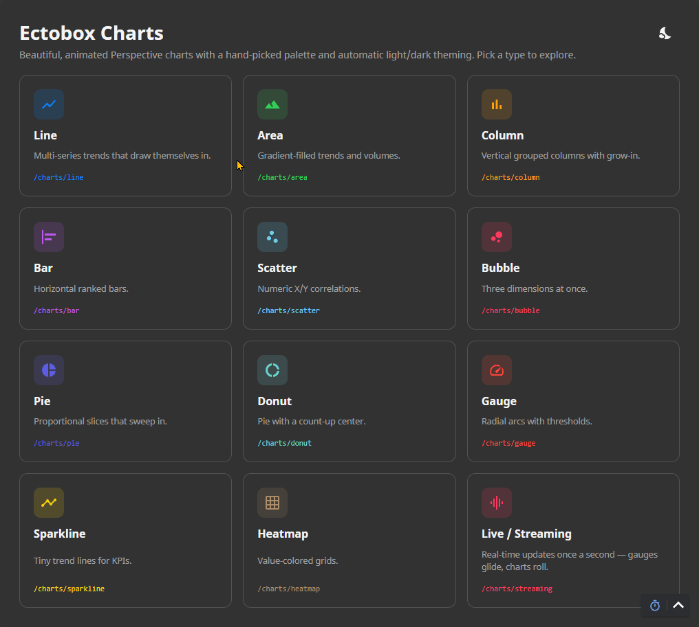

```python
# Every chart takes a dataset (from a named query, historian, etc.) or a plain array of objects.
# Drop one on a view, point its `data` prop at your query, and you're done.
```

## What's included

| Chart | Component id | Good for |
|---|---|---|
| **Line** | `ectobox.chart.line` | Multi-series trends (smooth / straight / step). |
| **Area** | `ectobox.chart.area` | Trends with gradient fill; volumes. |
| **Column** | `ectobox.chart.column` | Vertical grouped bars. |
| **Bar** | `ectobox.chart.bar` | Horizontal ranked bars. |
| **Scatter** | `ectobox.chart.scatter` | Numeric X/Y correlations. |
| **Bubble** | `ectobox.chart.bubble` | Three dimensions (X, Y, size). |
| **Pie** | `ectobox.chart.pie` | Proportions. |
| **Donut** | `ectobox.chart.donut` | Proportions with a count-up total in the hole. |
| **Gauge** | `ectobox.chart.gauge` | A single value with red/amber/green thresholds. |
| **Sparkline** | `ectobox.chart.sparkline` | Compact, axis-free trend lines for tiles/tables. |
| **Heatmap** | `ectobox.chart.heatmap` | Value-colored grids (schedules, density, correlation). |
| **Control Chart** | `ectobox.chart.control` | SPC: Individuals & Moving Range with zones and run rules. |
| **State Timeline** | `ectobox.chart.state-timeline` | Machines and lines over time: running, idle, down; roll-ups and short stops that never vanish. |
| **Sankey** | `ectobox.chart.sankey` | Where a quantity goes: hours into running and stops, parts into good and scrap, energy into lines. |
| **Mind Map** | `ectobox.chart.mindmap` | Ideas around one or more centres, with links between any two: loss trees, plant maps, root causes. |
| **Timeline** | `ectobox.chart.timeline` | Events along an axis, left to right or top to bottom: a shift log, a week of stops, a project plan. |

All sixteen appear in the Designer palette under the **Ectobox Charts** category.

## Why it's different
- **Hand-built SVG** — no ApexCharts/Chart.js/vendor bundle. Small, fast, and fully ours to shape.
- **Apple-style palette, always looks right** — a curated 12-color set applied automatically, so a
  multi-series chart looks good with zero configuration. Every color is a CSS variable you can override.
- **Automatic light/dark** — axes, gridlines, labels, and surfaces follow the gateway theme with no
  per-theme setup.
- **Animations that impress** — lines draw themselves in, columns/bars grow with a staggered cascade,
  pie/donut slices sweep in and explode on hover, gauges sweep + count up, scatter/bubble points pop in,
  heatmap cells wave in on a diagonal.
- **Overridable everywhere** — all styling is prefixed `.ecto-chart__*` CSS you can target from a
  project stylesheet.

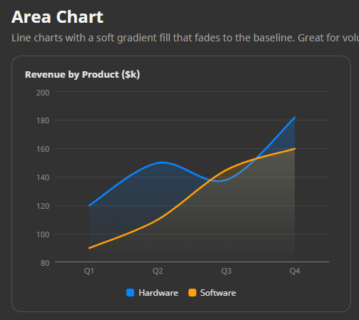
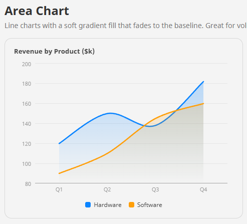

## Install

Charts comes in the **[Ectobox Perspective Component Suite](PerspectiveComponentSuite.md)**, one module with all of Ectobox's Perspective controls.

1. Download **`Ectobox-Perspective-Component-Suite-8.3.modl`** from the [Releases](https://github.com/Ectobox/EctoboxIgnitionModules/releases/download/modules/Ectobox-Perspective-Component-Suite-8.3.modl) list.
2. In the gateway's web interface, open the **Modules** page → **Install or Upgrade a Module** → pick the file (accept the Ectobox certificate on first install), and restart the gateway when it asks.
3. In the Designer, the chart components appear in the palette under **Ectobox Charts**.

Had it installed as a module of its own? Uninstall that module and install the suite: your projects need no changes. See [Moving from the separate modules](PerspectiveComponentSuite.md#moving-from-the-separate-modules).

## Quick start

1. Drop a chart (e.g. **Line Chart**) onto a view.
2. Bind its **`data`** prop to a dataset (named query, tag history, etc.) or set an array of objects.
3. In **`mapping`**, pick which column is the category/X axis and which columns are series — or leave it
   blank to auto-detect.

```python
# data as an array of objects (also what a dataset binding delivers):
[
  { "month": "Jan", "revenue": 42, "cost": 30 },
  { "month": "Feb", "revenue": 51, "cost": 33 }
]
# mapping: { "xColumn": "month", "series": [ {"column": "revenue"}, {"column": "cost"} ] }
# (leave mapping empty and it auto-uses the first non-numeric column as X and every numeric column as a series)
```

## Data & mapping

Every chart accepts an **Ignition dataset** *or* an **array of objects**, so it drops straight onto a
named-query binding or a scripted value. Each family maps columns a little differently:

| Family | Mapping props |
|---|---|
| Line / Area / Column / Bar | `mapping.xColumn` (category) + `mapping.series[]` (`column`, `name`, `color`). Empty = auto. |
| Scatter / Bubble | `mapping.xColumn`, `mapping.series[]` (Y), plus `sizeColumn` (bubble) and optional `labelColumn`. |
| Pie / Donut | `mapping.labelColumn` + `mapping.valueColumn`. |
| Heatmap | `mapping.xColumn`, `mapping.yColumn`, `mapping.valueColumn`. |
| Gauge | no data prop — bind the single **`value`** (plus `min`/`max`/`thresholds`). |
| Sparkline | an array of numbers, or `valueColumn` on an array of objects. |

## Theming & CSS

All styling ships in the module bundle. Axis/grid/label/surface colors follow Perspective's theme
variables (`--neutral-*`, `--container`) so **light/dark is automatic**. The series palette is exposed
as CSS custom properties you can override globally from a project stylesheet:

```css
:root {
  --ecto-chart-1: #0a84ff;   /* series 1 */
  --ecto-chart-2: #ff9f0a;   /* series 2 */
  /* ... up to --ecto-chart-12 ... */
}
```

Everything drawn is a prefixed class you can restyle: `.ecto-chart__line`, `.ecto-chart__area`,
`.ecto-chart__point`, `.ecto-chart__bar`, `.ecto-chart__dot`, `.ecto-chart__slice`,
`.ecto-chart__gauge-value`/`-track`, `.ecto-chart__cell`, plus the shared frame parts
`.ecto-chart__axis`, `.ecto-chart__gridline`, `.ecto-chart__axis-label`, `.ecto-chart__legend*`, and
`.ecto-chart__tooltip*`.

## Common properties

Beyond `data` + `mapping`, the cartesian charts share these (each chart also adds its own block, e.g.
`line.curve`, `bar.thickness`, `donut.innerRatio`, `gauge.thresholds`):

| Prop | Notes |
|---|---|
| `title` | Optional heading above the plot. |
| `categoryAxis` / `valueAxis` | `title`, `showLabels`, `showGridLines`; value axis adds `autoRange` + `min`/`max`. |
| `legend` | `enabled`, `position` (`top`/`bottom`/`left`/`right`). |
| `animation` | `enabled`, `durationMs`. |
| `palette` | Optional list of colors overriding the built-in palette for this chart. |

The Designer property editor shows every prop with inline descriptions, and defaults are chosen so a
freshly-bound chart looks good immediately.

## Control charts (SPC)

The **Control Chart** (`ectobox.chart.control`) is a real SPC chart, not a line chart with two extra
lines on it. Drop it on a view, bind `data`, point `mapping.valueColumn` at your measurement, and you get:

- **Two stacked panels sharing one X axis** — Individuals on top, Moving Range beneath. Every variables
  control chart is a pair, and both panels' limits are computed from the same σ estimate.
- **σ zone bands** — the ±1σ/±2σ/±3σ A/B/C regions filled behind the series, with the A/B/C letters
  in a reserved gutter to the right of the plot rather than printed over your data.
- **Western Electric run rules**, marked on the chart, listed in the hover tooltip, and reported through
  the `violations` property and the `onRuleViolation` event.
- **Correct math.** σ comes from the average moving range (`MR̄ / d2(2)`, i.e. `MR̄ / 1.1284`), not from the
  standard deviation of the individuals — using `s` would let a slow drift inflate the limits until the
  very drift you're hunting looked normal. The d2/d3/c4 factors are the published exact-integral tables,
  so the limits agree with what you'd calculate by hand.

Set **`chartType`** to pick the family. `IMR` (the default) is what you want for one measurement per part
or batch, and is the type this release computes; `XbarR`, `XbarS`, `P`, `NP`, `C`, `U` are in the enum so
that switching later is a property change rather than re-dropping the component.

### Panels and layout

The two panels are configured through `panels`:

| Prop | Notes |
|---|---|
| `panels.primary.title` / `panels.secondary.title` | Panel headings, drawn above each panel. Blank uses the right label for the chart type (“Individual value” / “Moving range” for I-MR). |
| `panels.primary.height` / `panels.secondary.height` | Height *weights* against each other, not pixels — 2 against 1 by default, so the individuals panel gets two thirds. |
| `panels.secondary.show` | Draw the range panel at all. |

Panel headings sit above their panel and the A/B/C zone letters sit in a gutter on the right, so neither
can end up on top of a control limit, a gridline, or the last few points — which is exactly where a
control chart is most worth reading. Both strips are only reserved when there is something to put in
them: turn `zones.labels` off and the plot takes the right-hand gutter back.

In a component too short to render both panels legibly, the range panel **removes itself** rather than
squashing the pair into unreadable strips — an I-MR chart dropped into a 200 px dashboard tile still
shows a usable individuals chart.

### The rules

| id | Rule |
|---|---|
| `beyondLimits` | 1 point beyond zone A (outside the control limits). |
| `twoOfThree` | 2 of 3 consecutive points in zone A or beyond, same side of the centerline. |
| `fourOfFive` | 4 of 5 consecutive points in zone B or beyond, same side. |
| `runOneSide` | 8 consecutive points on one side of the centerline. |

Narrow them with `rules.enabled` (a list of ids); leave it empty to run all four. Runs are never counted
across a gap in the data — "8 in a row" spanning measurements you don't have is a false alarm.

Only `beyondLimits` is applied to the **moving range** panel. A moving range is a skewed statistic whose
consecutive values share an observation, so zone and run rules there fire constantly for no reason.

### Read this bit: `limits.mode` should usually be `frozen`

`compute` is the **default** because it needs no configuration — the limits are recalculated from every
point on the chart. It's the right choice while you're exploring, and the wrong one for a chart somebody
is actually watching:

> With `compute`, a process that drifts out of control **quietly widens its own limits** until nothing
> looks wrong. The excursion you want to catch becomes part of the data the limits are built from.

So in production, take a known-good baseline run and hold those limits:

```python
limits.mode              = "frozen"
limits.baseline.count    = 25       # "the first 25 points"
# or limits.baseline.fromIndex / toIndex for an explicit window
```

`manual` takes limits you supply (`limits.manualPrimary` / `manualSecondary` — a trio counts as set once
`ucl` is above `lcl`, so the all-zero default means "work it out"). σ is re-derived from the limits you
give, so the zone bands still line up with them.

### Read this bit too: spec limits are not control limits

They get conflated constantly, and it matters:

- **UCL / LCL** come from **your process** — what it actually does when nothing is wrong.
- **USL / LSL** come from **your customer's tolerance** — what they'll accept.

A process can be perfectly in control and still produce scrap, or be out of control while every part is
in spec. This component draws **control** limits. Spec limits and the capability numbers (Cp, Cpk, Pp,
Ppk) that compare the two arrive in a later release, and will be drawn distinctly — different dash,
different color, own legend entry — precisely so they can't be mistaken for UCL/LCL.

### Outputs and events

The component writes its own analysis back into two read-only properties, so an exception report is a
binding rather than a script:

| Property | Contents |
|---|---|
| `results` | `inControl`, `pointCount`, `baselineUsed`, `truncated`, and a `primary`/`secondary` block each with `centerline`, `ucl`, `lcl`, `sigma`, `values`. |
| `violations` | One row per rule hit: `index`, `label`, `panel`, `ruleId`, `ruleName`, `description`, `value`. Bind a Table straight to it. |

Writes only happen when the computed answer actually changes, so they can't loop. Set
`output.writeBack = false` to turn them off and drive everything from events instead:

- **`onRuleViolation`** — fires when the set of violations changes, *including back to empty*, so it can
  both raise and clear an alarm. Payload: `violations`, `inControl`, `chartType`.
- **`onPointClick`** — `index`, `label`, `panel`, `value`, and that point's `violations`.

### maxPoints

Historian queries happily return thousands of rows, and an SVG with thousands of markers stops being
usable, so `maxPoints` (default **200**) keeps the most recent N. Truncation is never silent: the title
shows *"showing the last N of M observations"*, the browser console warns, and `results.truncated`
reports it. Note that the limits and rule checks then describe **only the points shown** — set it to `0`
for no cap.

### Styling

Alongside the usual `.ecto-chart__*` classes, the control-chart semantics are their own CSS variables so
a theme can re-skin them: `--ecto-spc-centerline`, `--ecto-spc-limit`, `--ecto-spc-violation`, and
`--ecto-spc-zone-a` / `-zone-b` / `-zone-c`. The centerline is solid and the control limits are dashed on
purpose — you can tell "where the process is centered" from "where it stops being acceptable" without
reading the legend.

## Scripting: `system.ectobox.charts.spc.*`

The same math is available to Jython, for alarming, reports and named-query post-processing — so a
script-driven alarm and the chart on the screen can never disagree. Available in gateway *and* Designer
scope (the Designer registration is what gives you autocomplete while you write).

```python
# A gateway timer script: check the filler's last shift of fill weights against limits frozen from
# its first 25 containers, and hold the lot the moment the process goes out of control.
fills = system.db.runNamedQuery('Filler/ShiftFillWeights', {'LineID': 1})

result = system.ectobox.charts.spc.Analyze(fills, {
        'valueColumn':   'fillWeight',
        'labelColumn':   'container',
        'limitMode':     'frozen',
        'baselineCount': 25,
    })

if not result['inControl']:
    first = result['violations'][0]
    system.tag.writeBlocking(['[default]Line1/Filler01/LotHold'], [True])
    system.util.getLogger('Line1.SPC').warn(
        'Lot held: {0} on container {1} ({2:.2f} g, {3} panel)'.format(
            first['ruleName'], first['label'], first['value'], first['panel']))
```

| Function | Returns |
|---|---|
| `Analyze(data, options)` | Everything: limits, per-point values/zones/hits, `violations`, `inControl`, `baseline`, `truncated`, `error`. |
| `Limits(data, options)` | Just the centerline/UCL/LCL/σ for each panel — for storing limits or seeding a `manual` chart. |
| `CheckRules(data, options)` | Just the violation list, ready to iterate. |
| `Rules(ruleSet)` | The rules as `id`/`name`/`description` dicts, for building a rule picker or a report. |

`data` accepts a **Dataset** (straight from `system.db.runQuery` or a tag history query), a list of
numbers, a list of dictionaries, or a list of rows. With dictionaries you must set
`options['valueColumn']` — a Jython dict has no column order to guess from.

`options` keys, all optional: `valueColumn`, `labelColumn`, `chartType`, `sigmaMultiplier`, `maxPoints`,
`limitMode`, `baselineCount` / `baselineFrom` / `baselineTo`, `centerline` / `ucl` / `lcl` (and
`mrCenterline` / `mrUcl` / `mrLcl` for the range panel), `ruleSet`, `rules`.

**Always check `r['error']`** before trusting the limits — it's `None` on success, and a sentence
explaining itself when there wasn't enough data or the chart type isn't computed yet.

The factor table is exposed too, so you can build limits by hand without hardcoding `1.128` somewhere:

```python
C = system.ectobox.charts.spc.constants
sigma = mrBar / C.d2(2)          # 1.1284
ucl   = rBar  * C.D4(5)          # 2.1145
```

`d2(n)`, `d3(n)`, `c4(n)`, `D3(n)`, `D4(n)`, `B3(n)`, `B4(n)`, `A2(n)`, `A3(n)` — deliberately keeping
their textbook casing, because that's what every SPC reference and printed factor table calls them.

## State timelines

The **State Timeline** (`ectobox.chart.state-timeline`) draws each machine or line as a row coloured by its state
over time: running, idle, down. It answers "where did the shift go?" and "which line lost the most?" at a glance.

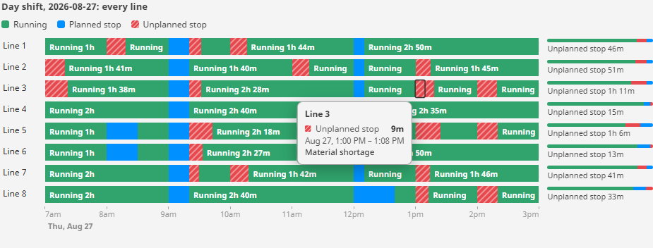

Bind `data` to what you already have. Three shapes are read, and `mapping.shape: auto` tells them apart:

| Shape | One row per | Columns | Typical source |
|---|---|---|---|
| `spans` | stretch of state | lane, start, end, state (+ reason) | a downtime table, MES state events |
| `changes` | change of state | lane, time, state | an event log, a Tag History binding in **Tall** format (path, value, t_stamp) |
| `history` | moment | t_stamp, then one column per tag | a Tag History binding in **Wide** format: each tag is a lane |

Column names are picked from dropdowns in the Designer (`mapping.laneColumn`, `startColumn`, `endColumn`,
`timeColumn`, `stateColumn`, `reasonColumn`). Leave one blank and the usual names are found (Line, Machine, StartTime,
EndTime, t_stamp, State, Reason…). A name that isn't a column is reported in the Designer, with the columns there are.

### States

`states` says what each value is called and how it looks, in legend order:

```json
"states": [
  { "value": "Running",        "label": "Running",        "color": "#30A46C", "pattern": "none",  "severity": 1 },
  { "value": "Planned stop",   "label": "Planned stop",   "color": "#0090FF", "pattern": "none",  "severity": 2 },
  { "value": "Unplanned stop", "label": "Unplanned stop", "color": "#E5484D", "pattern": "hatch", "severity": 3 }
]
```

- **Codes work.** A PLC keeps a state as a number: `{ "value": 3, "label": "Down" }` matches 3 and "3". Text values match
  in any capitals. The `value` dropdown lists the values in your data.
- **A value you didn't list is never hidden behind a made-up colour.** It's drawn grey with dots and named in the legend
  with a "!", so a new state from the PLC is seen the day it appears.
- **No `states` at all?** The data's own values are used, and the usual words get their usual colours: Running and
  Producing green, Down and Faulted red, Idle and Starved amber, Setup and Changeover blue.
- **`pattern`** (`hatch`, `dots`) puts a texture over the fill, so the state reads without colour: for colour-blind
  operators and grey printouts.
- **`severity`** decides which state wins where several share one pixel and in a line's roll-up. With none set, the rarer
  state wins, so short stops show over long runs.

### Time nobody wrote down

A table of stops holds only the stops. **`gapState: "Running"`** says the time between them was running. Leave it empty
and that time is drawn as hatched grey **No data**, never as a state. Neither is ever drawn in the future.

A row with an empty end is still going: until the lane's next row, or until now when `live` is on.

### Short stops never vanish

A 20-second stop on an 8-hour lane 1,000 px wide is under a pixel. Most charts drop it or draw a random sliver. Where a
pixel column holds several stretches, the State Timeline draws it in the **most severe** state touching it, on top of the
stretches either side. So 2,113 stops over two and a half weeks all show, and hovering a crowded column counts what's in
it ("Unplanned stop ×2, 39m; Running ×3, 5h 52m"). Drag across the chart to zoom in on them; double-click to zoom out;
**Reset zoom** goes back to the range you set. The new range is written to `range` and `onRangeChanged` fires.

Labels inside the bars show the whole state name and its duration when they fit, the name alone when only that fits,
and nothing otherwise. A label is never cut ("Produci").

### Lines over their machines

Give a lane a `parent` and the parent's row rolls up its lanes: at each moment, the worst state any of them is in. Hover a
stretch of the roll-up and it names the machines in that state. The parent needs no rows of its own, and starts collapsed
with `collapsed: true`.

```json
"lanes": [
  { "value": "Machining", "label": "Machining" },
  { "value": "Line 1", "parent": "Machining" },
  { "value": "Line 2", "parent": "Machining" }
]
```

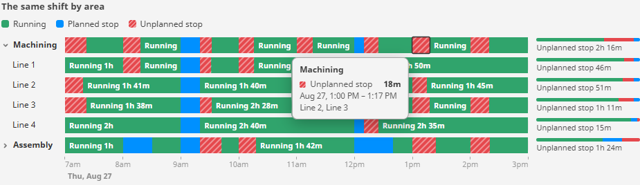

Lanes not listed follow in the order the data meets them. A listed lane with no rows ran the whole time (`gapState`).

### The summary column

`summary: "percent"` or `"duration"` adds a column at the right of each lane: a small bar of its time per state and one
number. `summaryState` picks the state it reports, so `"Unplanned stop"` compares the lines by what they lost
("Unplanned stop 1h 11m"); blank reports each lane's largest state.

### Live

`live: true` runs each lane's current state to now, draws a line at **Now**, puts a dot by each lane's name in its state now,
and leaves the rest of the range empty. It redraws every 15 seconds; poll your query for new rows. Set `range` to the shift
so the empty part says how much of it is left.

### Events

| Event | Payload |
|---|---|
| `onSegmentClick` | `lane`, `laneLabel`, `state`, `stateLabel`, `start`, `end` (epoch ms: `system.date.fromMillis(event.start)`), `durationMs`, `open`, `reason`, `from` (a roll-up's lanes), `row` (the data row) |
| `onLaneClick` | `lane`, `label`, `group` |
| `onRangeChanged` | `start`, `end`, `how` (`zoomIn`, `zoomOut`, `reset`) |

```python
# onSegmentClick: log what the operator tapped.
minutes = int(round(event.durationMs / 60000.0))
why = event.reason or 'no reason given'
line = '{0}: {1} for {2} min ({3})'
self.view.custom.eventLog = line.format(
	event.laneLabel, event.stateLabel, minutes, why)
```

The keyboard works too: Tab to the chart, ←/→ along a lane, ↑/↓ between lanes, Enter fires `onSegmentClick`.

### Time zones

Times without an offset (a plant database's `datetime` column, sent with `CONVERT(varchar(19), t, 126)`) are read in
`timeZone`, and the axis, tooltips and labels use it too. Set it to the plant's zone so every viewer sees the plant's
clock. Clock-change days are 23 or 25 hours long on the axis, with the hours still on the hour.

### Size

The core lays out 50 lanes × 20,000 rows in about 30 ms. Each lane draws as a handful of SVG paths however many stretches it
holds, so hovering and scrolling stay smooth. More lanes than fit scroll under a fixed axis; when they almost fit, the rows
ease down to fit (`rowHeight: 0`). `density`: `compact` 22 px rows, `normal` 30 px, `touch` 44 px for an HMI.

## Sankey

The **Sankey** (`ectobox.chart.sankey`) shows where a quantity goes: a week's hours into running and stops, parts into
good and scrap, energy into lines. Each node is a bar and each flow a band, both drawn to scale, left to right.

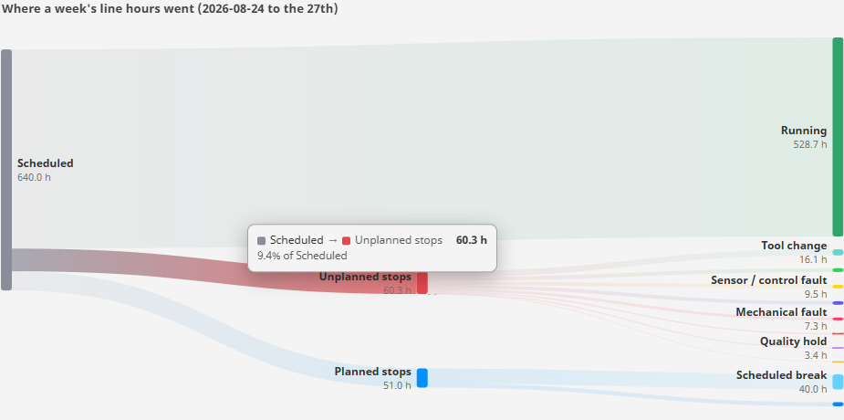

Bind `data` to rows of **source, target, value**, one per band. Rows with the same source and target are summed. The
chart works out the columns from the flow, so a query that returns two levels of rows draws three columns:

```sql
-- Scheduled hours -> running / planned / unplanned -> each stop's reason
SELECT 'Scheduled' AS source, 'Running' AS target, SUM(h.RuntimeSeconds) / 3600.0 AS value
FROM Plant.ProductionHours h WHERE ...
UNION ALL
SELECT 'Scheduled', CASE WHEN e.IsPlanned = 1 THEN 'Planned stops' ELSE 'Unplanned stops' END,
       SUM(e.DurationSeconds) / 3600.0
FROM Plant.DowntimeEvents e WHERE ... GROUP BY e.IsPlanned
UNION ALL
SELECT CASE WHEN e.IsPlanned = 1 THEN 'Planned stops' ELSE 'Unplanned stops' END, r.Description,
       SUM(e.DurationSeconds) / 3600.0
FROM Plant.DowntimeEvents e JOIN Plant.DowntimeReasons r ON r.ID = e.ReasonID WHERE ... GROUP BY e.IsPlanned, r.Description
```

`mapping.sourceColumn`, `targetColumn` and `valueColumn` are picked from dropdowns; blank finds the usual names (source/
from, target/to, value/amount/minutes...).

| Prop | Notes |
|---|---|
| `nodes` | Optional: `{ id, label, color, column }` per node. Listed nodes come first and keep their colour; the rest take the chart palette in order. `column` pins a node (-1 = from the flow). The `id` dropdown lists the data's nodes. |
| `align` | `justify` (every end node in the last column), `left`, `right`. |
| `linkColor` | `gradient` (source colour to target colour), `source`, `target`, `neutral`. |
| `labels` | `show`, and under each name `values`: `none`, `value` (1,500) or `share` (its part of its column, 32%). |
| `valueFormat` | `decimals` and `unit` ("h", "pcs", "kWh"), used in labels and tooltips. |
| `nodeWidth`, `nodePadding` | Bar width and the gap between bars, px. |

**It never draws a flow wrong to make it look tidy.**
- **Every bar is its value to scale, to the pixel.** A node is drawn to the larger of what flows in and what flows out.
- **Imbalance is shown, not hidden.** If a node takes in more than it passes on (1,000 made, 700 good, 100 scrap), the
  missing 200 is a hatched stub on its right; the tooltip says how much comes in but goes nowhere in the data.
- **Bad data is said in the Designer:** a row with no source or target, a value that isn't a number or is below
  zero, a node flowing into itself, and a band that would close a loop (dropped and named).
- **The same data always draws the same picture.** The order within each column is relaxed toward what each node links
  to, so bands run straighter and cross less, and an order is kept only if it crosses no more than the last.

Labels sit beside the bars, inside the chart. Where two would overlap, the smaller node's gives way and shows when you
hover it. Hover a band to lift it ("Housing → Rent 1,500, 75% of Housing"); hover a bar to light every band through it.
Tab to the chart and use the arrow keys to move between nodes.

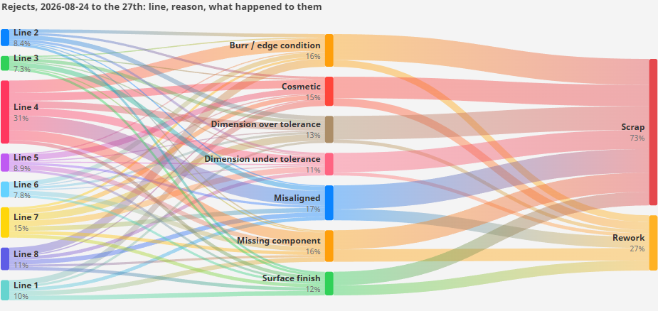

| Event | Payload |
|---|---|
| `onLinkClick` | `source`, `target`, `sourceLabel`, `targetLabel`, `value`, `share` (of the source's outflow, 0 to 1), `rows` |
| `onNodeClick` | `id`, `label`, `inflow`, `outflow`, `column` |

```python
# onLinkClick: say what the band was.
line = '{0} to {1}: {2:,.1f} ({3:.0%} of {0})'
self.view.custom.eventLog = line.format(
	event.sourceLabel, event.targetLabel,
	event.value, event.share)
```

The layout of 200 nodes and 1,000 flows takes about 5 ms.

## Mind maps

The **Mind Map** (`ectobox.chart.mindmap`) draws ideas around one or more centres: a loss tree, a plant's areas and the
parts they make, a root-cause map. Hover an idea and its trail to the centre lights, with a pulse running out along it;
its branch and anything linked to it light too, and the rest of the map steps back.

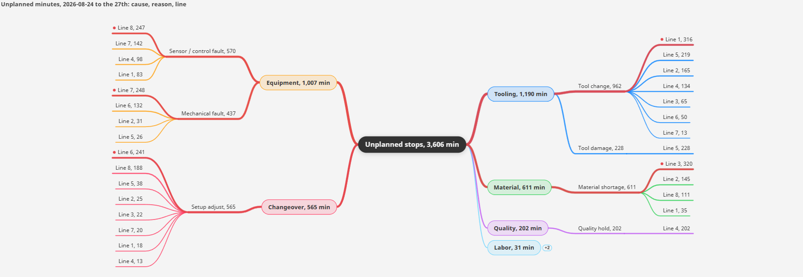

Bind `data` to rows of **id, parent, label**, one per idea. A row with no parent (or a parent that isn't in the data) is a
centre, so any number of centres can share one map: each is its own cluster, and clusters that never touch are packed
side by side to suit the component's shape. Rows can come in any order. One query can write every level:

```sql
-- Unplanned minutes -> cause -> reason -> line
WITH s AS (SELECT r.Category AS cat, r.Description AS reason, l.Name AS line,
                  SUM(e.DurationSeconds) / 60 AS mins
           FROM Plant.DowntimeEvents e JOIN ... WHERE ... GROUP BY r.Category, r.Description, l.Name)
SELECT 'all' AS id, '' AS parent, 'Unplanned stops' AS label, SUM(mins) AS value, NULL AS status FROM s
UNION ALL
SELECT 'c:' + cat, 'all', cat, SUM(mins), NULL FROM s GROUP BY cat
UNION ALL
SELECT 'r:' + reason, 'c:' + MIN(cat), reason, SUM(mins), NULL FROM s GROUP BY reason
UNION ALL
SELECT 'l:' + reason + ':' + line, 'r:' + reason, line, mins,
       CASE WHEN mins >= 240 THEN 'long' END FROM s
```

`mapping` picks the columns from dropdowns; blank finds the usual names (id, parent, label, color, icon, value, status,
note). Long labels wrap. A centre is a solid pill, a first-level idea a pill in its branch's colour, and anything
deeper is text on an underline the branch runs into.

| Prop | Notes |
|---|---|
| `links` | Cross-links between any two ideas, in one cluster or across clusters: `{ from, to, label }` with the ideas' ids (the dropdown lists them by label). Bind a second query or type them. Drawn as dashed arcs from a free edge of each idea, bowing round the map where they can. |
| `states` | `{ value, label, color, severity }`. Matched to the status column (`3` matches `3` and `"3"`, names in any capitals). An idea shows its state as a dot; a severity above 0 also lights the trail from that idea to its centre, so trouble can be seen from across the room. |
| `layout` | `balanced` (first-level branches split left and right by size) or `right` (every branch to the right, read like a tree). |
| `linkWidth` | `depth` (thick near the centre) or `value` (each branch as thick as its idea's value). |
| `collapsed` | Ids of ideas whose branches are folded away. The knob at an idea's outer edge folds and opens it (`+3` says how many are hidden) and writes this back; bind it to keep it. |
| `selected` | The idea last clicked, read and write: set it to ring an idea from elsewhere. |
| `zoom` | Ctrl + wheel or pinch to zoom, drag to pan, double-click the background to fit again. |
| `animation` | `enabled` (branches grow out from the centres on first draw) and `pulse` (the pulse along a hovered trail). Both are off when the viewer's system asks for reduced motion. |
| `palette` | The branch colours; empty = the Ectobox Charts palette. A `color` column sets an idea's colour (a first-level idea's is its whole branch's). |

**It never loses an idea.**
- **Bad data is said in the Designer and drawn anyway:** an id used twice (the first is used), a row with no id, a parent
  that isn't in the data or is the row itself, a loop of parents (broken at one idea, which becomes a centre), a status
  that isn't in `states`, a link to an id that isn't there.
- **Folding hides, it doesn't forget.** A folded branch's statuses still light its trail, and its links are drawn to the
  folded idea.
- **Text stays readable.** A map too big for the component opens at a readable size, centred, to be dragged around;
  **Show all** fits all of it.
- **The same data always draws the same picture.**

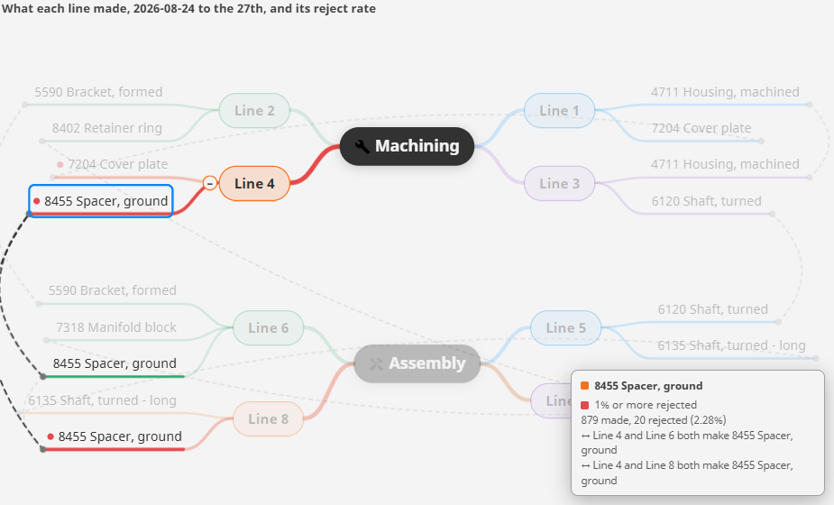

The tooltip sits in the corner farthest from the idea, so it never covers what the idea lights. Tab to the map and use the
arrow keys: up and down walk the ideas in reading order, left and right go out along a branch or back towards the centre,
Enter clicks, Space folds.

| Event | Payload |
|---|---|
| `onNodeClick` | `id`, `label`, `parent` (null for a centre), `depth` (0 = a centre), `status`, `row` (its data row) |
| `onLinkClick` | `from`, `to`, `label` |

There is no editing built in, on purpose: add ideas through your own buttons or click events writing to whatever `data`
is bound to, and the map redraws.

```python
# onNodeClick: say what was clicked.
line = '{0} (depth {1}){2}'
self.view.custom.eventLog = line.format(
	event.label, event.depth,
	', status ' + event.status if event.status else '')
```

## Timelines

The **Timeline** (`ectobox.chart.timeline`) puts events along an axis, left to right or top to bottom: one line's shift
with its stops, notes and rejects, a week of one kind of stop, a project plan. Each event is a card on a stem from its
moment on the axis; an event with an end is also a bar along the axis.

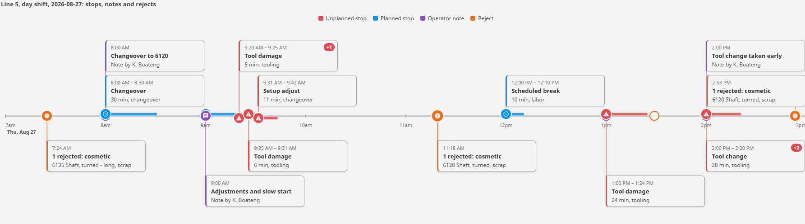

Bind `data` to rows of **time and title**, one per event; an **end** makes it a span. One query can union several
tables into those columns:

```sql
-- Line 5's shift: stops (spans), operator notes and rejects (moments)
SELECT id, time, [end], title, description, category FROM (
  SELECT CONCAT('s', e.ID) AS id, e.StartTime AS t,
         CONVERT(varchar(19), e.StartTime, 126) AS time, CONVERT(varchar(19), e.EndTime, 126) AS [end],
         r.Description AS title, ... AS description,
         CASE WHEN e.IsPlanned = 1 THEN 'Planned stop' ELSE 'Unplanned stop' END AS category
  FROM Plant.DowntimeEvents e JOIN ... WHERE ...
  UNION ALL
  SELECT CONCAT('c', c.ID), c.HourStart, CONVERT(varchar(19), c.HourStart, 126), NULL,
         c.CommentText, CONCAT('Note by ', c.CreatedBy), 'Note'
  FROM Plant.HourComments c JOIN ... WHERE ...
) x ORDER BY t
```

`mapping` picks the columns from dropdowns; blank finds the usual names (time, t_stamp or start; end; title, name or
event; description or notes; category or type; color; icon; id). Times can be ISO strings (read in `timeZone` when they
have no offset), dates, or epoch milliseconds. A card shows the date, the title (two lines at most) and
`descriptionLines` of description; the rest is on hover. When every event falls on one day the cards show only the
clock, and when the data is dates they show only dates.

| Prop | Notes |
|---|---|
| `orientation` | `horizontal` (time runs left to right, cards above and below) or `vertical` (top to bottom, cards beside the axis; it scrolls when the events need more room). |
| `spacing` | `time` (each event where its time falls, with an axis of hours and days) or `even` (one after another at equal steps, each card dated; it scrolls when they need more room). |
| `side` | `alternate` (both sides, whichever keeps a card nearer the axis), `start` (above, or left) or `end` (below, or right). |
| `categories` | `{ value, label, color, icon }`, matched to the category column (`3` matches `3` and `"3"`, names in any capitals). The icon goes on the event's dot. A value in the data that isn't listed still gets a colour. The legend lists them; click one to hide or show its events. |
| `range` | The window shown with time spacing; blank fits the events. Written back when someone zooms; bind it to keep it. |
| `timeZone` | The IANA zone times and labels are read in; blank = the viewer's browser. |
| `now` | Marks now on the axis when it falls in the window, and draws events still to come with a dashed outline. |
| `cardWidth` | Card width in px; 0 chooses it from the chart's width. |
| `selected` | The event last clicked (its id), read and write: set it to ring an event from elsewhere. |
| `zoom` | With time spacing: drag across the timeline to zoom in, double-click to zoom out, **Reset zoom** to go back. |

**Cards never overlap, and no stem runs under another card.**
- **Horizontal:** a card hangs from its stem and runs towards later times. Where cards would overlap, the earlier one
  goes farther from the axis, so every stem reaches its card clear of the others.
- **Out of room:** a crowded spot on a horizontal timeline folds into the card beside it, marked **+2**. Hover it to list
  what's there; click **+2** to zoom in until they open out. Every folded event keeps its dot on the axis.
- **Vertical:** each card sits level with its event, or just below the card before it on its side. The axis grows,
  scrolling, until no card is pushed far from its event.
- **Bad data is said in the Designer:** a time that isn't a time (the row is left out), an end before its start (drawn as
  a moment), a mapped column that isn't there.
- **The same data and the same size always draw the same picture.**

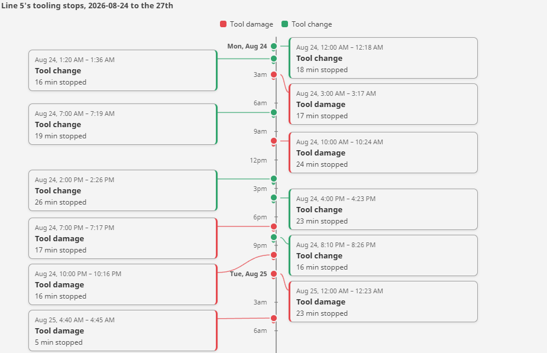

Tab to the timeline and use the arrow keys to step through the events in time order; Enter clicks.

| Event | Payload |
|---|---|
| `onEventClick` | `id`, `title`, `description`, `time` and `end` (epoch ms; `end` null for a moment), `category` (the `categories` value), `categoryLabel`, `index` (its place in time order), `row` (its data row) |
| `onRangeChanged` | `start`, `end` (epoch ms) and `how`: `zoomIn`, `zoomOut` or `reset` |

```python
# onEventClick: say what was clicked.
line = '{0}: {1} ({2})'
self.view.custom.eventLog = line.format(
	event.categoryLabel or 'Event', event.title,
	event.description or 'no detail')
```

## Live / streaming data

Because charts re-render on `data` change (and gauges *ease* to new values), a live dashboard needs no
special component — drive any chart from a Perspective **expression binding** on `now(pollRate)` with a
**script transform** that returns fresh data each tick:

```
Binding:   now(1000)                 # re-evaluates every second
Transform (script):
    import math
    t = value.getTime() / 1000.0     # now() returns a Date — use getTime() for millis
    return int(round(55 + 35 * math.sin(t / 5.0)))
```

Gauges glide between values; set `animation.enabled = false` on rolling line/area/sparklines so they
update like a clean live monitor.

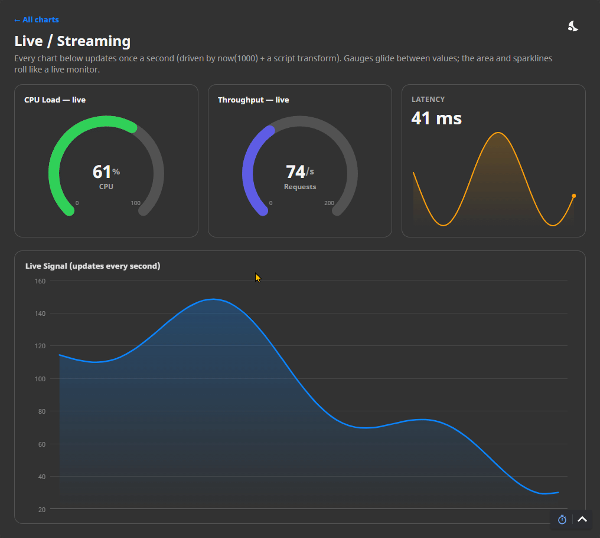
