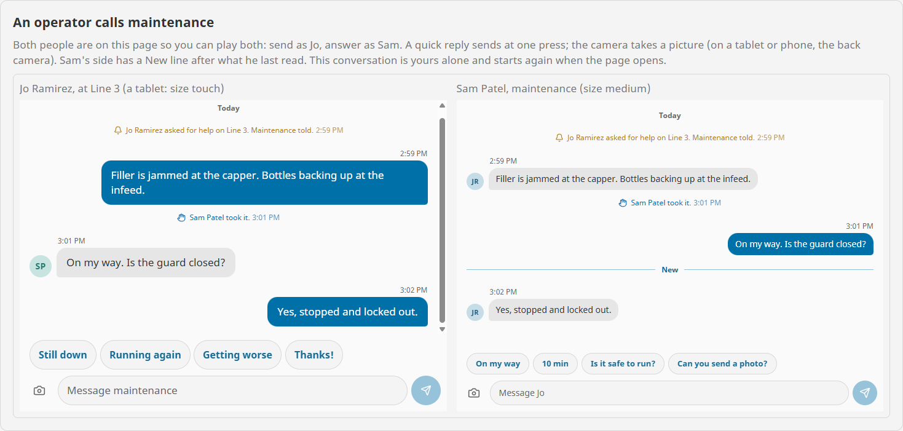
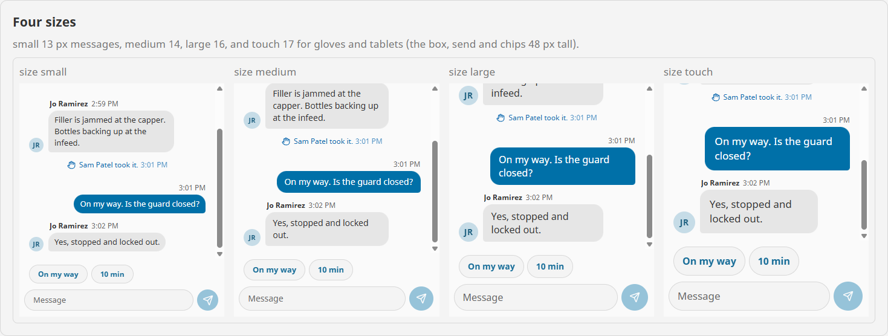

# Chat

**⬇ [Download the Ectobox Perspective Component Suite](https://github.com/Ectobox/EctoboxIgnitionModules/releases/download/modules/Ectobox-Perspective-Component-Suite-8.3.modl)**, which includes Chat.

A conversation on a screen: an operator calling maintenance from the line, a supervisor answering from the office, a
ticket's history. Chat shows the messages you bind to it and tells your script when someone sends one. Where the
messages live (a table, a tag, a message handler) is yours to choose.

- **Messages the way a phone shows them**: mine on the right in a colour, theirs on the left with a face and a name, a
  run from one person under one name and time, day lines (Today, Yesterday), and centred system lines in a tone
  (*Sam Patel took it*, *Escalated*).
- **Quick replies**: chips above the box that send at one press (*On my way*, *Be there in 10 minutes*).
- **Photos from a phone or tablet camera**: a camera button takes a picture (the back camera first) or picks one. The
  picture is shrunk before it is sent, and its hidden details (GPS position, the phone's name) are dropped.
- **A New line** after the last message the user read, and a button back to the newest when they scroll up.
- **Sent messages wait, faded,** until your script adds them. If it doesn't, they say **Not sent**, with Retry and
  Discard.
- **A touch size** for gloves and tablets: the box, send button and chips are 48 px tall.



## Install

Chat comes in the **[Ectobox Perspective Component Suite](PerspectiveComponentSuite.md)**, one module with all of
Ectobox's Perspective controls.

1. Download **`Ectobox-Perspective-Component-Suite-8.3.modl`** from the [Releases](https://github.com/Ectobox/EctoboxIgnitionModules/releases/download/modules/Ectobox-Perspective-Component-Suite-8.3.modl) list.
2. In the gateway's web interface, open the **Modules** page → **Install or Upgrade a Module** → pick the file (accept
   the Ectobox certificate on first install), and restart the gateway when it asks.
3. Open a project in the Designer. **Chat** appears in the component palette under the **Ectobox** category, twice:
   a plain conversation, and a help call with quick replies, a camera button and the touch size.

## Quick start

Bind `messages` to your list, oldest first, and set `me` to the person using this screen:

```json
"me": "Sam Patel",
"messages": [
  { "id": "1", "text": "Jo Ramirez asked for help. Maintenance told.", "icon": "lucide/bell", "at": 1794337320000 },
  { "id": "2", "from": "Jo Ramirez", "text": "Filler is jammed at the capper.", "at": 1794337320000 },
  { "id": "3", "from": "Sam Patel", "text": "On my way. Is the guard closed?", "at": 1794337440000 }
]
```

Sending fires **onSend**. The chat does not add the message itself: your script stores it, and when it comes back in
`messages` the chat shows it. Copy `clientId` into the message, which tells the chat that this is the one it sent:

```python
# onSend: here the conversation is in view.custom.call; on a real screen, insert a row or write a tag
messageList = [dict(m) for m in self.view.custom.call]
ids = [int(m['id']) for m in messageList]
messageList.append({
	'id': str(max(ids + [0]) + 1),
	'from': self.props.me,
	'text': event.text,
	'image': event.image,
	'at': system.date.now().getTime(),
	'clientId': event.clientId})
self.view.custom.call = messageList
```

### A message

| Key | What it is |
|---|---|
| `id` | Your id for it (a row id). Needed for `lastRead` and the New line. |
| `from` | Who wrote it. When it matches `me` (any case), it sits on the right. Empty: a centred system line. |
| `text` | What it says. Line breaks are kept. |
| `image` | A picture: a URL, or the data: URI onSend gives you. Pressing it shows it full size. |
| `at` | When: ms or seconds since 1970, a date text (`2026-11-10T14:05:00Z`) or a date. Shown in the viewer's own time. |
| `tone`, `icon` | A system line's colour (`neutral`, `accent`, `good`, `warning`, `bad`, `info`, `violet`, `teal`) and icon (`lucide/hand`). |
| `kind` | Empty works it out: `system` without `from`, `photo` with an image and no text, else `text`. |
| `clientId` | onSend's clientId, copied in when you store the message. |
| `avatar` | A picture of the sender (a URL). Empty: their initials, in a colour that comes from their name, as the [Avatar](Avatar.md) shows them. |

`messages` takes a dataset too. A named query whose columns are named after these keys works as it is, and a date
column works for `at`:

```sql
SELECT CONCAT('c', c.ID) AS id, c.CreatedBy AS [from], c.CommentText AS text, c.CreatedAt AS at
FROM HourComments c WHERE c.LineID = :line ORDER BY c.CreatedAt
```

### Photos

Turn on `photos` for a camera button beside the box. The picture is redrawn as a JPEG at most `photoSize` pixels on
its longest side (1600 by default, enough to read a label from across a machine; a 12 megapixel photo comes out at
about 100 to 300 KB), and onSend gives it to you as `image`, with its `width`, `height` and `bytes`.

| `camera` | How the picture is taken |
|---|---|
| `auto` (default) | `page` where the browser allows it, otherwise `app`. |
| `page` | A viewfinder over the chat, with a shutter, a switch between cameras, Retake and Use photo. Browsers allow it only on https (or localhost). |
| `app` | The device's own camera app on a phone or tablet, a file chooser on a PC. Works on plain http. |

⚠️ **Store pictures as files, and put their URL in `image`.** A data: URI kept in a tag or a row travels with the
conversation to every screen that shows it, picture and all. One message from the browser to Perspective can be at
most 2,097,152 characters, and a bigger one closes the session. The chat makes a picture smaller until it fits, and says *Too big to send* if it
still doesn't. A typed message too big to send stays in the box, to be cut and sent again.

## Settings

| Property | What it does |
|---|---|
| `messages`, `me` | The conversation (a list or a dataset, oldest first) and who is using this screen, as their name appears in `from`, e.g. `{session.props.auth.user.userName}`. |
| `quickReplies` | Chips above the box that send at one press. Each is a text, or `{label, text}` (*10 min* sends *Be there in 10 minutes*). |
| `placeholder` | The grey words in the empty box (*Message*). |
| `composer` | Off: no box, no quick replies, no camera, so the conversation only reads (a closed ticket, a log). |
| `enabled` | Off: the box and buttons are greyed and nothing sends. The conversation still scrolls. |
| `sendOnEnter` | On (default): Enter sends and Shift+Enter starts a new line. Off: only the send button sends. |
| `maxLength` | The most characters a message may have (2000). The count shows as the box nears it. 0: no limit. |
| `draft` | What is in the box, written as the user types. Bind it both ways to keep a half-written message when the view is reopened, or to put text in the box from a script. |
| `photos`, `camera`, `photoSize`, `photoQuality` | The camera button, how it takes the picture, the longest side (320 to 4096) and the JPEG quality (0.5 to 0.95, 0.8 by default). |
| `lastRead` | The id of the last message this user has seen. The chat draws a New line after it, and writes the newest id here once the user has scrolled to the end, then fires onRead. Bind it both ways, per user, to remember it. |
| `groupMinutes` | Messages from one person this many minutes apart (5) or less share one name and time. |
| `showAvatars`, `showNames` | The face and the name beside other people's messages. Turn names off for a chat between two people. |
| `sendTimeout` | Seconds a sent message waits, faded, before it says Not sent (15). 0: it waits for ever. A message with the same text from `me` that arrives later counts as arrived too, if you don't copy `clientId`. |
| `tone` | The colour of my messages, the send button and the quick replies (`accent` by default). |
| `size` | `small` (13 px messages), `medium` (14, default), `large` (16), `touch` (17, with the box, send and chips 48 px tall). |

Every height inside the chat is a whole number of pixels, and text in the chips, faces and bubbles is centred on its
letters, so nothing sits a pixel off at any size or browser zoom. Light, dark and custom themes work through
Perspective's theme variables, with text contrast of at least 4.5:1 in both.



## Events

| Event | When | Payload |
|---|---|---|
| `onSend` | The user sent a message, a quick reply or a photo (and on Retry) | `text`, `image` (a JPEG data: URI, or empty), `width`, `height`, `bytes`, `clientId`, `source` (`typed`, `quick` or `photo`) |
| `onRead` | The user has seen the newest message (`lastRead` is already its id) | `id` |

## See it working

Every example runs live on the [Public Demo Server](https://proveit.ectobox.com/data/perspective/client/ModuleDemos/chat),
each beside exactly how it is built:

| Page | Shows |
|---|---|
| Examples | An operator calling maintenance, both people on one page so you can play both: quick replies, the camera, a New line. Each visitor's conversation is their own. A line's last day of comments and unplanned stops from the plant tables, as a read-only log. And a message the gateway never takes: Not sent, then Retry. |
| Looks | Four sizes, four tones, two people without names or faces, read-only and disabled. |
