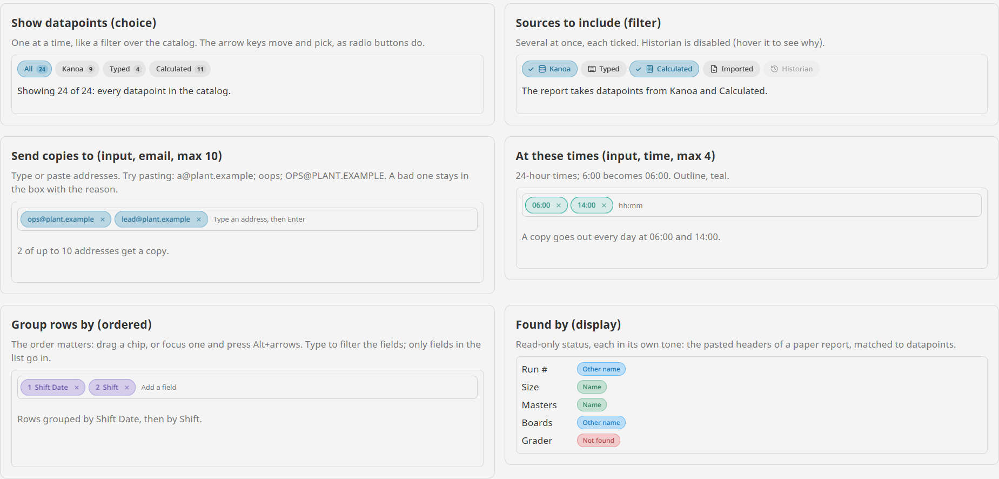
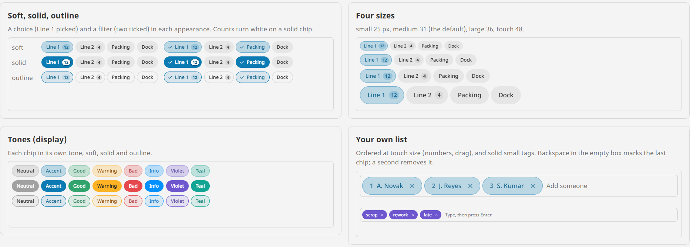

# Chips

**⬇ [Download the Ectobox Perspective Component Suite](https://github.com/Ectobox/EctoboxIgnitionModules/releases/download/modules/Ectobox-Perspective-Component-Suite-8.3.modl)**, which includes Chips.

Small labelled chips in one of four modes: pick one, tick several, type your own list, or show a status. The same
control is a filter over a list, the recipients of a report, the order rows are grouped in, or how each pasted header
was matched.

- **choice** picks one option, as radio buttons do. **filter** ticks several. Both take `options` and write `value`.
- **input** is the user's own list, typed or pasted in. Each entry is checked (email, number, time or a pattern of your
  own), kept unique and up to a `max`. A bad one stays in the box with the reason; nothing is dropped silently.
- **ordered** input chips show their place and drag to a new one (or move with Alt+arrows), for anything where the
  order matters.
- **display** chips are read-only status, each in its own tone.
- **Moves like it means it.** New chips pop in, removed ones shrink away, and the rest close up on a spring.



## Install

Chips come in the **[Ectobox Perspective Component Suite](PerspectiveComponentSuite.md)**, one module with all of
Ectobox's Perspective controls.

1. Download **`Ectobox-Perspective-Component-Suite-8.3.modl`** from the [Releases](https://github.com/Ectobox/EctoboxIgnitionModules/releases/download/modules/Ectobox-Perspective-Component-Suite-8.3.modl) list.
2. In the gateway's web interface, open the **Modules** page → **Install or Upgrade a Module** → pick the file (accept
   the Ectobox certificate on first install), and restart the gateway when it asks.
3. Open a project in the Designer; **Chips** appears in the component palette under the **Ectobox** category. Dropped on
   a view, it starts as a choice of All, Kanoa, Typed and Calculated, each with a count.

## Quick start

### Pick one, or tick several

```json
"mode": "filter",
"options": [
  { "value": "Kanoa",      "icon": "lucide/database" },
  { "value": "Typed",      "icon": "lucide/keyboard" },
  { "value": "Calculated", "icon": "lucide/calculator", "badge": 11 },
  { "value": "Historian",  "disabled": true, "tooltip": "This gateway has no Tag Historian" }
],
"value": ["Kanoa", "Calculated"]
```

An option needs only a `value`; with no `label` it shows the value. `icon` goes before the label (a Lucide or any
Ignition icon, or a picture's URL, drawn round), `badge` after it (`badgeTone` gives the count its own colour, e.g. `bad`), and `tooltip` shows on hover. With `mode` choice,
`value` is one value; with filter it is the list of ticked values, in the options' order.

### The user's own list

```json
"mode": "input",
"validate": "email",
"max": 10,
"value": ["ops@plant.example", "lead@plant.example"]
```

Enter, a comma, a semicolon or Tab adds what is typed. A pasted list splits on commas, semicolons, tabs and new lines,
so a column copied from a spreadsheet goes in at once. Bind `value` both ways to a custom property or a tag.

| Setting | What it does |
|---|---|
| `validate` | `none` (default), `email`, `number` (stored as a number), `time` (hh:mm, 24-hour; 6:00 becomes 06:00) or `pattern`. |
| `pattern` | A regular expression the whole entry must match, e.g. `WO-\d{4}`; `patternHint` says it in words for the reason: "'12' isn't a work order number (WO-1234)." |
| `unique` | On (default): no two entries the same, ignoring case. |
| `max` | The most entries; 0 (default) is no limit. Past it, the rest stay in the box with "Up to 10." |
| `suggestions` | Entries offered in a list as the user types, filtered by what is typed. A typed entry that matches one takes its spelling. |
| `allowCustom` | On (default). Off, with suggestions: only the suggestions go in. |
| `ordered` | Each chip shows its place and drags to a new one, across wrapped lines; Alt+arrows move the one in focus. |
| `removable` | On (default): an × on each chip; Delete or Backspace removes the one in focus, and Backspace in the empty box marks the last chip, then removes it. |
| `showReason` | On (default): why an entry wasn't added shows under the box. |
| `placeholder` | What the empty box says. |

### Status

`mode` display with each option's `tone` (`good`, `warning`, `bad` and so on) shows read-only chips. Turn `clickable`
on to make them buttons that fire `onChipClick`.

## Looks

| Property | Choices |
|---|---|
| `appearance` | `soft` (default): tints of the colour with a thin ring. `solid`: picked and own chips filled, their text white (dark on amber). `outline`: a line, filled lightly when picked. |
| `tone` | The colour of the picked choice, the ticked filters and the user's own chips: `accent` (default, the theme's), `neutral`, `good`, `warning`, `bad`, `info`, `violet`, `teal`. Unpicked chips are neutral. An option's own `tone` wins. |
| `color` | A colour of your own instead of `tone`. |
| `size` | Chip height: `small` 25 px, `medium` 31 (default), `large` 36, `touch` 48 for panel screens and gloves. |
| `wrap` | `wrap` (default) onto more lines, or `scroll`: one line that scrolls sideways. |
| `enabled` | Off greys the control and nothing can be changed. |

Labels are centred on their capitals and counts on their digits, in the theme's own font; a count at the end of a chip
sits evenly in its rounded end, and on a solid chip it turns white. Light, dark and custom themes work through
Perspective's theme variables. When the operating system asks for reduced motion, nothing animates.



## Events

| Event | When | Payload |
|---|---|---|
| `onChange` | The user changed `value` (not a binding) | `value`, `previous`, `added`, `removed`, `reason` (pick, key, add, suggestion, remove or reorder) |
| `onChipClick` | The user clicked one of their own chips, or a display chip with `clickable` | `value`, `label`, `index` |
| `onInvalid` | A typed or pasted entry wasn't added, one event each | `text`, `reason` |

## Keyboard

| Mode | Keys |
|---|---|
| choice | Tab onto the picked chip; arrows move and pick at once, wrapping round, skipping disabled ones; Home and End. |
| filter | Tab onto the chips; arrows move; Space or Enter ticks or unticks. |
| input | Type and press Enter. Left from the start of the box goes to the chips; Left and Right move between them, Right past the last returns to the box; Delete or Backspace removes one; Alt+arrows move it when ordered. In the suggestions, Up and Down choose and Enter adds; Escape closes them. |

Screen readers hear choice chips as radio buttons, filter chips as checkboxes and the user's own chips as a list, each
with its place ("2 Shift") and count.

## See it working

Every example runs live on the [Public Demo Server](https://proveit.ectobox.com/data/perspective/client/ModuleDemos/chips),
each beside exactly how it is built:

| Page | Shows |
|---|---|
| Examples | A report builder's: what the datapoint catalog shows (choice, with counts), which sources go in (filter, one disabled), who gets copies (email, max 10) and when (times, max 4), how rows are grouped (ordered, from a list of fields), and how pasted headers were found (display); onChange and onInvalid scripts. |
| Looks | Soft, solid and outline; four sizes with counts; every tone; an ordered list at touch size; wrap and scroll; turned off. |
