# Ectobox Datagrid

A **data grid for Ignition 8.3 Perspective** that holds its own on a plant floor. Bind a query and every column
appears, typed and formatted. From there, each feature is one property away: per-column filters, grouping with
subtotals, calculated columns, typed spreadsheet-style editing with validation, trees, master-detail panels, live tag
columns, and Excel, CSV and PDF export. When the table gets big, switch it to gateway mode: the gateway pages through
your named query and only the rows on screen ever reach the browser. A **Pivot Grid** ships alongside it for totals by
any two things: downtime by reason and line, scrap by defect and part, output by line and shift.

```python
# Drop a Datagrid on a view, bind its data prop to a named query, and you're done.
# Every column appears, typed from its values. Add column objects only for what you want different.
```

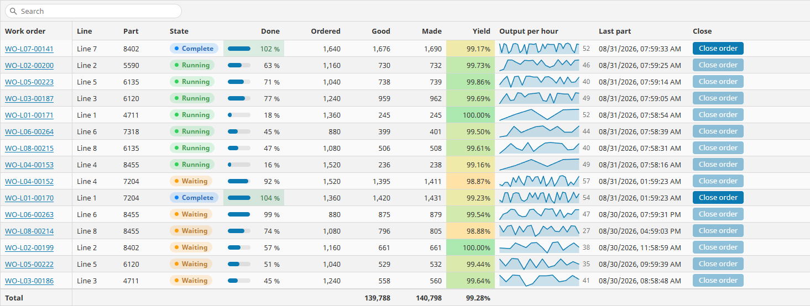

## What's included

| Component | Component id | Good for |
|---|---|---|
| **Datagrid** | `ectobox.datagrid.grid` | Work-order lists, QC data entry, downtime logs, equipment trees, reports with totals, live machine status. |
| **Pivot Grid** | `ectobox.datagrid.pivot` | Totals of your rows by fields down the side and across the top: downtime by reason by line, plan attainment by line and shift. |

Both appear in the Designer palette under the **Ectobox Datagrid** category.

Plus a scripting namespace, in gateway and Designer scope:

| Function | What it does |
|---|---|
| `system.ectobox.datagrid.ApplyChanges(changes, insertQuery, updateQuery, deleteQuery, database)` | Saves a grid's edits with your named queries, optionally as one transaction. |
| `system.ectobox.datagrid.ToXlsx(dataset, columns, sheetName, timeZone)` | An Excel workbook from a Dataset, as bytes. |
| `system.ectobox.datagrid.ToCsv(dataset, columns, delimiter, timeZone)` | CSV text from a Dataset. |
| `system.ectobox.datagrid.ToPdf(dataset, columns, title, paper, orientation, timeZone)` | A printable PDF from a Dataset, as bytes. |
| `system.ectobox.datagrid.EvaluateFormula(formula, rows)` | Works out a calculated-column formula in a script, with the same answers as the grid. |

## When to use it instead of Ignition's Table

Ignition's own Table is fine for a short, read-only list. Reach for the Datagrid when you need any of these:

- **Big tables.** Tens of thousands of rows work in the browser. Past that, gateway mode pages a named query on the
  gateway, so a table of millions of rows still opens instantly.
- **Data entry.** Typing replaces a value, Tab and Enter move on like Excel, every value is checked as it is typed,
  and dropdowns show names but store codes. Your script saves each cell, or a reviewed batch.
- **Totals that are right.** Footer totals, group subtotals and tree rollups, with ratios such as yield worked out
  from the totals rather than averaged.
- **Filters users expect.** An Excel-style value checklist and typed conditions on every column, a filter row, and
  a search box.
- **Reports.** Header bands, pinned columns, conditional colors, and Excel or PDF export of exactly what is on
  screen.
- **Live data.** A column of tag values, one tag per row, subscribed only while the row is on screen.

## Install

The Datagrid and Pivot Grid come in the **Ectobox Perspective Component Suite**, one module with all of Ectobox's
Perspective controls. See [PerspectiveComponentSuite.md](PerspectiveComponentSuite.md) for the details, including moving
from the separate Datagrid module.

1. Download **`Ectobox-Perspective-Component-Suite-8.3.modl`** from the
   [Releases](https://github.com/Ectobox/EctoboxIgnitionModules/releases/download/modules/Ectobox-Perspective-Component-Suite-8.3.modl) list.
2. In the gateway's web interface, open the **Modules** page → **Install or Upgrade a Module** → pick the file, and
   accept the Ectobox certificate the first time.
3. Restart the gateway when it asks.
4. In the Designer, the components are in the palette under **Ectobox Datagrid**.

## Quick start

1. Drop a **Datagrid** onto a view.
2. Bind its **`data`** prop to a named query (return format: dataset). Every column appears, typed from the data.
   Click a header to sort, Shift+click to add a second sort, and right-click it for the column menu.
3. To change a column, add an object for it to **`columns`**. Once you list columns, exactly those show, in that
   order. Each object needs only what is different:

```python
# props.columns: four columns from a work-order query
[
  {"field": "WorkOrderNumber", "title": "Work order", "display": {"pinned": "left"}},
  {"field": "Status", "title": "Status", "render": {"kind": "pill", "choices": [
      {"value": "Running",  "color": "#0090FF"},
      {"value": "Complete", "color": "#30A46C"},
      {"value": "Stalled",  "color": "#FFB224"}]}},
  {"field": "Done", "title": "Done", "type": "float", "formula": "[Good] / [QuantityOrdered]",
   "format": {"style": "percent", "decimals": 0},
   "render": {"kind": "progress", "progress": {"min": 0, "max": 1}}},
  {"field": "Good", "title": "Good made", "type": "integer", "summary": {"footer": "sum"}}
]
```

Status draws as a colored pill. Done is a calculated column, worked out for each row from two data columns and drawn
as a bar. Good made adds up in the footer.

Every option on a column is a dropdown or a checkbox in the property editor, with a description beside it. Right-click
a column object in the property editor for **Move Up** / **Move Down**. A column with a problem (a field that isn't in
the data, a formula with a mistake) shows a red header; point at it to read what's wrong.

## Where the rows come from

`source.mode` picks where the rows come from. Columns, sorting, filtering, formulas and events work the same in every
mode, so you can switch later without redoing the grid.

| `source.mode` | Rows come from | Use it for |
|---|---|---|
| `bound` (default) | The `data` prop: a dataset, an array of objects or an array of arrays. Everything runs in the browser. | Up to tens of thousands of rows. |
| `gateway` | A named query that the gateway runs a screenful at a time, with the grid's filters, sort and paging added around it. | Big tables: only the rows in view reach the browser. |
| `function` | A function in your project library that the gateway calls with keyword arguments. | Projects that keep data access in their own library (and stored procedures). |

### Bound mode

Bind `data` to anything that gives rows: a named query, a script transform, a tag holding a dataset. With no
`columns`, every column in the data appears.

### Gateway mode: a named query paged on the gateway

Set `source.mode` to `gateway` and `source.namedQuery` to a named query of type **Query**. Don't bind `data`: the grid
runs the query itself. The gateway wraps your query with the user's filters, sort and paging in one statement, so only
one screenful of rows leaves the database. Grouping, totals, the filter checklists and export still cover every
matching row: the database works them out.

```python
# props.source: three weeks of part completions, 140,000 rows
{
  "mode": "gateway",
  "namedQuery": "Production/PartCompletions",
  "parameters": {},
  "filterParameters": [],
  "keyField": "ID"
}
```

Things to know:

- **Set `source.keyField`** to a column that is unique per row (usually the ID). Gateway mode uses it to page without
  skipping or repeating a row, and needs it for editing.
- **The query's permissions still apply.** The named query's security settings are checked as for any other caller.
- **`source.parameters`** gives the query's parameters fixed values by name: a site, a line, a date range. Bind them
  for values that change.
- **A `WITH` at the start of the query and an `ORDER BY` at the end both work.** The query's own `ORDER BY` becomes the
  grid's order until a user sorts.
- **Filters are values, never text in the SQL.** Every filter value becomes a bound parameter, and column names are
  checked against the columns the query really returns. Text is compared ignoring case, the same as in bound mode.
- **A stored procedure can't be wrapped in a query.** To page a stored procedure, call it from a library function and
  use function mode (below).

### Filters into the query's own parameters

Some queries narrow their rows themselves: a table function such as
`SELECT ... FROM dbo.SelectWorkOrders(:LineName, :StatusID, :DueFrom, :DueTo)`, where a parameter of null means "all".
`source.filterParameters` hands the user's column filters to those parameters, so the database does the narrowing:

```python
# props.source.filterParameters: which column's filter goes to which parameter
[
  {"parameter": "LineName", "column": "Line",    "takes": "value", "textMatch": "equals"},
  {"parameter": "StatusID", "column": "Status",  "takes": "value"},
  {"parameter": "DueFrom",  "column": "DueDate", "takes": "from"},
  {"parameter": "DueTo",    "column": "DueDate", "takes": "to"}
]
```

| Key | Notes |
|---|---|
| `parameter` | The named query's parameter (or the function's keyword argument) that takes the filter. A dropdown in the Designer. |
| `column` | The grid column whose filter it takes. Make an ID column a lookup column, so users pick "Running" and the parameter gets 2. |
| `takes` | `value`: one value (an equals, a single pick, or text). `from`: the start of a range (>=). `to`: the end of a range, inclusive (<=; for a date, the last day). `toExclusive`: the end of a range, exclusive (<). `list`: several picks, as a list (for script functions). `csv`: several picks as one string, `'1,4'` (for a query that splits it). |
| `textMatch` | For text: how the query matches it. `contains` (default), `startsWith` or `equals`. |
| `wildcards` | `none` (default): the query adds its own `%`, as in `LIKE '%' + :x + '%'`. `percent`: the grid adds them, so `LIKE :x` gets `'%brien%'`. |

The rows are right either way. A filter the parameter can't say (two statuses for a one-ID parameter, "starts with"
for a `contains` parameter) is not passed; the grid applies that filter itself instead. A parameter with no filter
gets null. A filter never replaces a parameter set in `source.parameters`.

### Function mode: your own data functions

Many projects keep their data access in a project library, one function per query, with optional keyword arguments
that each narrow the rows. Point the grid at one:

```python
# Project library script: Plant/Data/WorkOrders
def SelectWorkOrders(siteId, lineName=None, statusId=None, dueFrom=None, dueTo=None):
    """Work orders for a site; each argument left as None means 'all'."""
    return system.db.runNamedQuery('WorkOrders/Select', {
        'SiteID': siteId,
        'LineName': lineName,
        'StatusID': statusId,
        'DueFrom': dueFrom,
        'DueTo': dueTo,
    })
```

```python
# props.source
{
  "mode": "function",
  "function": "Plant.Data.WorkOrders.SelectWorkOrders",
  "parameters": {"siteId": 2},
  "filterParameters": [
    {"parameter": "lineName", "column": "Line",    "takes": "value", "textMatch": "equals"},
    {"parameter": "statusId", "column": "Status",  "takes": "value"},
    {"parameter": "dueFrom",  "column": "DueDate", "takes": "from"},
    {"parameter": "dueTo",    "column": "DueDate", "takes": "to"}
  ],
  "keyField": "WorkOrderID"
}
```

- **`source.function`** is the function as `Package.Script.Function`. The Designer offers a dropdown of your library's
  functions, and the `parameter` dropdowns list the function's arguments.
- **`source.parameters`** are fixed keyword arguments. A mapped argument with no filter is left out, so its default
  applies.
- **What it may return:** a Dataset, a PyDataSet, a list of dictionaries, or an API-style dictionary,
  `{'success': True, 'data': [...]}`. With `{'success': False, 'error': {'message': ...}}` the grid shows the message
  instead of rows. `source.resultKey` names the key that holds the rows when it isn't `data`.
- **Its rows go to the browser.** Sorting, search and the filters that aren't mapped then work as in bound mode. When
  a user changes a mapped filter, the function is called again a moment after they stop typing.

### A function that pages: stored procedures with skip and take

Some stored procedures page themselves: they take how many rows to skip and how many to return, a sort column and
direction, and put the total count in every row. Name those arguments in `source.paging` and the grid asks for one
screenful at a time, so nothing ever holds the whole result.

```python
# Project library script: Plant/Data/Downtime
def SelectDowntimePaged(skip=0, take=100, sortColumn='StartTime', sortDirection='DESC',
                        lineName=None, reason=None, startFrom=None, startTo=None):
    """One page of downtime events, sorted, with TotalCount (the number of matches) in every row."""
    call = system.db.createSProcCall('Plant.GetDowntimePaged', 'PlantDB')
    call.registerInParam('Skip', system.db.INTEGER, skip)
    call.registerInParam('Take', system.db.INTEGER, take)
    call.registerInParam('SortColumn', system.db.NVARCHAR, sortColumn)
    call.registerInParam('SortDirection', system.db.NVARCHAR, sortDirection)
    call.registerInParam('LineName', system.db.NVARCHAR, lineName)
    call.registerInParam('Reason', system.db.NVARCHAR, reason)
    call.registerInParam('StartFrom', system.db.TIMESTAMP, startFrom)
    call.registerInParam('StartTo', system.db.TIMESTAMP, startTo)
    system.db.execSProcCall(call)
    return call.getResultSet()
```

```python
# props.source.paging
{
  "skip": "skip",
  "take": "take",
  "sortColumn": "sortColumn",
  "sortDirection": "sortDirection",
  "directionWords": "ASC/DESC",
  "sortNames": {"LineID": "LineName"},
  "totalField": "TotalCount"
}
```

| Key | Notes |
|---|---|
| `skip` / `take` | The arguments that take how many rows to skip and how many to return. |
| `sortColumn` / `sortDirection` | The arguments that take the sort. Without them, columns don't sort. |
| `directionWords` | The words `sortDirection` takes: `ASC/DESC`, `asc/desc` or `ascending/descending`. |
| `sortNames` | When the function's sort names differ from the grid's fields: field → the name the function takes. |
| `totalField` | The result column that holds the total number of matches (for example from `COUNT(*) OVER ()`). Without it, the scrollbar grows as pages arrive. |
| `maxCount` / `maxRows` | For a function that doesn't page but caps its rows: the argument that takes the cap, and the cap (default 1,000). When that many rows come back, the grid says it shows only the first ones. |

A page can only be filtered by the function itself, so only columns with a filter parameter can be filtered, and
grouping and the filter value lists are off. Mark columns the procedure can't sort with `sortable: false`. A filter set
on another column by a binding or a script is refused with a message, never silently dropped.

### Security: what a grid may run

- **The browser can't change the source.** `source` is taken from the view, its bindings and its scripts only. A
  browser that writes to it changes nothing on the gateway, and the attempt is logged once.
- **Only your library functions run.** The function path must lead through your project library's packages and
  scripts to a function defined in that script. `system.*` functions, Python built-ins, and anything a script merely
  imported are refused.
- **Filters reach parameters only through `filterParameters`**, and never replace a parameter set in
  `source.parameters`. Use `source.parameters` for what scopes the rows (a site, a customer).
- **Links only open web addresses.** A link cell whose address starts with something like `javascript:` is refused.
- **Tags are read and written with the user's own tag security** (see [Live tag columns](#live-tag-columns)).

## Columns

`columns` is a list of column objects. Leave it empty and every column in the data appears. Once you add columns,
exactly those show, in that order.

| Key | Notes |
|---|---|
| `field` | The data column this grid column shows. |
| `title` | Header text. Blank uses the field name. |
| `type` | `auto`, `text`, `integer`, `float`, `boolean`, `date`, `datetime`, `time`, `duration` or `lookup`. The type decides sorting, editing, copying and the formats on offer. `auto` works it out from the data. |
| `formula` | Makes this a calculated column (see [Calculated columns](#calculated-columns)). |
| `tag.pathTemplate` | Makes this a live tag column (see [Live tag columns](#live-tag-columns)). |
| `sortable` | Clicking the header sorts by this column (default on). |
| `filter.enabled` / `filter.checklist` | Users can filter this column; the filter menu lists its values to tick. Turn the checklist off for columns with thousands of different values, such as serial numbers. |
| `summary.footer` / `summary.group` | Totals (see [Totals](#totals-and-read-this-bit-ratios)). |
| `display` | Visibility, size, pinning, alignment, wrapping, header band (below). |
| `format` | How values look (below). |
| `render` | How the cell draws its value: pill, icon, progress bar, sparkline, link, button, image or view (below). |
| `style` | Conditional colors and color scales (below). |
| `editing` | Whether users can change values, and what is allowed (see [Editing](#editing)). |
| `lookup.values` | For `type: lookup`: the choices, each a stored `value` and the `label` users see. |

**Type is not format.** The type is what the value is; the format is only how it looks. Sorting, copying and export
always use the real value: a yield of 0.9452 shown as 94.5% copies into Excel as 0.9452.

### Display: width, pinning, alignment, wrapping, header bands

| Key | Notes |
|---|---|
| `display.visible` | Show this column. A hidden column can still be grouped by and read by formulas. |
| `display.width` | Width in pixels. `0` (default) fits the header and the values. |
| `display.minWidth` / `display.maxWidth` | The narrowest and widest the column can be resized or fitted to (default 60 and 600). |
| `display.pinned` | `none`, `left` or `right`: keep the column in view while scrolling sideways. Pin the work order on the left and its status on the right, and the rest slides between. |
| `display.align` | `auto` (numbers right, true/false centered, everything else left), `left`, `center` or `right`. The header follows its column. |
| `display.wrap` | Wrap long text onto more lines; the row grows to fit, up to `appearance.maxLines`. For notes and comments. A little slower than fixed rows on very large tables. |
| `display.fixed` | Users can't drag, pin, unpin or hide this column. |
| `display.headerBand` | A label over the header, shared with neighboring columns that have the same label. "Quality" over Good, Scrap and Yield. |

### Format

| Key | Notes |
|---|---|
| `format.style` | Numbers: `auto`, `number`, `percent` (0.945 shows as 94.5%), `currency` or `scientific`. |
| `format.decimals` | Decimal places. `-1` (default) = automatic. |
| `format.thousandsSeparator` | Group thousands: 4,812 (default on). |
| `format.units` | Text after the number: `pcs`, `kg`, `°C`. |
| `format.currency` | Currency code for `currency` (default `USD`). |
| `format.dateStyle` | `auto`, `date`, `datetime`, `time`, `relative` (5 min ago), `iso` or `custom`. |
| `format.datePattern` | For `custom`: a pattern like `system.date.format` uses, such as `EEE HH:mm`. |
| `format.durationStyle` | Durations: `auto`, `clock` (1:02:05) or `words` (1h 2m 5s). |
| `format.durationUnit` | What a value of 1 means: `milliseconds`, `seconds` (default), `minutes` or `hours`. |
| `format.nullText` | Shown when there is no value, such as `—`. |
| `format.trueText` / `format.falseText` | Shown for true and false. Blank shows a check mark and a dash. |

### Render: pills, icons, progress bars, sparklines, links, buttons, images, views

`render.kind` changes only the picture. Copy, export, sorting, filtering and totals still use the real value.

| `render.kind` | Draws | Settings |
|---|---|---|
| `auto` / `text` | The value as formatted. | |
| `pill` | A colored badge per value: Running green, Faulted red, Starved amber. | `render.choices[]` (`value`, `label`, `color`, `textColor`), `render.otherColor` for any other value, `render.pillStyle`: `soft` (default, a light tint with a dot), `solid` or `outline`. |
| `icon` | An icon per value. | `render.choices[]` with `icon` (a `material/…` icon, or an image path or URL) and `color`; `label` shows beside it. |
| `progress` | A bar: how full = (value − min) / (max − min). | `render.progress.min`, `max` (100 for percents, 1 for fractions, or a target), `color`, `showValue`. |
| `sparkline` | A small trend line from the cell's readings: an array, `"[1,2,3]"` or `"1, 2, 3"`. A missing reading is a gap, never a zero. | `render.sparkline.chart` (`line`, `area` or `bar`), `color`, `showLast`, `min` / `max` (set both to compare rows with each other). |
| `link` | Clickable text. | `render.link.text`, `urlFrom` (`value` or `field`), `urlField`, `opens`: `event` (fires `onCellAction` for your script), `newTab` or `sameTab`. |
| `button` | A button that fires `onCellAction` with its row: Acknowledge, Print label, Start. | `render.button.text`, `icon`, `look` (`primary`, `secondary`, `danger`), `disabledField` (a column that grays it out when true, such as Acknowledged). |
| `image` | The value as an Ignition image path or a URL. | `render.image.fit`: `contain` or `cover`. |
| `view` | A Perspective view in every visible cell. The heaviest option: keep the view light. | `render.view.path`. The view gets params `value`, `rowData`, `rowIndex` and `column`: declare them as input params. |

A choice matches the way a filter's Equals does: text ignoring case, numbers by value (3 and "3" are the same), blank
for empty cells. The first matching choice wins. These colors sit well together: green `#30A46C`, amber `#FFB224`, red
`#E5484D`, blue `#0090FF`, violet `#6E56CF`, gray `#8B8D98`.

Links, buttons and pills work from the keyboard too: Space or Enter on a link or button cell clicks it.

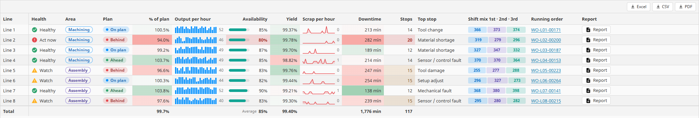

### Conditional styling and color scales

`style.rules` colors a cell, or its whole row, by value, the way Excel's conditional formatting does:

```python
# props.columns: a wall-thickness column, red when out of spec (1.9 to 2.1 mm)
{"field": "Thickness", "title": "Wall (mm)", "type": "float", "format": {"decimals": 3},
 "style": {"rules": [{"when": "notBetween", "value": 1.9, "value2": 2.1, "look": "bad"}]}}
```

| Key | Notes |
|---|---|
| `when` | `equals`, `notEquals`, `contains`, `notContains`, `startsWith`, `endsWith`, `greater`, `greaterOrEqual`, `less`, `lessOrEqual`, `between`, `notBetween`, `on`, `before`, `after`, `today`, `yesterday`, `last7Days`, `last30Days`, `isTrue`, `isFalse`, `empty`, `notEmpty`, or `formula`. The same conditions, meaning exactly the same, as the column filter. |
| `value` / `value2` | What to compare with. Dates as `2026-10-14` (a whole local day) or `2026-10-14T06:00`. |
| `formula` | For `when: formula`: a condition on the whole row, written like a calculated column, such as `AND([Scrap] > 5, NOT([Planned]))`. |
| `look` | A ready-made look in the theme's colors: `good` (green), `warning` (amber), `bad` (red, bold), `info` (accent), `muted` (gray text), `strong` (bold), or `custom` (only your `style`). |
| `style` | A Perspective style added on top of the look. |
| `wholeRow` | Style every cell of the row: a whole line red when it is Faulted. A cell's own rules win over its row's. |
| `stopIfTrue` | When this rule matches, skip the rules after it. |

Rules are checked in order. The first rule that matches wins each style setting.

`style.colorScale` shades number or date cells from low to high, a heatmap:

| Key | Notes |
|---|---|
| `enabled` | Shade this column by value. |
| `palette` | `redNeutralGreen` (low is bad, high is good, on target stays plain; the calmest for yield, % of plan, OEE), `greenNeutralRed` (the same with low good: scrap, downtime), `redAmberGreen` / `greenAmberRed` (a full traffic light), `heat` (nothing to red: counts, alarms), `blues` (nothing to blue: output), `diverging` (blue below the middle, red above: deviation from a setpoint), or `custom` with your own `low` / `middle` / `high`. |
| `strength` | `soft`, `medium` (default) or `strong`. Text stays readable at every strength, light and dark. |
| `min` / `max` | The ends of the scale. Blank = the lowest and highest values among the rows that pass the filters. |

A rule with a look or its own background replaces the scale on the cells it matches.

## Calculated columns

A calculated column works out its value for every row from a formula, like a formula in a spreadsheet, except it
belongs to the column, so every row gets it. Give the column a `field` name of its own (not one of the data's columns)
and a `formula`. From then on it sorts, filters, groups and totals like any other column.

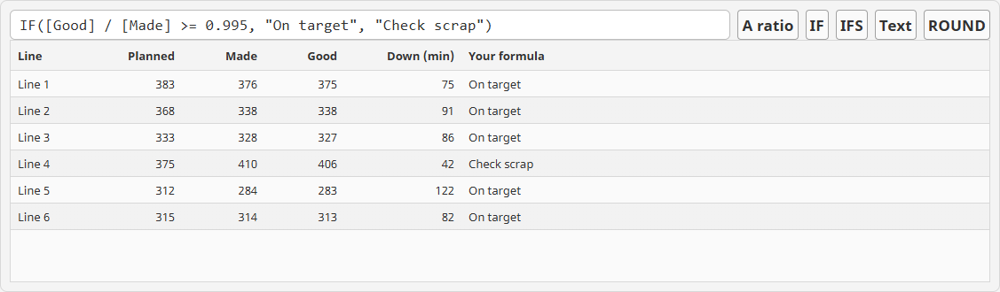

```python
# props.columns: first-pass yield for each line, shown as a percent
{"field": "Yield", "title": "Yield", "type": "float",
 "formula": "[Good] / ([Good] + [Scrap])",
 "format": {"style": "percent", "decimals": 2},
 "summary": {"footer": "formulaOverTotals", "group": "formulaOverTotals"}}
```

A formula produces a value. `type` and `format` say how it looks: this one is a fraction (0.9973) shown as 99.73%.
The formula never multiplies by 100.

### Writing a formula

| Write | Means |
|---|---|
| `[Good]` | The value of a column on the same row: its field name in square brackets. Other calculated columns can be read the same way. |
| `"Short"` | Text, in double quotes. Write `""` for a quote inside text. |
| `0.95`, `100`, `TRUE`, `FALSE` | Numbers as they are, with a dot for decimals. TRUE and FALSE mean yes and no. |
| `+`, `-`, `*`, `/`, `^`, `( )` | Add, subtract, multiply, divide, raise to a power. What is in brackets is worked out first. |
| `=`, `<>`, `<`, `<=`, `>`, `>=` | Compare two values: equal, not equal, less than, and so on. The answer is TRUE or FALSE. |
| `&` | Joins text and values into one text: `"Line " & 3 & " down"` gives `Line 3 down`. |
| `ROUND([Yield], 3)` | A function: its name, then its values in brackets, separated by commas. |

Rules that hold everywhere:

- **Blank in, blank out.** A blank value gives a blank answer, and dividing by zero is blank too. A row with missing
  data shows an empty cell, not an error.
- **A value of the wrong kind is blank**, never a guess: text times two is blank.
- **Text compares ignoring capitals**: `"shaft"` matches `"Shaft"`.
- **Spaces and line breaks don't matter**, so a long formula can run over several lines.
- **Dates are counted in milliseconds.** An hour is 3,600,000 of them, so `[LastPart] + [HoursToGo] * 3600000` is a
  date (give the column `type: datetime`).
- **A mistake turns the column's header red.** Point at the header to read what is wrong and where.

A longer example: a "next step" for each line at the end of a shift.

```
IFS(
  AND([Scrap] >= 4, [Yield] < 0.99),
    "Quality: " & [Scrap] & " scrap, check first-offs",
  [DownMin] - [PlannedDownMin] > 45,
    "Maintenance: " & ROUND([DownMin] - [PlannedDownMin], 0) & " min unplanned",
  [Actual] < [Planned] * 0.95,
    "Short " & ([Planned] - [Actual]) & " pcs, review the cycle",
  TRUE, "On track")
```

IFS checks each test from the top and gives the answer of the first one that is TRUE. The last test, `TRUE`, is
always TRUE, so a line that passed none of the others is "On track".

### Formulas that read other rows

`PREV`, `NEXT`, `RUNNINGSUM` and `RUNNINGCOUNT` read the rows around the current one, in the order shown on screen.
Sort the grid differently and they follow the new order. Because the order on screen is their input, these columns
can't themselves be sorted or filtered.

```python
# props.columns: one line's day, an hour a row
{"field": "Change",    "title": "vs last hour",  "type": "integer", "formula": "[Actual] - PREV([Actual])"},
{"field": "MadeSoFar", "title": "Made so far",   "type": "integer", "formula": "RUNNINGSUM([Actual])"},
{"field": "Ahead",     "title": "Ahead of plan", "type": "integer", "formula": "RUNNINGSUM([Actual]) - RUNNINGSUM([Planned])"},
{"field": "Pace",      "title": "Average /h",    "type": "float",   "formula": "RUNNINGSUM([Actual]) / RUNNINGCOUNT()"}
```

### Calculated columns in gateway mode

In gateway mode the grid never has every row, so it can't sort or filter 140,000 rows by a formula itself. It writes
the formula into the query as SQL, but only when the database is certain to get exactly the same answer the grid
would. Such a column sorts, filters, groups and totals across every row. A formula it can't hand over (for example one
using `HOUR`, which depends on the viewer's time zone) is worked out in the browser for the rows on screen and can't be
sorted or filtered; its header says so. The **Gateway mode** column below says which way each part of the language
goes.

### Formula reference

Every function, with what it does and a plant-floor example.

**Logic**

| Function | What it does | Example | Gateway mode |
|---|---|---|---|
| `IF(test, if TRUE, if FALSE)` | Checks one test and gives one of two answers. Leave out the third value and a FALSE test gives a blank. A blank test counts as FALSE. | `IF([Actual] >= [Planned], "Met", "Short")` gives Met when the line made its plan. | Database |
| `IFS(test 1, answer 1, test 2, answer 2, …)` | Checks pairs of a test and its answer from the top, and gives the answer of the first test that is TRUE. Put `TRUE` as the last test to catch everything else; without it, those rows are blank. | `IFS([Score] >= 90, "Strong", [Score] >= 80, "Fair", TRUE, "Weak")` gives Fair for a score of 85. | Database |
| `AND(test, test, …)` | TRUE only when every test is TRUE. | `AND([Scrap] >= 4, [Yield] < 0.99)` flags a line with 4 or more scrapped and yield under 99%. | Database |
| `OR(test, test, …)` | TRUE when at least one test is TRUE. | `OR([Visual] = "F", [Rework])` flags a lot that failed its visual check or was reworked. | Database |
| `NOT(test)` | The opposite: TRUE becomes FALSE, FALSE becomes TRUE. | `NOT([Planned])` is TRUE for an unplanned stop. | Database |
| `ISBLANK(value)` | TRUE when the value is empty. | `ISBLANK([Inspector])` is TRUE when nobody has signed off the lot. | Database |
| `COALESCE(value 1, value 2, …)` | The first value that isn't blank: a fallback for missing data. | `COALESCE([Actual], [Planned])` gives Actual if there is one, otherwise Planned. | Database |

**Math**

| Function | What it does | Example | Gateway mode |
|---|---|---|---|
| `ROUND(number, decimals)` | Rounds to that many decimal places; leave out `decimals` or use 0 for a whole number. A 5 rounds away from zero, as in Excel. A negative `decimals` rounds to tens, hundreds. | `ROUND(87.46, 1)` gives 87.5. | SQL Server: database; others: browser |
| `FLOOR(number)` / `CEILING(number)` | Rounds down / up to a whole number. | `CEILING([Parts] / 50)` gives 9 pallets for 430 parts at 50 a pallet. | Database |
| `ABS(number)` | The number without its minus sign. | `ABS([Thickness] - 2.00)` gives 0.03 for a wall of 1.97 mm. | Database |
| `MIN(value, …)` / `MAX(value, …)` | The smallest / largest of the values. Blanks are skipped. | `MAX([Ordered] - [Good], 0)` gives the parts still to go, never a negative. | Database |
| `MOD(number, divide by)` | What is left over after dividing. | `MOD([Counter], 1000)` gives 234 for a counter at 1234. | Browser |
| `SQRT(number)` | The square root. A negative number gives a blank. | `SQRT([Variance])` gives the standard deviation from a variance. | Browser |

**Text**

| Function | What it does | Example | Gateway mode |
|---|---|---|---|
| `CONCAT(value, value, …)` | Joins all its values into one text, the same as `&`. | `CONCAT("Line ", [LineNo], " / ", [WorkOrder])` gives Line 3 / 4711. | Database |
| `LEFT(text, count)` / `RIGHT(text, count)` | That many characters from the start / end of the text. | `LEFT([Description], 5) = "Shaft"` is TRUE for "Shaft, turned". | Database |
| `MID(text, start, count)` | Characters from the middle of the text, counting from 1 at the left. | `MID([WorkOrderNumber], 10, 3)` gives 141 for WO-L07-00141. | Depends on the database |
| `LEN(text)` | How many characters the text has. | `LEN([Lot])` gives 10 for L2026-0414. | SQL Server: browser; others: database |
| `UPPER(text)` / `LOWER(text)` | The text in capitals / small letters. | `UPPER([Inspector])` gives AM for am. | Database |
| `TRIM(text)` | Removes spaces at both ends and turns double spaces inside into single ones. | `TRIM([Reason])` gives Line 3 for "  Line  3 ". | Browser |

**Dates**

| Function | What it does | Example | Gateway mode |
|---|---|---|---|
| `YEAR(date)`, `MONTH(date)`, `DAY(date)`, `HOUR(date)`, `MINUTE(date)` | One part of a date or time, as a number, in the time zone of the person looking. | `HOUR([CompletedAt])` gives 15 for a part made at 3:47 PM. | Browser |
| `MINUTESBETWEEN(from, to)`, `HOURSBETWEEN(from, to)`, `DAYSBETWEEN(from, to)` | The minutes / hours / days from the first date to the second, fractions kept. | `HOURSBETWEEN([Started], [LastPart])` gives 36.0 for a work order that ran a day and a half. | Browser |
| `NOW()` | The date and time right now. | `[DueDate] < NOW()` is TRUE for an overdue work order. | Browser |

**Other rows** (in the order shown)

| Function | What it does | Example | Gateway mode |
|---|---|---|---|
| `PREV(value)` / `NEXT(value)` | The value on the row above / below. Blank on the first / last row. | `[Counter] - PREV([Counter])` gives the parts made since the row above. | Browser |
| `RUNNINGSUM(value)` | A running total, from the first row down to this one. | `RUNNINGSUM([Actual])` gives 50, 102, 137, … down an hour-by-hour list. | Browser |
| `RUNNINGCOUNT()` | This row's number, counting from 1 at the top. | `RUNNINGSUM([Actual]) / RUNNINGCOUNT()` gives the average per hour so far. | Browser |

The operators are worked out by the database in gateway mode, except `&` with numbers, which is worked out in the
browser.

The same language runs in scripts: see `EvaluateFormula` under [Scripting](#scripting-systemectoboxdatagrid).

## Sorting, filtering, search and grouping

**Sorting.** Click a header to sort; Shift+click adds a second key. `sort` holds the current sort, first key first
(`field`, `direction`: `ascending` or `descending`). Set it for the starting sort.

**Filtering.** Each header has a filter menu (the funnel): an Excel-style list of the column's values to tick, plus
conditions that fit the column's type. Everything users choose is written to `filtering.filters`, so you can bind it,
set a starting filter, or read it in a script:

```python
# props.filtering.filters: start on Line 3's unplanned stops
[
  {"field": "Line",    "condition": "values",  "values": ["Line 3"]},
  {"field": "Planned", "condition": "isFalse"}
]
```

| Key | Notes |
|---|---|
| `field` | The data column to filter. |
| `condition` | `values` (one of the ticked `values`; `null` = blank), `contains`, `notContains`, `equals`, `notEquals`, `startsWith`, `endsWith`, `greater`, `greaterOrEqual`, `less`, `lessOrEqual`, `between`, `on`, `before`, `after`, `today`, `yesterday`, `last7Days`, `last30Days`, `isTrue`, `isFalse`, `empty`, `notEmpty`. A condition that doesn't fit the column's type is ignored. |
| `value` / `value2` | What to compare with; `value2` is the upper end for `between`. Dates as `yyyy-mm-dd` (a whole day) or `yyyy-mm-ddThh:mm`. |

**The filter row.** `filtering.showFilterRow` adds a row under the headers to type filters into: `5`, `>5`, `1..10`,
`<>0` for numbers; a date, `>date`, `date..date` for dates; text to find, or `=text` for an exact match.

**Search.** `filtering.showSearch` adds a box above the grid that finds text in every shown column (and numbers equal
to a number), with matches highlighted. `filtering.search` holds the text: set or bind it to search from elsewhere.

When anything is filtered, the grid says so, for example "Showing 120 of 2,292 rows", with the filters in words.

**Grouping.** Users group by dragging a header into the group panel (`grouping.showPanel`) or from the header menu.
Each group gets a header row with its value, its row count and its subtotals. `grouping.fields` holds the grouping,
outermost first (`field`, `direction`); set it for a starting grouping. `grouping.startCollapsed` opens groups
collapsed, showing only their headers and subtotals. A grouping field needs a column, but the column can be hidden.

## Totals, and read this bit: ratios

Each column has two total settings:

| Key | Shows |
|---|---|
| `summary.footer` | A total in the footer row under the grid, for the rows that pass the filters. |
| `summary.group` | A subtotal on each group's header row, and a rollup on each parent row of a tree. |

Both take `none`, `sum`, `average`, `min`, `max`, `count` or `formulaOverTotals`. `sum` and `average` need a number
column; `min` and `max` also take dates; `count` counts the rows with a value. Parent groups are worked out from all
their rows, so an average is never an average of averages.

> **A ratio can't be added up, and its average is wrong.** The average of eight lines' yields is not the plant's yield:
> a line that made 50 parts would count as much as one that made 5,000.

`formulaOverTotals` is the right total for a calculated ratio. It works the column's formula out again from the
totals of what the formula reads: total good ÷ total made, in the footer and in every subtotal. A formula that reads
other calculated columns totals the same way, so a score of `[Availability] * [Yield]` totals as total availability
times total yield.

```python
# props.columns: a line report with output against plan, grouped by area
{"field": "Planned",  "title": "Planned", "type": "integer", "summary": {"footer": "sum", "group": "sum"}},
{"field": "Actual",   "title": "Actual",  "type": "integer", "summary": {"footer": "sum", "group": "sum"}},
{"field": "Attainment", "title": "vs plan", "type": "float", "formula": "[Actual] / [Planned]",
 "format": {"style": "percent", "decimals": 1},
 "summary": {"footer": "formulaOverTotals", "group": "formulaOverTotals"}}
```

`formulaOverTotals` isn't available for formulas that read other rows (`PREV`, `NEXT`, `RUNNINGSUM`,
`RUNNINGCOUNT`).

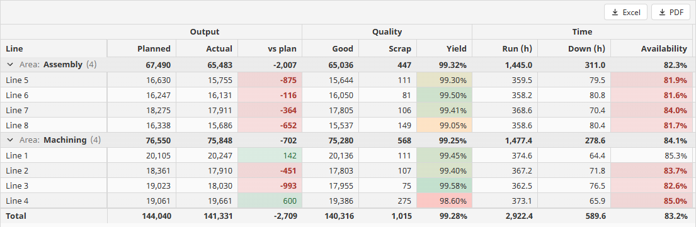

## Editing

Turn editing on per column with `editing.editable`. Then the grid works like a spreadsheet: typing over a cell starts
an edit and replaces the value, F2 or a double-click edits in place, Esc cancels, and Tab and Enter commit and move
on.

| Column key | Notes |
|---|---|
| `editing.editable` | Users can change this column's values. |
| `editing.newRowsOnly` | Editable only on rows added in the grid: for a lot or work-order number typed in for a new row and fixed once saved. Tab passes over it on saved rows; a new row starts in it. |
| `editing.editor` | `auto` picks from the type: text box, `number`, `date` / `datetime` / `time` (Alt+Down opens a picker), `checkbox` for true/false, `dropdown` for a lookup column. Or set `text`, `number`, `date`, `datetime`, `time`, `checkbox` or `dropdown` yourself. |
| `editing.required` | A value must be entered. An added row can't be left until it has one. |
| `editing.min` / `editing.max` | Numbers: the smallest and largest values allowed. |
| `editing.maxLength` | Text: the most characters allowed. `0` = no limit. |
| `editing.pattern` / `editing.patternMessage` | Text: the format the whole value must have, as a regular expression, and what to tell users when it doesn't match: `L\d{4}-\d{4}` with "Lot numbers look like L2026-0419". |

**Lookups store codes and show names.** A `type: lookup` column shows each value's label, and its dropdown editor
offers the labels:

```python
# props.columns: the visual check, stored as P / F / R
{"field": "Visual", "title": "Visual", "type": "lookup",
 "lookup": {"values": [{"value": "P", "label": "Pass"},
                       {"value": "F", "label": "Fail"},
                       {"value": "R", "label": "Rework"}]},
 "editing": {"editable": True, "required": True}}
```

**Validation as it is typed.** A value of the wrong type, a missing required value, a number outside `min`/`max`, too
long a text, or a text that doesn't fit the pattern is refused: the cell keeps focus and the user sees why.
`onValidationFailed` fires so you can log or count refusals.

**Keyboard data entry.** Tab moves right and, past the last editable cell, to the first editable cell of the next
row. `keyboard.enterMoves` sets where Enter goes: `down` (default), `right` (along the row like Tab, best for data
entry) or `none`. Read-only columns are skipped. Space toggles a true/false cell, Delete clears the selected cells,
and Ctrl+Z / Ctrl+Y undo and redo.

**Paste from Excel.** Ctrl+V pastes a block of cells into the editable cells, each value checked as if it were typed.
The grid says which cells weren't pasted, and why.

**Adding and deleting rows.** `editing.allowAdd` lets users add rows (right-click → Add Row); added rows go at the
bottom. `editing.allowDelete` lets users delete rows (right-click → Delete Rows, or Ctrl+Delete). Scripts can call
`addRow()` and `deleteSelectedRows()`.

**Set `source.keyField`.** With a key, edits are tied to the row's key, so they stay with the right row when the
data refreshes or is re-sorted, and your scripts get the key as `key`. Without one, rows are matched by position.

### Saving: cell by cell, or a reviewed batch

`editing.commit` picks how edits reach your scripts.

**`cell` (default): each change is saved as it is made.** Three events carry the edits:

| Event | When | Payload |
|---|---|---|
| `onCellCommit` | A user changed a value (also fired again by undo and redo). | `row` (source row index), `rowIndex` (position as shown), `key` (the key field's value), `column` (field), `value`, `oldValue`, `rowData` (the row with the new value). |
| `onRowInsert` | A user finished an added row: moved off it with every required value. | `insertId`, `values` (by field). |
| `onRowsDelete` | A user deleted rows. | `rows`, each `{row, key, rowData}`. |

Dates reach your scripts as epoch milliseconds: `system.date.fromMillis` makes them dates for a query.

```python
# onCellCommit on a QC entry grid (editing.commit = cell, source.keyField = Lot)
row = event.rowData
molded = row['MoldedAt']
system.db.runNamedQuery('QC/UpdateLot', {
    'Lot': event.key,
    'MoldedAt': system.date.fromMillis(molded) if molded is not None else None,
    'Thickness': row['Thickness'],
    'Visual': row['Visual'],
    'Inspector': row['Inspector'],
})
# Read it back, so a "Saved at" column fills in
self.refreshBinding('props.data')
```

```python
# onRowInsert: a new lot, finished
values = dict(event.values)
values['MoldedAt'] = system.date.fromMillis(values['MoldedAt'])
system.db.runNamedQuery('QC/InsertLot', values)
self.refreshBinding('props.data')
```

```python
# onRowsDelete
for deleted in event.rows:
    system.db.runNamedQuery('QC/DeleteLot', {'Lot': deleted['key']})
self.refreshBinding('props.data')
```

**`batch`: changes collect until a script saves them.** Each changed cell, added row and deleted row is marked, and
nothing is written until your Save button runs. `editing.changes` holds what is pending (bind a label to
`editing.changes.pending` for "3 changes not saved"). The component methods do the rest:

| Method | Does |
|---|---|
| `getChanges()` | The changes not yet accepted, as a dictionary: `pending` (a count), `inserts` (each `{insertId, values}`), `updates` (each `{row, key, changes, original, values}`) and `deletes` (each `{row, key}`). In an update, `changes` and `original` hold only the edited fields, new and old; `values` is the whole row as it is now. Dates are epoch milliseconds. |
| `acceptChanges()` | The changes were saved: clear their marks. The values keep showing until the data is refreshed. |
| `rejectChanges()` | Throw away every change not yet accepted; cells show the data again. |

`system.ectobox.datagrid.ApplyChanges` turns a Save button into a few lines. It runs your delete, update and insert
named queries for every changed row, deletes first, then changed rows, then added rows. Each query gets the **whole
row** as its parameters, by field name, each value converted by its column's type (a date as a date), so name the
named query's parameters after the grid's fields.

```python
# Save button's onActionPerformed, beside a batch-mode Datagrid named LotGrid
grid = self.getSibling('LotGrid')
changes = grid.getChanges()
result = system.ectobox.datagrid.ApplyChanges(
    changes, 'QC/InsertLot', 'QC/UpdateLot', 'QC/DeleteLot', database='PlantDB')
grid.acceptChanges()
grid.refreshBinding('props.data')
system.util.getLogger('QC.Lots').info('Lots saved: {0} added, {1} changed, {2} deleted'.format(
    result['inserted'], result['updated'], result['deleted']))
```

```sql
-- Named query QC/UpdateLot (an Update Query): parameters named after the grid's fields
UPDATE QcLots
SET MoldedAt = :MoldedAt, Thickness = :Thickness, Visual = :Visual, Inspector = :Inspector
WHERE Lot = :Lot
```

Pass `database` and the whole save is one transaction: if any row fails, nothing is saved, and the error says which
row. Because `ApplyChanges` raises before `acceptChanges()` runs, a failed save keeps its marks for the user to fix
and try again. A Discard button calls `grid.rejectChanges()`.

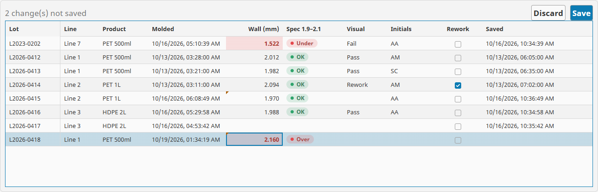

## Selection and copying

`selection.mode` sets what users can select: `multi-row` (default; Shift and Ctrl+click), `single-row`,
`cell-range` (a block of cells, like Excel) or `none`. The grid writes:

| Prop | Contents |
|---|---|
| `selection.selectedRows` | The selected rows as objects, every data column included. |
| `selection.activeCell` | The cell the keyboard is on: `row` (source row index), `rowIndex` (position as shown), `column` (field). |

A selection is a property like any other, so another component can bind to it with no script. Here, clicking a line
in one grid loads its downtime stops in the grid beside it, through a query binding whose `Line` parameter is:

```
try({../lines.props.selection.selectedRows[0].Line}, '')
```

`onSelectionChange` fires too, with `selectedRows` and `activeCell`.

**Copy.** Ctrl+C copies the selected cells; **Ctrl+Shift+C** copies them with their column titles, ready to paste
into Excel. Copies carry the real values, not the formatted text.

**From a script.** `scrollToRow(key)` brings the row with that key into view and makes it the active row, opening its
group if it is in a closed one. `selectRows(keys)` selects the rows with those keys and brings the first into view. A
row the filters hide stays hidden, and the grid tells the user which.

## Trees

Set `hierarchy.enabled` and the rows show as a tree: each row names its parent, and children are indented under it
with an expander. Grouping is off while the rows are a tree.

| Key | Notes |
|---|---|
| `hierarchy.idField` | The column that identifies each row: an ID, or a tag's full path. |
| `hierarchy.parentField` | The column holding each row's parent id. Blank, or an id that isn't in the data, makes a top-level row. |
| `hierarchy.treeColumn` | The column that carries the indent and the expander. Blank = the first visible column. |
| `hierarchy.startExpanded` | `none`, `firstLevel` (default) or `all`. |
| `hierarchy.hasChildrenField` | For trees loaded a level at a time (below). |

- **Sorting** orders siblings. **Filtering and search** keep the matching rows and the rows above them, so the path
  to each match stays visible.
- **Rollups.** Set a column's `summary.group` and each parent row shows its whole branch: its own row and every row
  below it, each counted once. An area's open work orders are its machines' plus their components'. A
  `formulaOverTotals` ratio is worked out over the branch's totals.
- **Keyboard.** On the tree column, Right opens a row or steps to its first child, and Left closes it or steps to its
  parent. The header menu has Expand All and Collapse All.

### Trees from parent ids

One table with an id and a parent id is all a tree needs. An equipment register with `AssetID` and `ParentAssetID`
shows as site → area → line → machine → component.

### Gateway trees: each level fetched as it opens

In gateway mode the same `hierarchy` settings work on a named query of any size. The gateway fetches each level as it
is opened, rather than the whole table. While users filter or search, the gateway returns the matches and every row
above them, opened. A level sends at most 10,000 rows and a search at most 50,000, and the grid says when there are
more. Footer totals cover every row, not only the levels opened.

### Lazy trees: children asked for when a row opens

For a tree whose children come from somewhere else, such as a tag browser, set `hierarchy.hasChildrenField` to a
true/false column that is true when a row has children not in the data yet. Opening such a row fires
`onExpandRequest` with `id`, `row`, `level` and `rowData`. Add the children (rows whose parent is this row's id) to
`data`, or clear the row's has-children value when it has none, and it shows "No items". The row shows "Loading…"
meanwhile, and says so if nothing arrives in 15 seconds.

```python
# onExpandRequest on a tag browser tree
# hierarchy: idField = Path, parentField = Parent, hasChildrenField = HasChildren
# Plain Python copies of the rows: the rows in a prop are Perspective objects, not dicts.
rows = system.util.jsonDecode(system.util.jsonEncode(self.props.data)) or []
parent = event.id
children = []
for tag in system.tag.browse(parent).getResults():
    children.append({
        'Path': str(tag['fullPath']),
        'Parent': parent,
        'Name': str(tag['name']),
        'HasChildren': bool(tag['hasChildren']),
    })
for row in rows:
    if row['Path'] == parent:
        # Its children are here now, or it has none and the grid shows "No items".
        row['HasChildren'] = len(children) > 0
self.props.data = rows + children
```

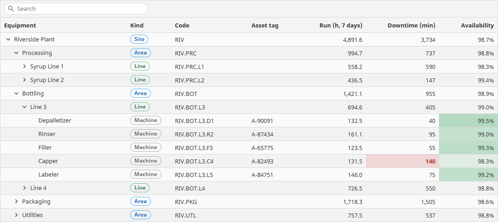
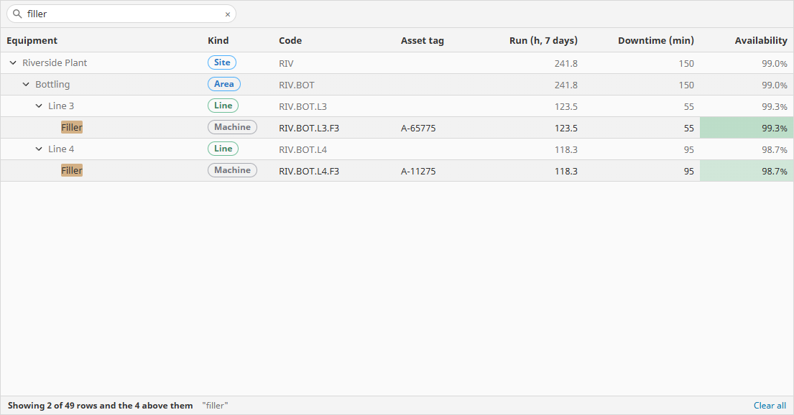

## Master-detail

`detail` opens a panel under a row, from the chevron at the start of the row or with Ctrl+Enter.

| Key | Notes |
|---|---|
| `detail.mode` | `none` (default), `view` (a Perspective view per open row) or `grid` (a read-only child grid of the rows that belong to this one). |
| `detail.height` | The panel's height in pixels (default 240). |
| `detail.single` | Only one row open at a time: opening one closes the other. |
| `detail.view.path` | `view` mode: the view to show. It gets params `row` (the row as an object), `key` (the key field's value, or the row index) and `rowIndex`: declare them as input params on the view. |
| `detail.grid.columns` | `grid` mode: the child grid's columns, the same column objects as the grid's own (formats, renderers, conditional styles, formulas). |
| `detail.grid.data` | Every detail row, as an array of objects or a dataset. Each open row shows its own. |
| `detail.grid.namedQuery` | Instead of `data`: a named query run for each opened row, with the row's `masterField` value in the parameter named `detailField`. At most 5,000 rows per row; the grid says when there are more. |
| `detail.grid.masterField` | This grid's column the detail rows belong to, such as `ID`. |
| `detail.grid.detailField` | The detail rows' column that holds it, such as `WorkOrderID`, and with `namedQuery`, the parameter's name. |

A detail grid is read-only, and live tag columns don't run in it. For editing or live tags under a row, put a Datagrid
in a detail view.

## Live tag columns

A live tag column shows the current value of each row's own tag, updating as the tag changes. Give the column a field
name of its own, a type, and a path template with `{Field}` for each data column it takes from the row:

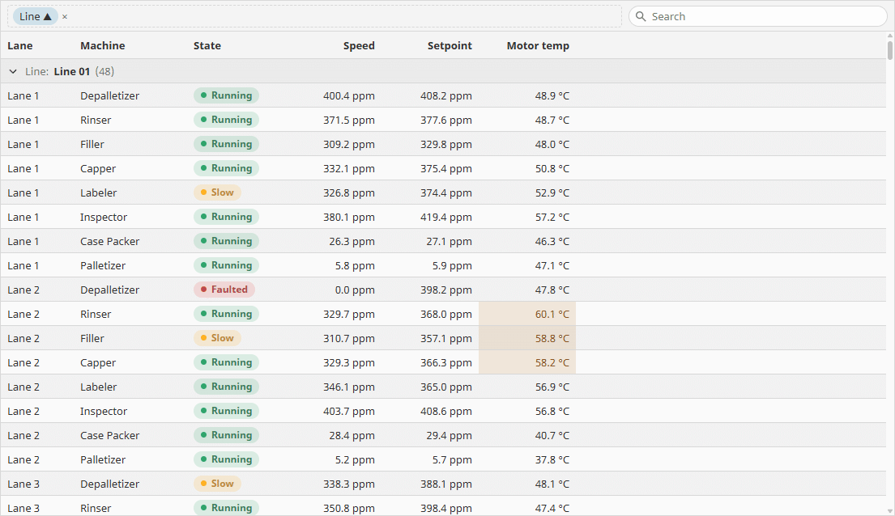

```python
# props.columns: each machine's state and speed setpoint, from rows of Line and Machine
{"field": "State", "title": "State", "type": "text",
 "tag": {"pathTemplate": "[default]Plant/{Line}/{Machine}/State"},
 "render": {"kind": "pill", "choices": [
     {"value": "Running", "color": "#30A46C"},
     {"value": "Starved", "color": "#FFB224"},
     {"value": "Faulted", "color": "#E5484D"}]}},
{"field": "Setpoint", "title": "Speed setpoint", "type": "float", "format": {"units": "bpm"},
 "tag": {"pathTemplate": "[default]Plant/{Line}/{Machine}/SpeedSetpoint"},
 "editing": {"editable": True, "min": 0, "max": 600}}
```

- **Only the rows on screen are subscribed**, and scrolling away unsubscribes them. So a live column can't be sorted,
  filtered or grouped by. Values reach the browser at most four times a second, and one grid subscribes at most
  10,000 tags.
- **Tag security applies.** Each tag is read with the user's own permissions. A tag the user may not read shows a dash
  and says so; its value never reaches the browser.
- **Writing back.** Turn on `editing.editable` and users can write the tag, one cell at a time. The value is checked
  against the column's rules (here 0 to 600) and the tag's write permission, and written with the user's security.
  A refused write shows the tag system's reason, such as a read-only tag. A tag write happens at once, so it can't be
  undone, and paste and Delete leave tag cells alone.
- **Cell states explain themselves.** A cell waiting for its first value, a row with no tag at its path, and a tag
  with bad quality each look different, with a tooltip saying why.
- **Export** reads each exported row's tags at the moment of the export. A tag that isn't good exports blank.

Live tag columns work in bound and gateway mode.

## Dragging rows between grids

`dragDrop` lets users drag rows from one grid onto another, such as tags from an Available list onto an Assigned
list. The grids never change their own data: your scripts save the change and refresh.

| Key | Notes |
|---|---|
| `dragDrop.dragOut` | Users can drag rows out of this grid: the selected rows when the pressed row is selected, otherwise just that row. |
| `dragDrop.dropIn` | Users can drop rows from other grids on this one. A grid never takes its own rows. |
| `dragDrop.group` | Grids exchange rows only when their groups match, such as `tags`. |

The target grid fires `onRowsDrop` with `rows`, `source` (`{view, path, name}`; `self.view.rootContainer.getChild(source.path)`
reaches the other grid when it is in this view) and `target` (`{row, rowIndex, rowData}` for the row dropped on, or
None). The source grid fires `onRowsDragOut` with `rows` and `target` (`{view, path, name}`).

## Export

Users can download the grid as an **Excel workbook**, a **CSV file** or a **PDF**: the rows as they see them,
filtered, sorted and grouped, with the columns in their order and formats, header bands, group subtotals and the
footer totals. Excel keeps numbers, dates and true/false as typed cells, so the sheet sums and charts like data typed
into Excel. The PDF is laid out for printing: the title, column titles and header bands on every page, long text
wrapped, page numbers. In gateway mode, an export covers every matching row, not just the ones loaded. A tree exports
every row with everything open.

| Key | Notes |
|---|---|
| `export.showButton` | A button for each file type at the right of the grid's toolbar. |
| `export.menu` | Offer Export to Excel / CSV / PDF on the header and cell right-click menus (default on). |
| `export.excel` / `export.csv` / `export.pdf` | Which file types users can download (all on by default). |
| `export.fileName` | The start of the file name; the date and time are added: "Downtime 2026-10-14 0905.xlsx". Blank = the component's name. |
| `export.csvDelimiter` | `comma`, `semicolon` (where Excel uses a decimal comma, most of Europe) or `tab`. |
| `export.pdfPaper` | `letter`, `a4`, `legal` or `tabloid`. |
| `export.pdfOrientation` | `auto` (landscape when the columns won't fit across portrait), `portrait` or `landscape`. |
| `export.pdfTitle` | The title at the top of the first page and the foot of every page. Blank = the file name. |

A PDF holds up to 10,000 rows. From a script, `grid.exportData('pdf')` downloads exactly what the user sees
(`'xlsx'`, the default, `'csv'` or `'pdf'`). To get a file's bytes in a script, to email it or save it, use
`ToXlsx`, `ToCsv` or `ToPdf` (see [Scripting](#scripting-systemectoboxdatagrid)).

## User layouts and saved views

Users can rearrange the columns at runtime: drag a header to move it (dropping it among pinned columns pins it), drag
its edge to resize, double-click the edge to fit, and right-click it to sort, pin, hide or show columns, or Reset
Layout. `layout` says what they may change and where their changes are kept:

| Key | Notes |
|---|---|
| `layout.persist` | `user` (default): saved on the gateway for the signed-in user, and back every time they open the view, on any device. A session with nobody signed in keeps it for the session. `session`: kept until the session ends. `none`: until the view closes. Nothing is kept from the Designer. |
| `layout.key` | Grids with the same key share one saved layout: the same grid on several views. Leave it empty for a layout per view and component. For an embedded view used in several places, bind it to something that tells them apart. |
| `layout.allowReorder` / `allowResize` / `allowPin` / `allowHide` | What users may change. |

Saved layouts are kept in the gateway's internal database, one per user per grid. There is nothing to set up.

The grid writes what users have changed to `state` (`order`, `widths`, `pinned`, `visible`). Only differences from the
design are kept, by field, so a saved layout still applies after you add or reorder columns in the Designer. To keep
layouts somewhere else, set `layout.persist` to `none` and bind `state`.

**Saved views.** `getState()` returns what the user has done to the grid's view as a dictionary you can store:
`columns` (order, widths, pinned, hidden), `sort`, `filters`, `search` and `groupBy`. `setState(state)` puts it back;
the parts you leave out stay as they are.

```python
# "Save view" button: keep the supervisor's view of the downtime log under a name
grid = self.getSibling('DowntimeGrid')
viewName = self.getSibling('ViewName').props.text
system.db.runNamedQuery('Views/Save', {
    'UserName': self.session.props.auth.user.userName,
    'ViewName': viewName,
    'StateJson': system.util.jsonEncode(grid.getState()),
})
```

```python
# "Open view" button
grid = self.getSibling('DowntimeGrid')
stateJson = system.db.runNamedQuery('Views/Load', {
    'UserName': self.session.props.auth.user.userName,
    'ViewName': self.getSibling('ViewPicker').props.value,
})
grid.setState(system.util.jsonDecode(stateJson))
```

`resetLayout()` puts the columns and sort back as designed and forgets the user's saved layout.

## Pivot Grid

The Pivot Grid (`ectobox.datagrid.pivot`) totals your rows by fields down the side and across the top. Feed it one
plain query, one row per event, and it does the rest: minutes of downtime by reason against each line, pieces scrapped
by defect against part, output by line against shift.

```python
# Pivot Grid props: unplanned downtime minutes, by category and reason, against area and line
# data: a query binding returning Area, Line, Category, Reason, StartTime, Minutes, Planned
{
  "rows":    [{"field": "Category", "sortBy": "value", "direction": "descending"},
              {"field": "Reason",   "sortBy": "value", "direction": "descending"}],
  "columns": [{"field": "Area"}, {"field": "Line"}],
  "values":  [{"field": "Minutes", "aggregate": "sum", "format": {"decimals": 0},
               "style": {"colorScale": {"enabled": True, "palette": "heat", "strength": "soft"}}}],
  "filters": [{"field": "Planned", "condition": "isFalse"}]
}
```

The worst reasons sort to the top, inside the worst categories, and the darker the cell, the more time lost.

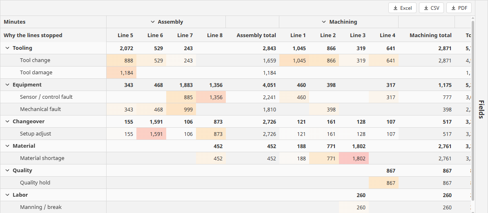

### Millions of rows: gateway mode

By default the pivot totals the rows in `data`, in the browser. For a big table, let the database do it: set
`source.mode` to `gateway` and `source.namedQuery` to a named query of type **Query**, and leave `data` unbound.

```python
# Pivot Grid props: a year of hourly production, totalled in the database
{
  "source":  {"mode": "gateway", "namedQuery": "Production/HourlyProduction", "parameters": {"Site": "Riverside"}},
  "rows":    [{"field": "Line"}],
  "columns": [{"field": "HourStart", "dateGroup": "month"}],
  "values":  [{"field": "Good", "aggregate": "sum"},
              {"aggregate": "formulaOverTotals", "formula": "[Good] / [Made]", "title": "Yield"}]
}
```

- **One query, the same answers.** The gateway adds a GROUP BY around your query, so only the totals leave the
  database, never the rows. Every number is exactly what bound mode shows for the same rows: dates are grouped by year,
  month, week, day, hour or shift in the viewer's time zone, text is grouped ignoring case, and a ratio such as yield
  is worked out from the totals.
- **Everything else works as in bound mode:** `filters` (they become part of the query), `exclude`, sorting by value,
  subtotals, the field panel and export.
- **Drill-down asks the database.** Double-clicking a cell lists the rows behind it, up to 5,000, fetched for that
  cell alone.
- **`parameters`** gives the named query's parameters (a site, a date range). Bind them for values that change. The
  query's own permissions apply.
- **The databases:** SQL Server and PostgreSQL are tested; MySQL and Oracle are supported. Date grouping needs one of
  those four. On SQLite, group dates in bound mode.
- **Group with care.** A pivot of more than 50,000 groups is refused with a message: filter first, or group dates more
  coarsely. Grouping by hour across a year, or a gateway in a different time zone from the viewer, makes many groups.

### Rows, columns and values

`rows` are the fields down the side and `columns` the fields across the top, outermost first. Each value of a field
is a member.

| Key (in `rows[]` and `columns[]`) | Notes |
|---|---|
| `field` | The data column, such as `Line`. |
| `title` | What its members are called in tooltips and the field panel. Blank = the field. |
| `dateGroup` | For a date column: `year`, `quarter`, `month`, `week` (ISO week), `day`, `hour` or `shift`, in the viewer's time zone. `none` = every distinct value. |
| `sortBy` / `direction` / `sortValue` | Order the members by `label` or by `value` (their total), `ascending` or `descending`; `sortValue` picks which value (0 = the first in `values`). |
| `exclude` | Members left out, by their label as shown (`Line 9`, `(Blank)`, `Mar 2026`). Their rows count nowhere, totals included. |

`values` says what each cell shows; several values give several columns under each column member.

| Key (in `values[]`) | Notes |
|---|---|
| `field` | The data column to total, such as `Good`. |
| `title` | The value's column title. Blank = the aggregate and the field. |
| `aggregate` | `sum`, `average`, `min`, `max`, `count` or `formulaOverTotals`. |
| `formula` | With `formulaOverTotals`: a formula over the sums of the fields it reads, such as `[Good] / [Actual]`. |
| `type` | `float`, `integer` or `duration`, with `format` for how the number reads. |
| `style` | Conditional styling and color scales, as on a Datagrid column. |

`formulaOverTotals` matters as much here as in the grid. With
`{"title": "vs plan", "aggregate": "formulaOverTotals", "formula": "[Actual] / [Planned]"}`, the third shift's
"vs plan" is its total made over its total planned, in every cell, subtotal and grand total, never an average of
hours.

**Shifts.** For `dateGroup: shift`, list your shifts in `shifts` (each a `name` and the local `start` time, `HH:MM`,
24-hour), or bind it to your shift table. A shift runs until the next one starts, past midnight too.

**Filters.** `filters` decides which rows count before anything is totalled, with the same conditions as the
Datagrid's filters.

### Totals, opening and labels

| Key | Notes |
|---|---|
| `totals.rows` | A grand total row at the bottom (default on). |
| `totals.columns` | Grand total columns at the right (default on). |
| `totals.columnSubtotals` | A total after each open column member's columns: a Q3 total after its months (default on). |
| `expand.rows` / `expand.columns` | What is open when the pivot first shows: `none`, `firstLevel` or `all` (default). Members open and close with their chevrons. |
| `labels.title` / `labels.width` | The row labels column's title (blank = the row fields' titles) and width (default 240). |

### Drill-down: where does this number come from?

Double-clicking a cell (`drillDown.enabled`, on by default) fires `onCellDrill`, and with `drillDown.popup` on, shows
the cell's rows in a grid over the pivot, up to 5,000. `drillDown.columns` sets that grid's columns, the same column
objects as the Datagrid's; empty shows every column of the data.

`onCellDrill` carries `value` (the cell's number), `valueTitle`, `filters` (one per row and column field above the
cell: `{field, dateGroup, key, label, value}`, where `value` is the member's raw value, and for a date group you use
`key` or `label`) and `rows` (the contributing rows, up to 5,000).

```python
# onCellDrill: open the downtime log filtered to the line and reason behind the number
params = {}
for f in event.filters:
    params[f['field']] = f['value']
system.perspective.openPopup('downtimeDetail', 'Downtime/EventList', params=params,
    title='{0} min: {1}'.format(int(round(event.value or 0)), event.valueTitle))
```

### The field panel

`fieldPanel.enabled` adds a panel beside the pivot where users move fields between rows, columns and values (drag, or
each field's menu), change how dates group and values total, and leave members out. It is off until you turn it on.
Their changes are written to `rows`, `columns` and `values`: bind those bidirectionally to keep them.
`fieldPanel.open` starts it open (users close it to a tab at the edge) and `fieldPanel.width` sets its width.

### Selection and export

`selection.mode` is `cell-range` (default; a block of cells to copy into Excel), `single-row` or `none`. The Pivot
Grid exports to Excel, CSV and PDF from its right-click menus or toolbar buttons, with the same `export` settings as
the Datagrid. The file carries the column members as header bands, every row member open with its subtotals, and the
grand totals.

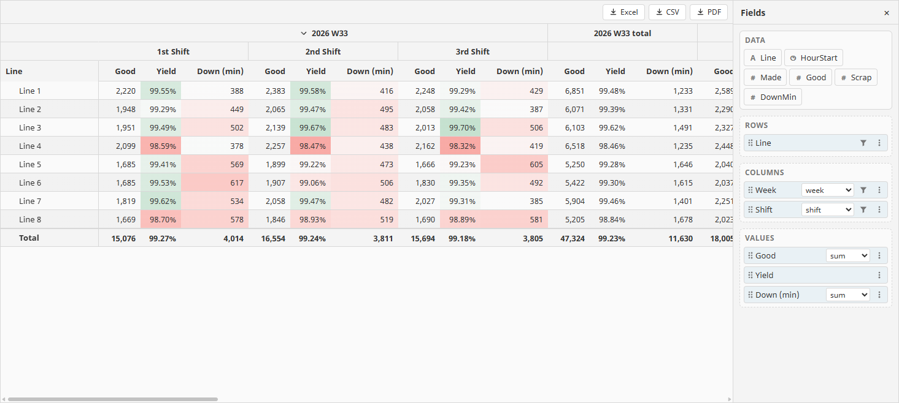
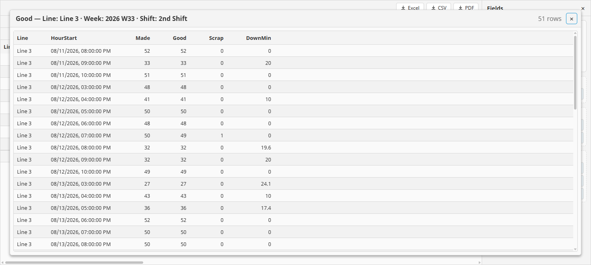

## Property reference

### Datagrid

| Prop | Notes |
|---|---|
| `data` | The rows (bound mode): a dataset, an array of objects, or an array of arrays. |
| `source` | Where the rows come from: `mode` (`bound`, `gateway`, `function`), `namedQuery`, `function`, `parameters`, `filterParameters`, `resultKey`, `paging`, `keyField`. |
| `columns` | Column definitions. Empty = every column in the data. |
| `sort` | The current sort, first key first. |
| `filtering` | `showFilterRow`, `showSearch`, `search`, `filters`. |
| `grouping` | `fields`, `showPanel`, `startCollapsed`. |
| `hierarchy` | Tree settings: `enabled`, `idField`, `parentField`, `treeColumn`, `startExpanded`, `hasChildrenField`. |
| `detail` | Master-detail: `mode`, `height`, `single`, `view`, `grid`. |
| `appearance` | `density` (`compact`, `normal`, `comfortable`), `maxLines` (1 to 20, for wrapped columns), `striped`, `gridLines` (`horizontal`, `vertical`, `both`, `none`), `colors`. |
| `selection` | `mode`; `selectedRows` and `activeCell` are written by the grid. |
| `keyboard` | `enterMoves`: `down`, `right` or `none`. |
| `editing` | `commit` (`cell` or `batch`), `allowAdd`, `allowDelete`; `changes` is written by the grid. |
| `export` | `showButton`, `menu`, `excel`, `csv`, `pdf`, `fileName`, `csvDelimiter`, `pdfPaper`, `pdfOrientation`, `pdfTitle`. |
| `dragDrop` | `dragOut`, `dropIn`, `group`. |
| `layout` | `persist` (`user`, `session`, `none`), `key`, `allowReorder`, `allowResize`, `allowPin`, `allowHide`. |
| `state` | What users have changed about the columns: `order`, `widths`, `pinned`, `visible`. Written by the grid. |
| `messages.noData` | Shown when there are no rows. Default "No rows to show". |
| `style` | The component's own style. |

### Pivot Grid

| Prop | Notes |
|---|---|
| `data` | The rows to total: a dataset, an array of objects, or an array of arrays. |
| `source` | `mode`: `bound` (default; the rows in `data`) or `gateway` (the database totals `namedQuery`, with `parameters`). See [gateway mode](#millions-of-rows-gateway-mode). |
| `rows` / `columns` | The fields down the side and across the top, outermost first. |
| `values` | What each cell shows. |
| `filters` | Which rows count, before anything is totalled. |
| `totals` | `rows`, `columns`, `columnSubtotals`. |
| `expand` | `rows`, `columns`: `none`, `firstLevel` or `all`. |
| `labels` | `title`, `width`. |
| `shifts` | Each shift's `name` and `start`, for `dateGroup: shift`. |
| `drillDown` | `enabled`, `popup`, `columns`. |
| `fieldPanel` | `enabled`, `open`, `width`. |
| `appearance` | As on the Datagrid. |
| `selection.mode` | `cell-range`, `single-row` or `none`. |
| `export` | As on the Datagrid. |
| `messages.noData` | Shown when there are no rows. |
| `style` | The component's own style. |

## Component methods

Call these on the Datagrid from any script that can reach it, for example `self.getSibling('WorkOrderGrid')`.

| Method | Does |
|---|---|
| `refresh()` | Gateway and function mode: run the source again, for a new row count and fresh rows. (In bound mode the rows come from your binding: refresh that, as in `self.refreshBinding('props.data')`.) |
| `getChanges()` | The edits not yet accepted (see [Saving](#saving-cell-by-cell-or-a-reviewed-batch)). |
| `acceptChanges()` | Clear the marks of saved changes. |
| `rejectChanges()` | Throw away every change not yet accepted. |
| `addRow()` / `addRow(values)` | Add a row at the bottom, optionally with some values filled in: `addRow({'Line': 'Line 3', 'Shift': 'B'})`. `editing.allowAdd` need not be on for scripts. |
| `deleteSelectedRows()` | Delete the selected rows, exactly as Ctrl+Delete does (needs `editing.allowDelete`). |
| `expandAllGroups()` / `collapseAllGroups()` | Open or close every group. |
| `clearFilters()` | Remove every filter and the search. |
| `resetLayout()` | Put the columns and sort back as designed and forget the user's saved layout. |
| `exportData()` / `exportData(format)` | Download the grid as the user sees it to this session's browser: `'xlsx'` (default), `'csv'` or `'pdf'`. |
| `scrollToRow(key)` | Bring the row with this key into view and make it the active row. The key is the `source.keyField` value (or, with no key field in bound mode, the row's index). |
| `selectRows(keys)` | Select the rows with these keys and bring the first into view. |
| `getState()` | The user's view as a dictionary: `columns`, `sort`, `filters`, `search`, `groupBy`. |
| `setState(state)` | Put back a view from `getState()`. |

## Events

### Datagrid

| Event | Payload |
|---|---|
| `onCellClick` | A cell was clicked: `row` (source row index), `rowIndex` (position as shown), `column` (field), `value`, `rowData` (the whole row). |
| `onCellDoubleClick` | A cell was double-clicked: `row`, `rowIndex`, `column`, `value`, `rowData`. |
| `onSelectionChange` | The selection or the active cell changed: `selectedRows`, `activeCell` (`{row, rowIndex, column}` or None). |
| `onCellCommit` | Cell commit mode: a user changed a value (also fired by undo and redo): `row`, `rowIndex`, `key`, `column`, `value`, `oldValue`, `rowData`. |
| `onRowInsert` | Cell commit mode: a user finished an added row: `insertId`, `values`. |
| `onRowsDelete` | Cell commit mode: a user deleted rows: `rows`, each `{row, key, rowData}`. |
| `onValidationFailed` | A value was refused (wrong type, required, min/max, length or pattern): `row`, `rowIndex`, `column`, `text` (what was typed), `message`. |
| `onCellAction` | A button cell was pressed, or a link cell with `opens: event` was clicked: `kind` (`"button"` or `"link"`), `row`, `rowIndex`, `column`, `value`, `rowData`. |
| `onExpandRequest` | A lazy tree row was opened: `id`, `row`, `level`, `rowData`. |
| `onRowsDrop` | Rows from another grid were dropped on this one: `rows`, `source`, `target`. |
| `onRowsDragOut` | This grid's rows were dropped on another grid: `rows`, `target`. |

A button that acts on its row:

```python
# onCellAction: an Acknowledge button on a fault list (render.kind = button)
if event.kind == 'button' and event.column == 'Ack':
    system.db.runNamedQuery('Faults/Acknowledge', {
        'FaultID': event.rowData['FaultID'],
        'UserName': self.session.props.auth.user.userName,
    })
    self.refreshBinding('props.data')
```

### Pivot Grid

| Event | Payload |
|---|---|
| `onCellDrill` | A cell was double-clicked: `value`, `valueTitle`, `filters`, `rows` (see [Drill-down](#drill-down-where-does-this-number-come-from)). |

## Scripting: `system.ectobox.datagrid.*`

Registered in gateway and Designer scope, so you get autocomplete and argument help while you write. Arguments may be
given by position or by keyword.

### `ApplyChanges(changes, insertQuery, updateQuery, deleteQuery, database)`

Saves a grid's edits with your named queries (see [Saving](#saving-cell-by-cell-or-a-reviewed-batch)).

| Argument | Notes |
|---|---|
| `changes` | What `grid.getChanges()` returned. |
| `insertQuery` | Named query path for an added row. Needed only when there are added rows. |
| `updateQuery` | Named query path for a changed row, such as `UPDATE ... WHERE Lot = :Lot`. Needed only when rows were changed. |
| `deleteQuery` | Named query path for a deleted row. Needed only when rows were deleted. |
| `database` | Optional. The database connection the named queries use. When given, the whole save is one transaction. |

Returns a dictionary of row counts: `deleted`, `updated`, `inserted`.

### `ToXlsx(dataset, columns, sheetName, timeZone)`

Makes an Excel workbook from a Dataset and returns its bytes: attach it to an email, save it with
`system.file.writeFile`, or download it with `system.perspective.download`. Numbers, dates and true/false are typed
cells; the header is bold and frozen, with AutoFilter.

| Argument | Notes |
|---|---|
| `dataset` | The rows: a Dataset, such as from `system.db.runNamedQuery`. |
| `columns` | Optional. A grid's column list (`grid.props.columns`) to take titles, number formats, lookup labels, widths and calculated columns from; hidden columns are left out. Leave it out to export every column as it is. |
| `sheetName` | Optional. The worksheet's name (Excel allows 31 characters). Default `Sheet1`. |
| `timeZone` | Optional. Dates are written as local times in this zone, such as `America/New_York`. Default: the gateway's. |

```python
# "Email this week's downtime" button
grid = self.getSibling('DowntimeGrid')
rows = system.db.runNamedQuery('Downtime/ThisWeek', {'LineName': 'Line 3'})
workbook = system.ectobox.datagrid.ToXlsx(rows, grid.props.columns, sheetName='Line 3 downtime')
system.net.sendEmail(
    smtpProfile='PlantMail',
    fromAddr='mes@plant.example.com',
    subject='Line 3 downtime, week {0}'.format(system.date.format(system.date.now(), 'w')),
    body='Attached: every stop on Line 3 this week.',
    to=['maintenance@plant.example.com'],
    attachmentNames=['Line 3 downtime.xlsx'],
    attachmentData=[workbook])
```

To download exactly what a user sees, with their filters, sort, groups and totals, call `grid.exportData('xlsx')`
instead.

### `ToCsv(dataset, columns, delimiter, timeZone)`

Makes CSV text from a Dataset: UTF-8 with the byte order mark Excel needs, quoted where needed, numbers at full
precision with a dot, dates as `yyyy-MM-dd HH:mm:ss` local time, TRUE/FALSE, lookups as their labels. Text that a
spreadsheet would run as a formula (starting with `=`, `+`, `-` or `@`) gets a leading `'` so it can't.

| Argument | Notes |
|---|---|
| `dataset` | The rows: a Dataset. |
| `columns` | Optional. A grid's column list, as for `ToXlsx`. |
| `delimiter` | Optional. `,` (default), `;` (where Excel uses a decimal comma) or `tab`. |
| `timeZone` | Optional. The time zone dates are written in. Default: the gateway's. |

### `ToPdf(dataset, columns, title, paper, orientation, timeZone)`

Makes a PDF from a Dataset and returns its bytes, laid out for printing or emailing: the title and when it was made at
the top, the column titles (and header bands) on every page, long text wrapped, numbers and dates formatted as the
grid formats them, and "Page n of m" at the bottom. At most 10,000 rows.

| Argument | Notes |
|---|---|
| `dataset` | The rows: a Dataset. |
| `columns` | Optional. A grid's column list, as for `ToXlsx`. |
| `title` | Optional. Printed at the top of the first page and the foot of every page. Default `Report`. |
| `paper` | Optional. `letter` (default), `a4`, `legal` or `tabloid`. |
| `orientation` | Optional. `auto` (default: landscape when the columns won't fit portrait), `portrait` or `landscape`. |
| `timeZone` | Optional. The time zone dates are written in. Default: the gateway's. |

```python
# "Print the shift's QC lots" button
grid = self.getSibling('LotGrid')
lots = system.db.runNamedQuery('QC/ShiftLots', {'Shift': 'B'})
pdf = system.ectobox.datagrid.ToPdf(lots, grid.props.columns, title='QC lots, B shift', paper='letter')
system.perspective.download('QC lots B shift.pdf', pdf)
```

### `EvaluateFormula(formula, rows)`

Works out a formula the same way a calculated column does, with the same language and the same answers, for scripts,
reports and checks. Give it one row (a dictionary) to get one value back, or a list of dictionaries or a Dataset to
get a list back, one value per row in order. With a list, `PREV`, `NEXT`, `RUNNINGSUM` and `RUNNINGCOUNT` read the
neighboring rows. Blank in, blank out: dividing by zero gives `None`. A formula with a mistake raises a `ValueError`
saying what and where. In a script, date parts such as `HOUR` are in the gateway's time zone.

| Argument | Notes |
|---|---|
| `formula` | The formula, such as `[Good] / ([Good] + [Scrap])`. Fields go in brackets. |
| `rows` | A dictionary (one row), a list of dictionaries, or a Dataset. |

```python
# One row: 0.96
firstPassYield = system.ectobox.datagrid.EvaluateFormula('[Good] / ([Good] + [Scrap])', {'Good': 480, 'Scrap': 20})

# Every line at the end of a shift: warn about any line under 98% yield
totals = system.db.runNamedQuery('Production/ShiftTotals', {'Shift': 'A'})
yields = system.ectobox.datagrid.EvaluateFormula('[Good] / ([Good] + [Scrap])', totals)
for i, lineYield in enumerate(yields):
    if lineYield is not None and lineYield < 0.98:
        system.util.getLogger('Production.Yield').warn('{0} A-shift yield {1:.1%} is under 98%'.format(
            totals.getValueAt(i, 'Line'), lineYield))
```

## Keyboard

| Keys | Does |
|---|---|
| Arrows, Home / End, Page Up / Page Down | Move the active cell. Ctrl with Up / Down goes to the first / last row. |
| Tab / Shift+Tab | Commit and move right / left; past the last editable cell, to the first editable cell of the next row. |
| Enter | Commit and move as `keyboard.enterMoves` says. |
| Typing | Start an edit, replacing the value. |
| F2, double-click | Edit in place. |
| Esc | Cancel the edit. |
| Backspace | Start an edit with the cell emptied. |
| Delete | Clear the selected editable cells. |
| Space | Toggle a true/false cell; press a link or button cell. |
| Alt+Down | Open the date picker or the dropdown. |
| Ctrl+C / Ctrl+Shift+C | Copy / copy with headers. |
| Ctrl+V | Paste into editable cells. |
| Ctrl+Z / Ctrl+Y | Undo / redo. |
| Ctrl+Delete | Delete the selected rows (with `editing.allowDelete`). |
| Ctrl+Enter | Open or close the row's detail panel. |
| Right / Left (tree column) | Open a row or step to its first child / close it or step to its parent. |
| Shift+F10, Menu key | Open the right-click menu at the active cell. |

## Theming & CSS

Colors follow the session's theme, light, dark or your own, with no setup. To restyle one grid, set
`appearance.colors`. To restyle every grid, set the matching CSS variable in your theme instead:

| `appearance.colors` | CSS variable | Colors |
|---|---|---|
| `background` | `--ecto-grid-bg` | Cell background. |
| `text` | `--ecto-grid-fg` | Cell text. |
| `headerBackground` | `--ecto-grid-header-bg` | Header background. |
| `headerText` | `--ecto-grid-header-fg` | Header text. |
| `stripe` | `--ecto-grid-stripe` | Shading on every other row. Use a see-through color, so the selection shows through. |
| `hover` | `--ecto-grid-hover` | The row under the mouse. |
| `selection` | `--ecto-grid-selected` | Selected rows and cells. |
| `activeCell` | `--ecto-grid-active` | Outline of the cell the keyboard is on, and of the editor. |
| `gridLines` | `--ecto-grid-line` | Lines between cells. |
| `border` | `--ecto-grid-border` | Border around the grid. |
| `changed` | `--ecto-grid-changed` | Marker on edits not saved yet, and on added rows. |

```css
/* Plant standard: unsaved edits marked in amber */
:root {
  --ecto-grid-changed: #FFB224;
}
```

## Feedback

Found a problem, or a grid requirement it can't meet? Please
[open an issue](https://github.com/Ectobox/EctoboxIgnitionModules/issues).
