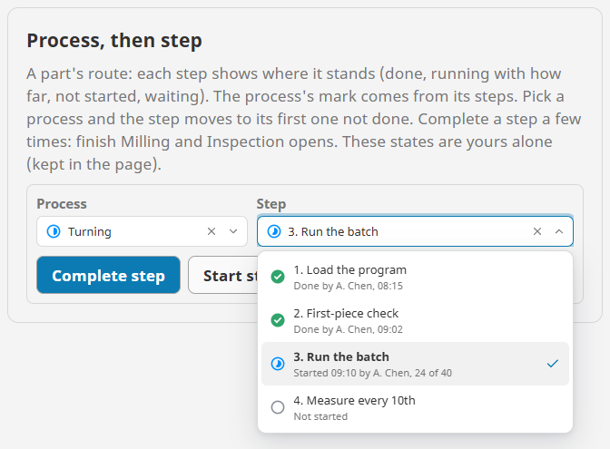
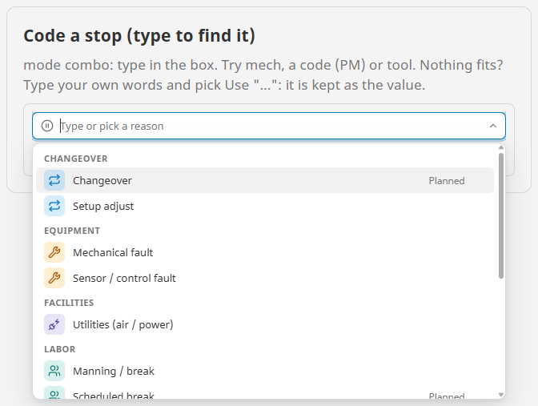

# Dropdown

**⬇ [Download the Ectobox Perspective Component Suite](https://github.com/Ectobox/EctoboxIgnitionModules/releases/latest/download/Ectobox-Perspective-Component-Suite-8.3.modl)**, which includes Dropdown.

Pick from a list. By default there is no typing: open the list, or press a letter and the box jumps to the row it
starts, as a computer's own lists do. Set `mode` to `combo` and the box takes typing to filter. The same control picks
the line that takes the next order, a process and then its step, a downtime reason, one work order among hundreds, or
the lines a report covers.

- **Rows that say where things stand.** An icon from Lucide or Material in its tone's colour, or in a tinted tile; a
  second line; a word at the right in a colour (Running, Starved, Down); group headings; disabled rows that say why
  when you point at them.
- **Status marks.** A row can show done (a green tick), in progress (a blue ring that fills with how far it has got),
  not started, waiting, skipped, needs attention or failed. A parent's mark can be rolled up from its children: a
  process is done when all its steps are, in progress when any has started, and says "2 of 5".
- **A list that follows another.** Steps under the picked process: when the process changes, the step moves to the
  first one not done (or the first, or none), and keeps a step that still belongs.
- **Several at once.** `multiple`: a box on each row, Select all, Clear and Done; the box says the picks (All lines
  for every one) and how many.
- **Long lists stay quick.** From 12 options the list gets its own search field, and only the rows on screen are drawn:
  5,000 options scroll as smoothly as 5. For lists too big for the browser, `search` server asks the gateway.
- **It opens from the box.** The list grows out of the box with a small spring, down, or up when there is no room below
  (or always one way, if you say so). On a phone it is a sheet from the bottom with rows sized for a thumb. When the
  computer asks for reduced motion, it just appears.



## Install

Dropdown comes in the **[Ectobox Perspective Component Suite](PerspectiveComponentSuite.md)**, one module with all of
Ectobox's Perspective controls.

1. Download **`Ectobox-Perspective-Component-Suite-8.3.modl`** from the [Releases](https://github.com/Ectobox/EctoboxIgnitionModules/releases/latest/download/Ectobox-Perspective-Component-Suite-8.3.modl) list.
2. In the gateway's web interface, open the **Modules** page → **Install or Upgrade a Module** → pick the file (accept
   the Ectobox certificate on first install), and restart the gateway when it asks.
3. Open a project in the Designer. **Dropdown** appears in the component palette under the **Ectobox** category four
   times: lines with their state, downtime reasons to type in (combo), lines to pick several of (multiple), and steps
   with their status marks.

## Quick start

### Rows from a named query

Bind `options` to a named query whose columns are named as the row's fields. Return Format can stay at Dataset.

```sql
SELECT l.Code AS value, l.Name AS label, l.Area AS [group],
       N'lucide/factory' AS icon,
       CASE s.State WHEN 1 THEN N'Running' ELSE N'Stopped' END AS trailing,
       CASE s.State WHEN 1 THEN N'good' ELSE N'bad' END AS trailingTone,
       CAST(CASE WHEN s.State = 3 THEN 1 ELSE 0 END AS bit) AS disabled,
       N'Stopped: it takes no new order until it runs again.' AS reason
FROM Plant.Lines l ...
```

Bind `value` both ways to a custom property or a tag. It holds the picked row's `value`, or null (with `multiple`, a
list of them).

| Row field | What it does |
|---|---|
| `value` | What `value` holds when the row is picked. The only field a row needs. |
| `label` | The row's text, and what the box shows once picked. Empty shows the value. |
| `description` | A second, smaller line. When any row has one, every row is two lines tall. Searched too. |
| `icon` | An icon before the label: `lucide/factory`, `material/engineering`, any Ignition icon library, or a picture's URL. |
| `tone` | The icon's colour: `neutral`, `accent`, `good`, `warning`, `bad`, `info`, `violet`, `teal`. |
| `tile` | True puts the icon in a small tile tinted by `tone`. |
| `status` | `done`, `active`, `todo`, `waiting`, `skipped`, `warning` or `error`: the mark drawn before the label, in place of the icon. |
| `progress` | With `active`: how far it has got, 0 to 1 (0.4 fills the ring 40%). |
| `badge`, `badgeTone` | A short word after the label, and its colour. |
| `trailing`, `trailingTone` | Text at the right, e.g. Running in `good`. |
| `group` | A heading the row sits under. Rows of a group stay together while filtering. |
| `keywords` | Hidden words the row is also found by when typing: a list, or one text split on `;` `,` or `\|`. |
| `parent` | The value of the parent row this one belongs to (a step's process). |
| `disabled`, `reason` | Greyed, skipped by the keys; `reason` says why when it is pointed at. |

Any other columns ride along: `onChange` hands the whole row to your script as `event.option`.

### A process, then its step

Bind both Dropdowns to the same list of steps (each with `parent` and `status`):

| | Property | Set to |
|---|---|---|
| Process | `options` | the processes |
| | `statusFrom` | the steps: each process takes its mark from its steps |
| Step | `options` | the steps |
| | `filterByParent` | true: only the steps whose `parent` is `parentValue` |
| | `parentValue` | a binding to the Process's `value` |
| | `afterParentChange` | `next` (default): the first step not done or skipped; `first`; or `clear` |

A process is **done** when every step is done or skipped, **failed** or **needs attention** when any step is,
**in progress** when any step has started or finished (the ring filled with the share done), **waiting** when every
step waits, and **not started** otherwise. With `statusCount` on (default) a process with no trailing text of its own
says **2 of 5**. A process's own `status` wins over its steps'.

When the process changes, a step that still belongs to it is kept, so a page that loads, or a binding that arrives
late, never loses a good value. `onChange` fires with reason `parent` when the step moves.

### Typing (combo) and your own words

`mode` combo types in the box: every word must match the label, the second line or a keyword, the best matches first
and highlighted (Search Select's rules). With `allowCustom`, what was typed is offered as its own row, **Use "..."**,
always last, so Enter takes the best match and never the raw text by surprise. Picked, `value` is that text and
`onChange` says `custom` true.



### Searching on the gateway

For lists too big to send to the browser, set `search` to `server`. After a pause in typing (`debounce`, 250 ms) and
from `minChars` characters (2), the box writes `searchText` and fires `onSearch`; write the answer to `options`, and
skip it if `searchText` has moved on (a late answer). This is the same handshake as
[Search Select](SearchSelect.md#searching-on-the-gateway).

## Settings

| Property | What it does |
|---|---|
| `mode` | `select` (default): pick, no typing. `combo`: type in the box to filter. |
| `multiple` | Pick several; `value` is a list. |
| `placeholder` | What the empty box says. |
| `icon` | An icon at the left while nothing is picked (a picked row's own mark or icon shows there once it is). |
| `size` | `small` 29 px, `medium` 34 (default), `large` 41, `touch` 48: Search Select's and the Segmented Control's heights. |
| `look` | `outline` (default), `soft` (filled, no line), `quiet` (only text and chevron until pointed at, for toolbars). |
| `clearable` | On (default): an × clears `value`. |
| `monospace` | Labels in a fixed-width font, for codes that line up. |
| `enabled` | Off greys the control; it can't be opened. |
| `loading` | A spinner, Loading... when empty, and it won't open. |
| `required`, `requiredText` | Once opened and left empty, the box turns red and says `requiredText` (Required). |
| `listSearch` | A search field in the list: `auto` (default, from 12 options), `always`, `never`. |
| `allowCustom` | combo: what was typed can be kept as the value. |
| `order` | While typing: `best` (default) or `list` (the options' order). |
| `highlight` | On (default): the typed words are marked in each row. |
| `rows` | Rows shown before the list scrolls (8); group headings among them don't count. |
| `listWidth` | The list's width in px when it should be wider than the box (0: the box's). |
| `opens` | `auto` (default): down, or up when there isn't room below and there is more above. `down` or `up`: always. |
| `popup` | `auto` (default): a sheet from the bottom on a screen under 600 px wide, a menu elsewhere. `menu` or `sheet`: always. |
| `title` | The sheet's heading (the placeholder when empty). |
| `motion` | `spring` (default), `fade` or `none`. |
| `followSystemMotion` | On (default): no motion when the computer asks for reduced motion. |
| `statusInBox` | On (default): the picked row's status mark shows in the box. |
| `noun` | What the options are, plural: "Search 139 work orders", "All lines". |
| `emptyText` | What the list says with nothing to pick, e.g. Pick a process first. |
| `filterByParent`, `parentValue`, `afterParentChange` | A list that follows another (above). |
| `statusFrom`, `statusCount` | Marks rolled up from child rows (above). |
| `search`, `minChars`, `debounce`, `searchText` | Searching on the gateway (above). |

The text sits centred on the capitals in the theme's font, and the icon and the chevron sit as far from the left and
right borders at every size. Light, dark and custom themes work through Perspective's theme variables.

## Events

| Event | When | Payload |
|---|---|---|
| `onChange` | A person picked, cleared or kept typed text, or the parent's change moved the value (not a binding's change) | `value`, `previous`, `option` (the row, or a list of rows with `multiple`), `reason` (click, key, clear, all, custom or parent), `custom` |
| `onOpen` | The list opened (load costly options here) | |
| `onClose` | The list closed | |
| `onSearch` | `search` server: a pause in typing with a new text | `text` |

## Keyboard

On a closed box, Space, Enter, Alt+Down, Down and Up open the list on the picked row, and a letter picks the next row it
starts without opening it; letters typed quickly make a word (l, i, n, e, space, 4 picks Line 4). On an open list, Up,
Down, Page Up, Page Down, Home and End move past headings and greyed rows, Enter or Space picks, Escape closes with
nothing changed, and a letter starts the list's search field when it has one. Screen readers hear a combo box and its
list of options.
