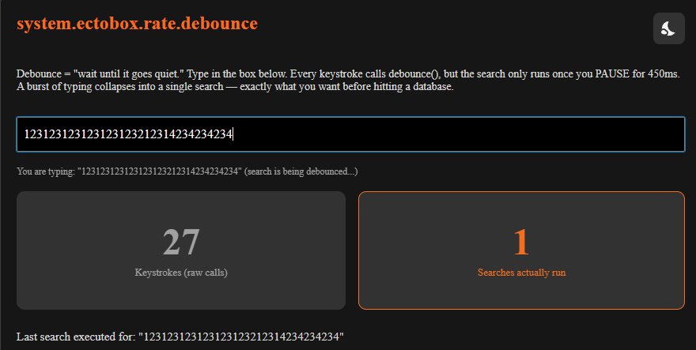
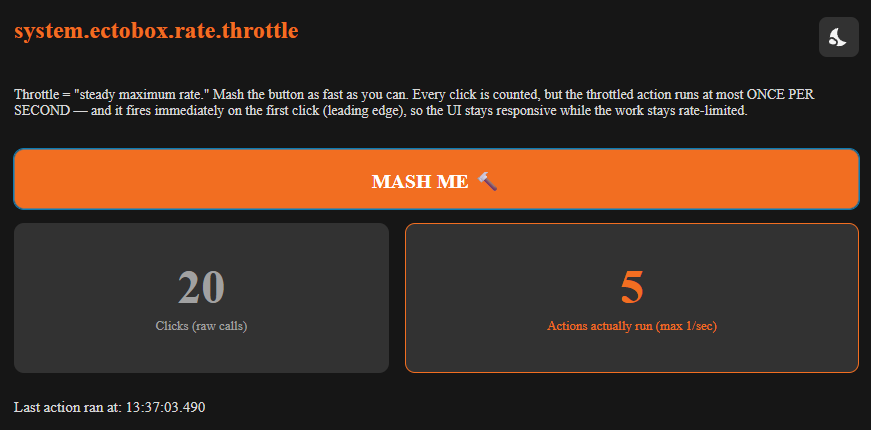

# Ecto Ignition Library

A free Ignition 8.3 module that adds Ectobox scripting utilities to the `system.*` namespace. It's a
home for small, reusable Jython helpers: rate-limiting (`system.ectobox.rate`), and reading and writing Excel
workbooks and CSV files (`system.ectobox.excel`). Every function is fully
documented in the Designer's script editor, with real parameter names and descriptions in autocomplete.



## Install

The Ecto Ignition Library comes in the **[Ectobox Perspective Component Suite](PerspectiveComponentSuite.md)**, one module with all of Ectobox's Perspective controls.

1. Download **`Ectobox-Perspective-Component-Suite-8.3.modl`** from the [Releases](https://github.com/Ectobox/EctoboxIgnitionModules/releases/latest/download/Ectobox-Perspective-Component-Suite-8.3.modl) list.
2. In the gateway's web interface, open the **Modules** page → **Install or Upgrade a Module** → pick the file (accept the Ectobox certificate on first install), and restart the gateway when it asks.
3. The functions are available immediately under `system.ectobox.rate` and `system.ectobox.excel` in both the Gateway and Designer scopes.

Had it installed as a module of its own? Uninstall that module and install the suite: your projects need no changes. See [Moving from the separate modules](PerspectiveComponentSuite.md#moving-from-the-separate-modules).

## `system.ectobox.rate`

| Function | What it does |
|---|---|
| `debounce(key, delayMs, function[, args])` | Runs `function` once `delayMs` has passed with no further calls on `key`. Coalesces bursts into a single action. |
| `throttle(key, intervalMs, function[, args])` | Runs `function` immediately, then suppresses calls for `intervalMs`. The most recent call during the window fires once when it closes. |
| `cancel(key)` | Cancels a pending debounce (and clears throttle state) without running the function. Returns `True` if something was pending. |
| `flush(key)` | Runs a pending call right now instead of waiting — a pending debounce and/or a throttle's queued trailing call. Returns `True` if anything fired. |

`function` is any callable — a `def`, `lambda`, or bound method. Give it arguments either by closing
over what you need or by passing an `args` list/tuple. `debounce` and `throttle` return the `key`, so
you can keep it to `cancel`/`flush` later.

### Examples

```python
# Debounce: only refresh after the user stops clicking for half a second.
def send():
    system.perspective.sendMessage("refresh", {"target": target},
                                   sessionId=sessionId, pageId=pageId)
system.ectobox.rate.debounce(sessionId + "::refresh", 500, send)

# Debounce with args instead of a closure.
system.ectobox.rate.debounce("recalc", 300, recalcTotals, [orderId])

# Throttle: write to a tag at most once per second while a value chatters.
system.ectobox.rate.throttle("tank1::level", 1000, updateHistorian, [newLevel])
```


### How `key` works

Calls that share a `key` are the same debounce/throttle. Pick a string that identifies the *action*
and its context — e.g. `sessionId + "::refresh"` keeps each Perspective session independent. Reusing
a key across unrelated actions will make them coalesce; that's the whole mechanism.

## Behavior notes

- **Threads:** timing and execution are split across two pools. A single-thread scheduled executor
  handles *timing only* — when a timer elapses it hands the callback to a cached execution pool, which
  takes microseconds, so one timing thread drives every key. The cached pool has zero core threads and
  spins up a worker per callback that needs to run right now, reclaiming it after 30s idle — so a slow
  callback can never delay the *timing* of another key, and an idle gateway holds zero live threads.
  Scheduling and cancelling are O(1); no thread ever sleeps out a delay.
- **Where the callable runs:** on a background worker thread — *except* a throttle's leading edge and
  `flush`, which run synchronously on the caller's thread (they're meant to fire immediately). For
  gateway/Perspective calls, pass explicit context (e.g. `sessionId`/`pageId`, tag paths) rather than
  relying on the calling thread's context, keep the callback short, and offload heavy work.
- **Timing source:** throttle intervals use a monotonic clock (`System.nanoTime()`), so a system
  clock/NTP adjustment won't make a window fire early or stall.
- **Scope isolation:** the module registers in the Gateway and Designer scopes, each with its own
  independent registry (they run in separate JVMs). A gateway event and a Designer-console test with
  the same key do not collide.
- **Errors:** exceptions thrown by your function are logged under the `EctoIgnitionLib.Rate` logger
  and swallowed, so one bad run can't take down the scheduler.

## `system.ectobox.excel`

Excel workbooks and CSV files to Datasets and lists, and back. Read a client's spreadsheet straight from a File
Upload without saving it anywhere, or make a report for download. Nothing to install: .xlsx and CSV are read and
written with Java's own zip and XML support, and old .xls workbooks with the Apache POI library Ignition already ships.

| Function | What it does |
|---|---|
| `Read(source, sheet=None, header=True, asList=False, typed=True, maxRows=100000, delimiter=None, dayFirst=False, timeZone=None)` | Reads an .xlsx, .xls or CSV file into a Dataset, or a list of dicts with `asList=True`. |
| `Sheets(source)` | A workbook's sheets: a list of dicts with `name`, `rows` (rows with something in them, the header counted) and `hidden`. |
| `Write(data, path=None, format=None, columns=None, sheetName='Sheet1', delimiter=None, timeZone=None)` | Writes an .xlsx workbook or a CSV file. With no `path`, returns the bytes. |

### Examples

```python
# A File Upload's onFileReceived: a client's CSV or workbook, parsed in memory, never saved.
rows = system.ectobox.excel.Read(event.file.getBytes(), asList=True)
for row in rows:
    system.db.runNamedQuery('Parts/Upsert', {'part': row['Part'], 'qty': row['Qty']})

# Pick a sheet by name (or by number from 0).
ds = system.ectobox.excel.Read('/data/imports/plan.xlsx', sheet='Week 12')

# A two-sheet report for download. A list of (name, data) pairs keeps the sheet order.
data = system.ectobox.excel.Write([('Orders', orders), ('Lines', lines)])
system.perspective.download('report.xlsx', data)

# CSV to a folder on the gateway (the format comes from the extension).
system.ectobox.excel.Write(ds, path='/data/exports/today.csv')
```

### Reading

- **`source`:** bytes (`event.file.getBytes()`, `system.file.readFileAsBytes`, a database blob), an upload's file
  itself (`event.file`), a file path on the gateway, or CSV text (text with a line break in it). The kind of file
  comes from its contents, not its name.
- **Types:** a column takes a type only when every filled cell in it is that type: whole numbers make an Integer
  column (Long past 2,147,483,647), other numbers Double, true/false Boolean, dates Date. Anything else is a String
  column, with each value as Excel shows it. `typed=False` gives every column as text.
- **Text that reads as a value counts as one** (a CSV is all text): `1234`, `-1.5`, `1,234.50` and `1.2E+05` are
  numbers, `true`/`false` are booleans, `2026-03-14 13:05` and `3/14/2026 1:05 PM` are dates. A leading zero keeps a
  value text (`00123` is a part number, not 123), and so does a whole number too long for a Long (an ID keeps every
  digit).
- **Slash dates** like `03/04/2026`: a column with a first part past 12 is read day first, one with a second part past
  12 month first. When nothing in the column says, `dayFirst` decides: False (default) reads 03/04/2026 as March 4, True as 3 April.
- **Formula cells** give the value Excel last calculated. Error cells (`#N/A`) are empty.
- **Names:** the header row's text. A blank one takes its column's letter, and a repeat gets ` 2`, ` 3`. With
  `header=False` the columns are named A, B, C.
- **Rows with nothing in them** are left out. The first sheet that isn't hidden is read unless `sheet` says otherwise.
- **CSV as clients send it:** UTF-8 with or without Excel's byte order mark, UTF-16 (Excel's "Unicode Text"),
  Windows-1252 (Excel's plain CSV on a Western PC). Comma, semicolon, tab or bar, found from the first lines or from
  Excel's `sep=;` line. Quoted values may hold the delimiter, quotes and line breaks.
- **Limits:** a sheet with more than `maxRows` data rows raises an error rather than handing back part of it, and no
  read holds more than 20 million cells, or more than 64 million characters of text from an .xlsx. Workbooks from anywhere are safe to open: XML entity tricks are refused, a
  part that unpacks past 2 GB stops, and a CSV value past 1,000,000 characters (an unclosed quote) is an error.
- **Dates** are wall times, read in the gateway's time zone unless `timeZone` names another.

### Writing

- **`data`:** a Dataset (or PyDataSet), a list of dicts, or a list of lists (the first is the header unless `columns`
  is given). For several sheets, a dict of sheet name to data, or a list of `(name, data)` pairs to set their order.
- **`columns`:** pick and order the columns to write.
- **Workbooks** have typed cells (numbers, true/false, dates shown `yyyy-mm-dd`, with `hh:mm:ss` in a column where
  any has a time), a bold header that is frozen and filtered, and columns as wide as their values. Text with a line
  break wraps. Text is never a formula.
- **CSV** is UTF-8 with the byte order mark Excel needs, quoted where needed, numbers in full with a dot. Text
  starting with `=` `+` `-` `@` gets a leading `'` so a spreadsheet never runs it as a formula. `delimiter` takes
  comma, semicolon, tab or one character, and a `.tsv` path defaults to tab.
- **Nothing is changed quietly.** A whole number past 15 digits is written as text, because Excel would round it.
  Text past 32,767 characters, or more rows or columns than a sheet holds, raises an error naming the cell.
- **A `path`** is written beside the file and moved into place, so nothing reads half a file. Old `.xls` isn't
  written: Write makes `.xlsx` and CSV.

Errors raise `ValueError` with a plain message: `Read: there is no sheet named 'Orders': the workbook has 'Plan', 'Notes'`.
