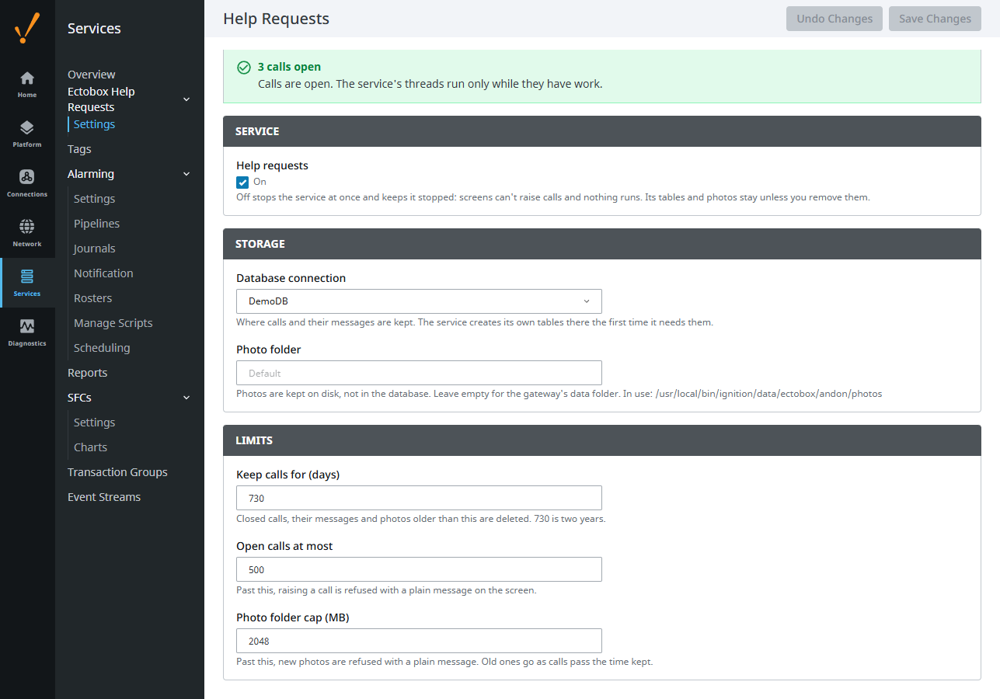
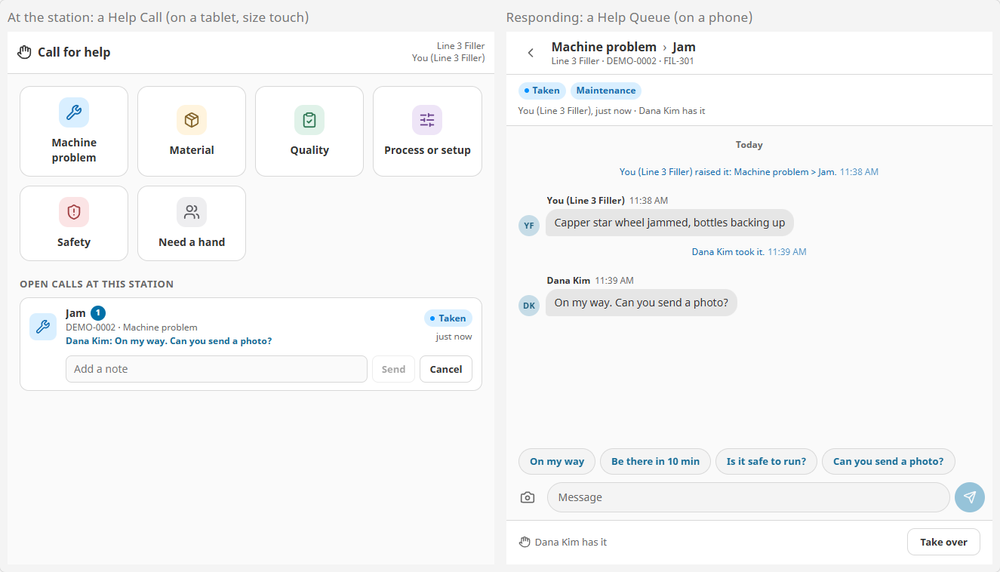

# Help Requests

**⬇ [Download the Ectobox Perspective Component Suite](https://github.com/Ectobox/EctoboxIgnitionModules/releases/download/modules/Ectobox-Perspective-Component-Suite-8.3.modl)**, which includes Help Requests.

An andon for Perspective: a station asks for help (a machine problem, material, quality), the right team is told, they
take it, talk to the station and close it, and if nobody takes it in time it escalates up a chain. Three controls and a
small gateway service:

- **Help Call**, on each station: big tiles for the topic, then its detail (Machine problem, then Jam), an optional
  note and up to 4 photos, then **Check and send**. Below them, the station's open calls with their chat, and Cancel.
- **Help Queue**, for responders on a phone, tablet or desk: the calls for the teams the signed-in user's roles put
  them on, urgent and escalated first. Take, On my way, I'm here, Running again in, Done (with what it was), Take over,
  and a chat with the station with quick replies and the camera.
- **Help Board**, on a wall screen: an area's open calls as cards, with their chat and buttons, and the areas down the
  left with their counts (red when a call there is urgent or escalated).
- **The Help Requests service** on the gateway routes each call, keeps the open ones in memory, writes everything to a
  database you choose, keeps photos as files, and escalates on time. It is dormant until you give it a database.


## Install

Help Requests come in the **[Ectobox Perspective Component Suite](PerspectiveComponentSuite.md)**.

1. Download **`Ectobox-Perspective-Component-Suite-8.3.modl`** from the [Releases](https://github.com/Ectobox/EctoboxIgnitionModules/releases/download/modules/Ectobox-Perspective-Component-Suite-8.3.modl) list.
2. In the gateway's web interface, open the **Modules** page → **Install or Upgrade a Module** → pick the file (accept
   the Ectobox certificate on first install), and restart the gateway when it asks.
3. Open **Services → Ectobox Help Requests → Settings** in the gateway's web interface and pick a database connection
   (below).
4. In the Designer, **Help Call**, **Help Queue** and **Help Board** are in the component palette under **Ectobox**.

## Set it up

### 1. The service



| Setting | What it does |
|---|---|
| Help requests (On) | Off stops the service at once and keeps it stopped: screens can't raise calls and nothing runs. |
| Database connection | Where calls and their messages are kept. SQL Server and PostgreSQL. None: the service stays dormant. |
| Photo folder | Photos are files, not database rows. Empty: `data/ectobox/andon/photos` in the gateway's data folder. |
| Keep calls for (days) | Closed calls, their messages and photos older than this are deleted. 730 (two years) by default. |
| Open calls at most | Past this (500 by default), raising a call is refused with a plain message on the screen. |
| Photo folder cap (MB) | Past this (2048 by default), new photos are refused with a plain message. |

The first time it needs them, the service creates its tables in a schema named **Ectobox**: `AndonCalls`,
`AndonMessages`, `AndonPhotos`, `AndonEvents` and `AndonSchemaVersions`. The settings are kept in the gateway's config
files like any other setting.

`AndonSchemaVersions` holds the version of the tables. Version 2 (suite 1.5.68) adds `AndonCalls.TakenByUser`: the
user name of whoever took the call, so two responders with the same name are two people. Tables made by an older suite
get the column the first time the service loads them, and calls taken before then are matched by name as before. The
1.5.29 suite refuses version 2 tables ("made by a newer version of the module"): once 1.5.68 has used a database,
1.5.29 can't use it.

**Turning it off**: switch it off and Save, then choose **Keep** (the tables and photos stay, and turning it back on
carries on where it left off) or **Remove** (type REMOVE: it drops only the tables it created, the schema too if it
created it and it is empty, and deletes only the photos it named).

### 2. Teams and topics

Both are lists on the controls, so a screen's behaviour is set where the screen is built. Keep each list in one place
(a project script or a dataset tag) and bind every control to it.

```python
teams = [
	{'id': 'maintenance', 'label': 'Maintenance', 'role': 'Maintenance', 'tone': 'blue', 'icon': 'lucide/wrench'},
	{'id': 'warehouse', 'label': 'Warehouse', 'role': 'Warehouse', 'tone': 'amber', 'icon': 'lucide/package'},
	{'id': 'supervisor', 'label': 'Shift supervisor', 'role': 'Supervisor', 'tone': 'violet', 'icon': 'lucide/user-check'},
]
topics = [
	{'id': 'machine', 'label': 'Machine problem', 'icon': 'lucide/wrench', 'team': 'maintenance',
	 'escalation': ['supervisor'], 'escalateMinutes': 10,
	 'children': [
		{'id': 'jam', 'label': 'Jam'},
		{'id': 'leak', 'label': 'Leak', 'priority': 'high', 'cc': ['supervisor']},
		{'id': 'other', 'label': 'Something else', 'needNote': True}]},
	{'id': 'material', 'label': 'Material', 'icon': 'lucide/package', 'team': 'warehouse',
	 'children': [{'id': 'out', 'label': 'Out of material', 'priority': 'high'}]},
]
```

| A team | |
|---|---|
| `id` | What the topics use, e.g. `maintenance`. |
| `label`, `tone`, `icon` | How it is shown. Tones: blue, amber, green, violet, red, teal, gray. |
| `role` | The Ignition role whose holders answer its calls on a Queue or Board. |

| A topic, and a detail in its `children` | |
|---|---|
| `id`, `label`, `icon`, `tone` | Stored with each call (keep the ids once calls use them: reports group by them) and shown on the tile. |
| `team` | The team called. A detail's replaces the topic's. |
| `cc` | Teams told as well. A detail's add to the topic's. |
| `priority` | `high`: urgent, red and first in every list. |
| `escalation`, `escalateMinutes` | Teams told one level at a time while nobody takes the call, and the minutes between levels (10; 0: none). |
| `needNote` (detail) | The station must write a note or add a photo (for Something else). |

### 3. A Help Call on each station

Drop a Help Call on the station's view and set `station` (*Line 3 Filler*). Bind `asset` and `order` to what the line
is running, so every call records them. On a shared station login, bind `operator` to whoever badged in. Bind `topics`
and `teams` to your lists.

### 4. A Help Queue for responders, a Help Board for the floor

Bind `teams` and `topics` on each. A Queue's `team` lists one team's calls; empty, every team the user's roles put
them on. A Board's `area` picks the team it shows first: bind it to a page parameter for one address per area.



## Who may do what

The gateway decides, never the browser:

- A station raises and cancels only its own calls. A responder acts only on calls for a team their roles put them on.
- The gateway keeps its own copy of a control's `station`, `topics` and `teams` (as the view, its bindings and
  scripts set them). A browser that writes them is ignored.
- Photos are checked as JPEGs (10 MB and 50 megapixels at most, read from the header before decoding), redrawn at most
  2400 px on the longest side (which drops EXIF, so no GPS position), kept with a 480 px thumbnail, and shown only to
  the session that asked, for an hour. Up to 20 photos a call.
- A call's chat holds up to 500 messages written by people and scripts, photos included (the call's own lines, such as
  taken or on my way, don't count). A session may send 10 messages at once, then one every 2 seconds; faster is
  refused with "You're writing faster than the chat allows".

## What it costs

Until a database is set the service holds nothing: no thread, no table, no memory. Once set, it keeps only the open
calls in memory, writes in order on one thread that exists only while writes wait, and holds one timer per call that
can escalate. Measured on a test gateway: 500 open calls added 1 MB of memory; 50 screens and about one action a second
for five minutes averaged 0.34% CPU and 5 MB of memory, with no errors. If the database goes down, calls carry on and
the writes wait and catch up in order; past 5000 waiting, a new call is refused in words rather than lose what
people said. On a restart the open calls are read back.

## Settings

### Help Call

| Property | What it does |
|---|---|
| `station`, `asset`, `order`, `operator` | Where the call comes from, what it is working on, and who is there (the signed-in user's name when there is one). |
| `topics`, `teams` | The tiles and the teams they call (above). |
| `quickReplies` | Chips in a call's chat that send at one press (*Still down*, *Running again*). |
| `cancelReasons` | Offered on Cancel. Empty: Fixed it ourselves, Raised by mistake, Not needed any more. |
| `photos`, `camera` | Photos with a new call and in the chat. `camera` auto, page (a viewfinder in the page, https) or app (the device's camera app). |
| `size` | `touch` (default: big tiles for a gloved hand), `large`, `medium`. |

### Help Queue

| Property | What it does |
|---|---|
| `team` | One team's calls, by id. Empty: every team the user's roles put them on. |
| `teams`, `topics` | As on the Help Call. |
| `quickReplies` | Chips in the chat (*On my way*, *Can you send a photo?*). |
| `resolutions` | What it was, offered on Done and kept with the call. Empty: As reported, Adjusted or reset, Replaced a part, Cleaned or cleared, Material swapped, Not a fault, Something else. |
| `etaMinutes` | The Running again in choices. Empty: 15, 30, 60 and 120. |
| `photos`, `camera` | The camera button in the chat. |
| `size` | `medium` (default: a phone or desk), `large`, `touch`. |

### Help Board

| Property | What it does |
|---|---|
| `area` | The team whose calls show first. Empty: every team's. The areas list changes it. |
| `showAreas` | The list of areas on the left with their counts. |
| `teams`, `topics`, `resolutions`, `etaMinutes` | As on the Queue. |
| `size` | `large` (default: read from across the room) or `medium`. |

## Events

| Event | Control | When | Payload |
|---|---|---|---|
| `onRaise`, `onCancel` | Call | This station raised or cancelled a call | `call` |
| `onTake` | Queue, Board | This person took a call, or took it over | `call` |
| `onStatus` | Queue, Board | On my way or I'm here | `call` |
| `onEta` | Queue, Board | Running again in was set | `call` (`etaMinutes`, `etaAt`) |
| `onResolve` | Queue, Board | This person closed a call | `call` (`resolution`, `resolutionNote`) |
| `onAction` | all | `source` props only: every request the screen makes | `action`, `call`, `by` and what was asked |

A `call` has `id`, `number` (AND-000123), `station`, `asset`, `order`, `topic`, `detail`, `note`, `team`, `cc`,
`teams`, `priority`, `escalation`, `level`, `status` (raised, taken, onway, atstation, done, cancelled), `raisedBy`,
`raisedAt`, `takenBy`, `takenAt`, `onWayAt`, `arrivedAt`, `etaAt`, `etaMinutes`, `closedBy`, `closedAt`, `resolution`
and `resolutionNote`, with times in ms (in events and the `calls` prop; the script functions below give dates).

## Scripting: `system.ectobox.andon`

Gateway scope. Every function takes keyword arguments; a refusal raises `ValueError` with the reason in words. The
calls they return carry their times as dates, so `system.date.secondsBetween(call['raisedAt'], call['takenAt'])` is
the wait before someone took it.

| Function | What it does |
|---|---|
| `raiseCall(station, topics, topic, detail, note, asset, order, by)` | Raises a call from a tag, a timer or a button of your own, routed by the topics you pass. Returns the call. |
| `takeCall(call, by)`, `onMyWay(call, by)`, `atStation(call, by)` | Takes a call (or takes it over), on the way, at the station. |
| `setEta(call, minutes, by)` | Running again in, 1 to 1440 minutes. |
| `resolveCall(call, resolution, note, by)`, `cancelCall(call, reason, by)` | Closes a call as done, or cancels it. |
| `addMessage(call, text, by)`, `addPhoto(call, photo, text, by)` | Writes in a call's chat; a photo is JPEG bytes or a data URI (as the Chat's onSend gives). `call` is its number, its id or a call. |
| `getCall(call)` | One call, open or closed, with its messages. |
| `getOpenCalls(station, team)` | The open calls, oldest first, optionally one station's or one team's. |
| `getCalls(startDate, endDate, station, limit)` | Calls raised between two dates, from the database, newest first. For reports. |
| `getStatus()` | OFF, NOT_SET, READY or RUNNING, the database, open calls, writes waiting, the problem, the photo folder's size. |
| `routeCall(topics, topic, detail, note)` | Who a pick goes to: team, cc, priority, escalation, escalateMinutes, and the labels. No database. |
| `preparePhoto(photo, longest, quality)` | Checks a photo and redraws it smaller: JPEG only, 10 MB and 50 megapixels at most. Returns `image` (a data URI), `width`, `height`, `bytes`. No database. |

## Your own system instead: `source` props

To keep calls in your own ticketing system or MES, set each control's `source` to `props`. The screen then shows the
`calls` and `lines` you bind (calls as `getCall` returns them; lines as `{id, call, at, from, text, kind, image}`), and
every request fires **onAction** for your script, which stores it and binds it back. `problem` shows a refusal in words.
On a Queue or Board, `user` and `userTeams` say who is using it. Nothing reaches the gateway's service.
`routeCall` and `preparePhoto` give you the same routing and photo checks without it.

```python
# onAction on each control
payload = dict(event)
if payload['action'] == 'raise':
	route = system.ectobox.andon.routeCall(topics=self.props.topics, topic=payload['topic'],
		detail=payload['detail'], note=payload['note'])
	# insert the call with route['team'], route['cc'], route['escalation'] ...
```

## See it working

The [Public Demo Server](https://proveit.ectobox.com/data/perspective/client/ModuleDemos/andon) runs the three
controls with `source` props: each visitor gets a plant of their own, kept in their session and gone when they leave,
with scripted teammates who take calls, answer and escalate.

| Page | Shows |
|---|---|
| Try it | A station's Help Call beside a responder's Help Queue: raise a call with photos, watch it get taken, chat, take it over, close it. |
| Wall board | A busy half hour on your demo plant's floor as a wall screen shows it, urgent and escalated calls first; watch for a minute as people take calls, answer, close them, and a new one comes in. |
| Set it up on your gateway | The service, the teams and topics, and the three controls, in eight steps. |
