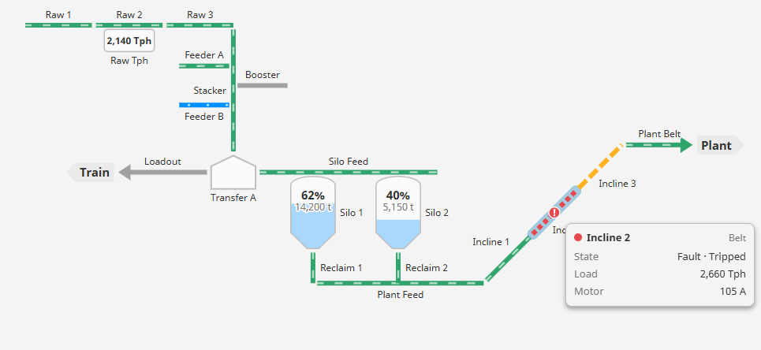
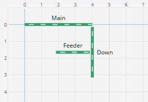
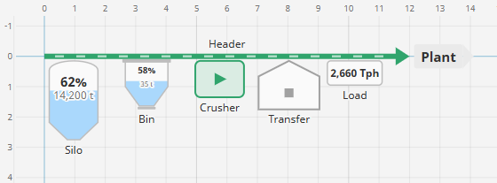
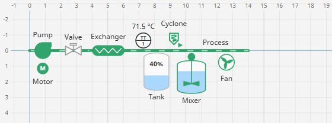
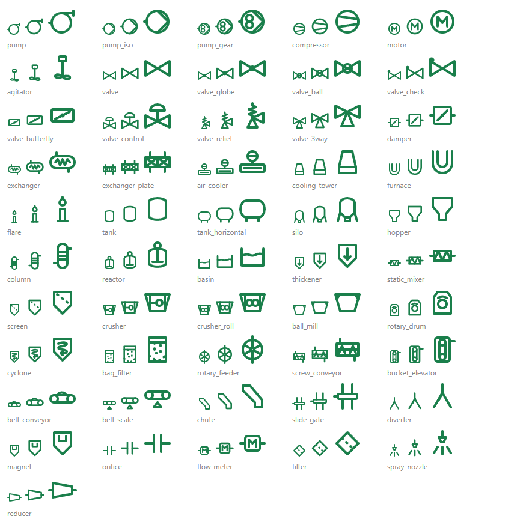
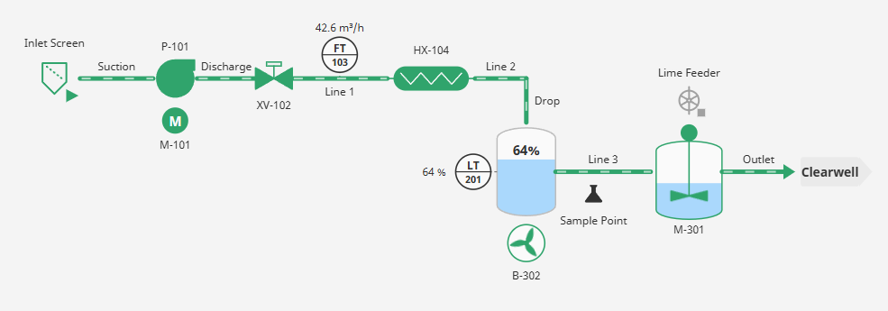
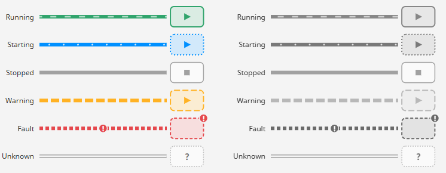
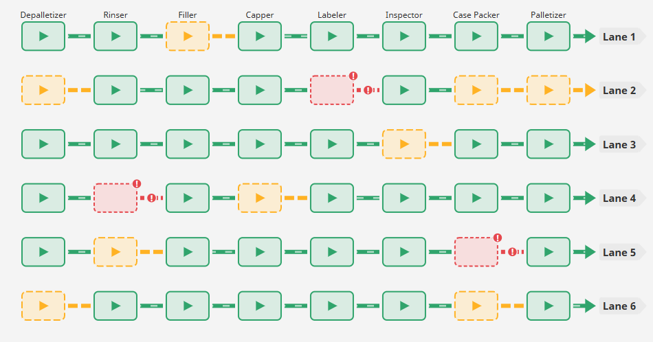
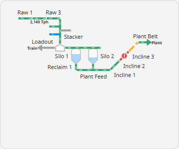

# Process Map

**⬇ [Download the Ectobox Perspective Component Suite](https://github.com/Ectobox/EctoboxIgnitionModules/releases/download/modules/Ectobox-Perspective-Component-Suite-8.3.modl)**, which includes the Process Map.

Belts and pipes, silos, bins, tanks, pumps, valves, instruments, machines and buildings with their live states, drawn
by **how they connect** rather than where they sit. Each item builds on another: it starts at that item's end, its start, or part way along it, then goes a
direction for a length. So:

- **You never line up joints by hand.** Move the first belt and everything built on it moves with it; nothing comes
  apart.
- **One map fits any screen.** The drawing scales to its box — a control-room wall, a tablet, a phone — with belts and
  text kept at a readable size, and pinch or Ctrl + wheel to zoom in.
- **A state is never colour alone.** Running belts move; starting is dotted, warning has long dashes, a fault short
  dashes and a mark; machines show ▶ or ■. It still reads for a colour-blind operator, and on a printout.

## Install

The Process Map comes in the **[Ectobox Perspective Component Suite](PerspectiveComponentSuite.md)**, one module with
all of Ectobox's Perspective controls.

1. Download **`Ectobox-Perspective-Component-Suite-8.3.modl`** from the [Releases](https://github.com/Ectobox/EctoboxIgnitionModules/releases/download/modules/Ectobox-Perspective-Component-Suite-8.3.modl) list.
2. In the gateway's web interface, open the **Modules** page → **Install or Upgrade a Module** → pick the file (accept
   the Ectobox certificate on first install), and restart the gateway when it asks.
3. Open a project in the Designer; **Process Map** appears in the component palette under the **Ectobox** category.

## Quick start

1. Drop a **Process Map** into a view and size it like any component. Its box is the drawing area — no coordinate
   container, nothing else to place.
2. Open **`items`** in the property editor. The first item is your first belt: set `anchor` to **start**, `start` to
   where it begins (grid units in from the top-left), a `direction` and a `length`.
3. **Add an item.** It arrives with every property, and with `parent` blank it carries on from the end of the item
   before it — so a straight run is just adding items.
4. To turn or branch, pick a **`parent`** from the dropdown (the map's other items), set **`attach`** to `end`,
   `start` or `along` (with `position`, a percentage along the parent), and a new `direction`.

While you lay out, the Designer shows a grid with unit numbers along the top and left, so "4 units in" can be read off
the drawing (`design.grid`: `designer` by default, or `always` / `never`).

## Laying out

Every placement setting is a dropdown or a number:

| Property | What it does |
|---|---|
| `name` | What other items pick as their parent, and what `selected` holds when it's picked. |
| `label` | The text drawn beside it. Blank shows the name. |
| `kind` | Lines: `belt`, `pipe`. Bulk handling: `silo`, `bin`, `building`, `machine`. Process: `tank`, `mixer`, `pump`, `valve`, `motor`, `fan`, `exchanger`, `instrument`. Any icon: `symbol`. Also `value` (a number box) and `exit` (where material leaves the map). See [Kinds](#kinds). |
| `icon` | With `kind: symbol`: the icon to draw, e.g. `material/science` or `processmap/screen` from a library you uploaded. |
| `anchor` | `parent`: build on the parent (blank parent = the item before). `start`: stand on its own at `start`. |
| `parent` | The item this one builds on — a dropdown of the map's other items. |
| `start` | With `anchor: start`: grid units in from the top-left (a belt's start; a node's top-left corner). |
| `attach` | Where on the parent it starts: its `end`, its `start`, or `along` it at `position` percent. |
| `direction` | `right`, `up-right`, `up`, `up-left`, `left`, `down-left`, `down`, `down-right`, or `angle` (degrees as on a protractor: 0 right, 90 up). |
| `length` | Belts: how long, in grid units. |
| `width`, `height` | Nodes: size in grid units (0 = the kind's own size). |
| `flow` | `forward` (material moves from start to end) or `reverse` (toward the start — a feeder drawn out from the belt it feeds). |
| `arrow` | An arrowhead where material leaves: `end`, `start` or `none`. |
| `placement` | Nodes on a line: `beside` (default — next to it, in its `direction`) or `inline` (sitting in the line, turned to run along it). |
| `labelSide`, `labelPriority` | Where the label goes (`auto` finds a clear spot) and which labels give way first on a small screen. |

Two runs that don't touch are simply two items with `anchor: start` — `Belt1` at `{x: 2, y: 0}` going down 3, `Belt2`
at `{x: 4, y: 0}` going down 2 — and everything else hangs off one of them.

### Kinds

| `kind` | Drawn as | Shows |
|---|---|---|
| `belt` | A thick line, flow marks moving along it when running. | Its state. |
| `silo` | Tall, domed roof, cone. | A level: `value` between `min` and `max`, in percent and in its `unit`. |
| `bin` | An open hopper, rim, pyramid bottom and slide gate. | A level, as a silo. |
| `machine` | A rounded box. | Its state: tinted, ▶ running, ■ stopped, a mark when faulted. |
| `building` | A gabled roof (a transfer house, a plant). | Its state, as a machine, when it has one. |
| `value` | A number box. | `value` with its `unit` and `decimals` (Tph, tons, amps). |
| `exit` | An arrow-shaped tag. | Where material leaves the map: Train, Plant, Warehouse. |
| `pipe` | A slimmer, round-ended line; pipes that join meet with no break, so a turn reads as an elbow. | Its state, as a belt. |
| `tank` | Dished ends; a horizontal drum when you make it wider than tall. | A level, as a silo. |
| `mixer` | A tank with an agitator and its motor on top. | A level, and its state: the paddle turns while it runs. |
| `pump` | P&ID centrifugal pump: a circle, its discharge leaving tangentially. | Its state. |
| `valve` | P&ID valve: a bow-tie with its stem and actuator. | Its state: open (running) filled, closed (stopped) hollow. |
| `motor` | A circle with an M. | Its state. |
| `fan` | A housing with three blades. | Its state: the blades turn while it runs. |
| `exchanger` | Shell and tube. | Its state. |
| `instrument` | An ISA balloon: the label's letters over its loop number (`FT 103`), a dashed lead to where it measures. | Its `value` beside the balloon. |
| `symbol` | Any icon — Ignition's own, or a library you uploaded. | Its state, as the icon's colour and a ▶ / ■ badge. |

A node hangs off its parent in its `direction` (a silo `down` from a belt sits under it, its top touching); a belt
whose parent is a node leaves from the node's edge in the belt's direction.

### Pipes and process symbols

A pump, a valve or an exchanger usually sits **in** a pipe rather than beside it. Make the pipe its `parent` and
give it `placement: inline`:

- With `attach: end` it carries the pipe on — the next item, built on it, leaves its far edge. `Suction` → `P-101`
  (`parent: Suction`, `attach: end`, `placement: inline`) → `Discharge` (`parent: P-101`, `direction: right`) draws
  one pipe with the pump in it.
- With `attach: along` it sits at `position` percent along the pipe, which carries on through it.
- It turns with its pipe, so a valve in a pipe going down stands upright. `flow: reverse` mirrors it.

`placement` only means something for a node whose parent is a belt or pipe (its `direction` is then unused). On a
node with no parent, on a node built on another node, or on a belt or pipe itself, the map shows its **!** saying so,
and the node sits beside as usual.

An **instrument** hangs off its pipe like any node (`attach: along`, `direction: up`) and draws a dashed lead back to
the point it measures. Its `label` gives the balloon's text: the first word over the line (`FT`), the rest under it
(`103`). Set `tag` (or `value`) for the reading beside it.

A **symbol** draws any icon in the state colours: set `icon` to `library/name`. Ignition's own libraries
(`material/…` and the rest) work as they are. To use your own drawings — a set of P&ID symbols, your company's own — add an
icon library to the gateway: a folder named for the library under
`data/config/resources/core/com.inductiveautomation.perspective/icons/` holding

- `library.svg`: one root `<svg>` with a nested `<svg id="name" viewBox="…">` per symbol;
- `config.json`: `{"svgFileName": "library.svg"}`;
- `resource.json`: the usual resource manifest, listing those two files.

Restart the gateway, and `icon: processmap/cyclone` draws the `cyclone` symbol from a library folder named `processmap`. Draw the
symbols with `currentColor` for their lines and they follow the state colour too. A line drawing's strokes keep their
width in pixels however large the map draws it, as the map's own lines do.

**A ready-made library:** [`icons/processmap`](icons/processmap) holds 51 process symbols as P&IDs draw them: ISO
10628-2's symbol wherever the standard has one (checked against the drawings on Wikimedia Commons), and the common US
form where that is as usual (the `pump` with its tangential outlet beside `pump_iso`; the control valve's diaphragm
actuator; the orifice's two plates; the diamond filter). They're drawn the way Lucide draws its icons (a 24 px grid, 2 px round strokes, `currentColor`): pumps (US and ISO styles), a compressor, a motor and an
agitator; gate, globe, ball, check, butterfly, control, relief and three-way valves and a damper; heat exchangers, an
air cooler, a cooling tower, a furnace and a flare; tanks, a drum, a silo, a hopper, a column, a reactor, a basin and a
thickener; screens, crushers, a mill, a rotary drum, a cyclone, a bag filter, a rotary feeder, screw, bucket and belt
conveyors, a belt scale, a chute, a slide gate, a diverter and a magnet; and an orifice, a flow meter, a filter, a
spray nozzle and a reducer. Copy its three files to `…/icons/processmap/` and restart. They're free to use, in the map or
anywhere else Perspective takes an icon.

## Live state

Each item's state comes from its **`status`** (picked from a dropdown, or bound to anything) or its **`tag`**:

| `status` | State |
|---|---|
| `true` / `1` | running |
| `false` / `0` | stopped |
| Text naming a state (any capitals) | that state: `running`, `stopped`, `starting`, `warning`, `fault`, `unknown` |
| Anything else | what **`stateMap`** says: a rule per value, first match wins (`3` → `fault`, label "Tripped") |
| Nothing, and no tag | a plain belt: nothing says how it is |

**From tags**, set an item's `tag` to its folder or UDT instance and `tags.statusMember` to the tag inside it that
holds its state (e.g. `State`), or leave the member blank to use the tag itself. The gateway reads only the tags the
view's own items name, with the user's tag permissions, and only under `tags.rootPath` when it is set. With
`tags.statusFromAlarms` on, an item's worst active alarm under its tag is shown over its status: High or Critical as a
fault, Medium or Low as a warning.

## Values and details

- **`value`, `min`, `max`, `unit`, `decimals`**: what a silo, bin, tank, mixer, instrument or number box shows. Bind `value`, or set `tag` to the
  tag that holds it.
- **`details`**: extra lines shown when an item is tapped or the pointer rests on it — `{label, value, unit, decimals}`,
  or `member` to read a tag inside the item's `tag` (e.g. Amps). A detail member is watched only while its item's
  details are on screen, so a hundred machines' amps aren't streamed for a panel nobody has open.

## What a click does

Tapping or clicking an item picks it: **`selected`** becomes its name (bind it both ways so a faceplate follows), and
**`onSelect`** fires with `name`, `label`, `kind`, `state`, `tag` and `index`. Its details open beside it; tap
elsewhere or press Escape to close them. To open a page or write the pick to a tag, bind `selected` or use `onSelect`.

## Fitting any screen

The map works out its drawing from how the items connect, so it fits any box without a second layout:

- **`appearance.align`**: `top-left` (default — grid 0, 0 at the control's top-left, so `start {x: 2}` is 2 units in
  from its left edge) or `center`.
- **Labels** keep a readable size. When there isn't room, `low` ones give way first, then `normal`; `always` ones stay.
  A label whose side you chose is never cut at the edge: the map makes room for it.
- **Zoom**: pinch and drag on a touch screen, Ctrl + wheel and drag with a mouse; the fit button (or a double-click)
  shows the whole map again. Zooming in gives the drawing more room, so labels that had none come back. At the whole-map
  view one finger still scrolls the page, so a map in a long page never traps you. (`interaction.zoom` turns it off.)

## Looks

| Property | What it does |
|---|---|
| `appearance.size` | `compact`, `normal` or `touch` (thicker belts and larger text for HMI screens). |
| `appearance.colors` | Each state's colour (blank = the suite's palette). A state's pattern never changes, so colour is never the only difference. |
| `appearance.animate` | Moving flow marks on running belts. Off — or when the device asks for reduced motion — running belts keep their look, still. |
| `appearance.gap` | The small break left where one item builds on another, in grid units. |
| `appearance.showUnits` | Units after values in number boxes and vessels. |

Colours follow the project's theme, so light and dark themes just work.

## Keyboard

Every item is also a button in a list screen readers announce ("Map items"): Tab moves from item to item — the one
the keyboard is on is outlined on the map — and Enter picks it, its state read out ("Incline 2: Fault"). Escape
closes the details.

## When something is wrong

Items the map can't place as asked are shown — an amber **!** at its top-left, its tooltip saying what — and still
drawn, standing at their `start`:

- a `parent` that isn't an item of the map;
- parents that go round in a loop;
- the same `name` on two items (parents find the first);
- a `position` outside 0–100, or a `length` of 0;
- `placement: inline` on something that isn't a node built on a belt or pipe.

A tag the user may not read shows its quality in the item's details instead of a value.

## See it working

Every example runs live on the [Public Demo Server](https://proveit.ectobox.com/data/perspective/client/ModuleDemos/processmap),
each beside exactly how it is built:

| Page | Shows |
|---|---|
| A coal yard | Belts, feeders, a transfer house, silos and an incline from tags: trip a belt, start one, see its load and amps; the same yard at phone size. |
| A bottling line, from tags | 48 machines on six lanes, each lit by its own State tag. |
| Pipes and process symbols | A pumping skid from tags: pipes with a pump, valve and exchanger in them, flow and level instruments, a tank, a mixer, a blower, and symbols from an uploaded icon library and from Material icons. Close the valve, trip the pump, start the feeder. |
| Laying out a map | Each placement idea on the grid, beside its items; pipes with things in them; every kind of item. |
| States without colour | Every state at every size, a grayscale switch, and a status bound to a checkbox. |
