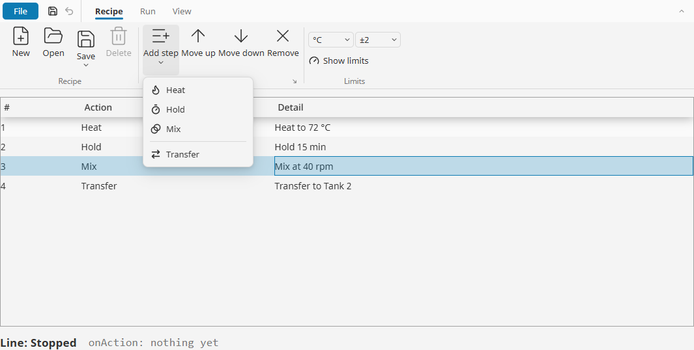
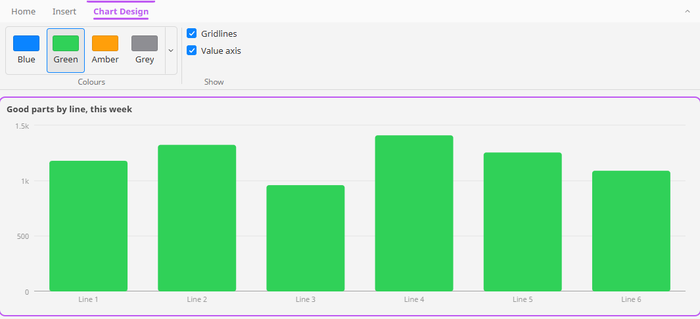
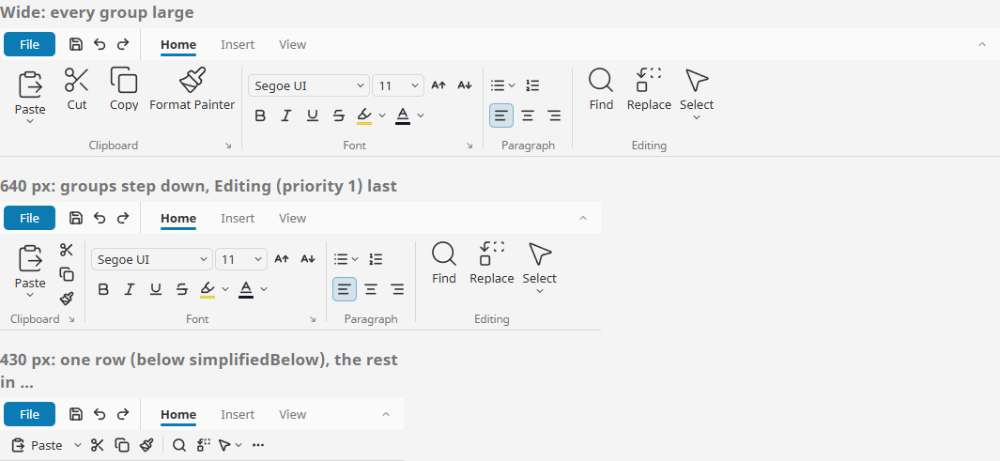
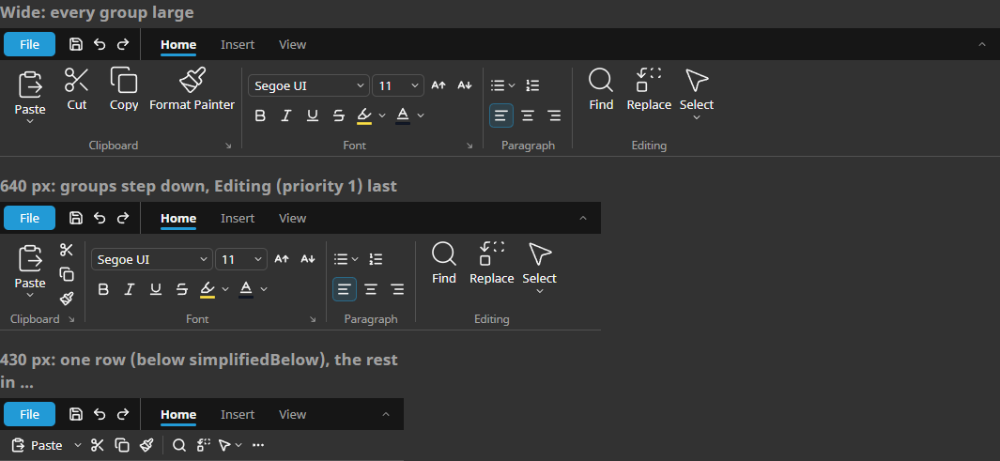
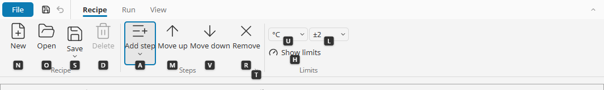

# Ribbon

**⬇ [Download the Ectobox Perspective Component Suite](https://github.com/Ectobox/EctoboxIgnitionModules/releases/download/modules/Ectobox-Perspective-Component-Suite-8.3.modl)**, which includes the Ribbon.

An Office-style command bar for Perspective: tabs of grouped commands, drawn with [Lucide](https://lucide.dev) icons,
that shrink to fit any screen. You write the commands as a list; the ribbon lays them out, and as it narrows each group
steps down (large buttons, then small ones with names, then icons, then one button), so every command stays reachable
on a wall screen, a laptop and a tablet.

- **One event for everything.** `onAction` reports every command by its `id`, so one script with
  `if event.id == 'save'` handles the whole ribbon.
- **What changes is separate from what it is.** Checked, disabled, hidden and picked values live in `state`, keyed by
  the same ids: bind `state.bold.checked` to a tag and Bold follows it.
- **The rest of Office:** split buttons, menus, selects, colours, galleries, checkboxes, contextual tabs, a
  quick-access row, a File button that shows a view of yours, Alt keytips, tooltips, collapse to tabs only, roles per
  command, and a touch size for HMI screens.



It is a component like any other: put it where you want it (usually across the top of a page or in a docked view) and
give it the width it should have. It draws no title bar and takes nothing over.

## Install

The Ribbon comes in the **[Ectobox Perspective Component Suite](PerspectiveComponentSuite.md)**, one module with all of
Ectobox's Perspective controls.

1. Download **`Ectobox-Perspective-Component-Suite-8.3.modl`** from the [Releases](https://github.com/Ectobox/EctoboxIgnitionModules/releases/download/modules/Ectobox-Perspective-Component-Suite-8.3.modl) list.
2. In the gateway's web interface, open the **Modules** page → **Install or Upgrade a Module** → pick the file (accept
   the Ectobox certificate on first install), and restart the gateway when it asks.
3. Open a project in the Designer; **Ribbon** appears in the component palette under the **Ectobox** category. Dropped
   on a view, it starts with a Home, Insert and View ribbon to edit.

## Quick start

`tabs` holds the ribbon: each tab a list of groups, each group a list of commands. A command needs only an `id`, a
`label` and an `icon`:

```json
"tabs": [
  { "id": "home", "label": "Home", "groups": [
    { "id": "clipboard", "label": "Clipboard", "items": [
      { "id": "paste", "type": "split", "label": "Paste", "icon": "lucide/clipboard-paste", "size": "large",
        "items": [ { "id": "pasteText", "label": "Keep text only" } ] },
      { "id": "cut", "label": "Cut", "icon": "lucide/scissors" },
      { "id": "copy", "label": "Copy", "icon": "lucide/copy" }
    ] }
  ] }
]
```

Then one `onAction` script:

```python
if event.id == 'cut':
    ...
elif event.kind == 'menuItem' and event.parent == 'paste':
    ...
```

`onAction` gets `id`, `kind` (`command`, `menuItem`, `launcher` or `file`), `parent` (a menu row's split button or
menu), `tab`, `group`, `label`, `value` (a pick from a select, colour or gallery) and `checked` (a toggle or checkbox).
`state` is already written when it runs. `onTabChanged` gets `tab` and `previous`.

An id may only have letters, digits, `-` and `_` (it becomes a property path, `state.<id>`). A missing id is made from
the label; two the same are reported (see [When something is wrong](#when-something-is-wrong)).

## Commands

| `type` | What it is | In `state.<id>` |
|---|---|---|
| `button` (default) | Does something. | `disabled`, `visible` |
| `toggle` | On or off (Bold). Toggles with the same `exclusive` name are one choice: Left, Centre, Right. | `checked` |
| `split` | A button plus an arrow for more choices (Paste, Save). The rows are its `items`. | |
| `menu` | Opens a list (`items`); a row can be `{"separator": true}`. | |
| `checkbox` | A box and its name. | `checked` |
| `select` | Pick from `options` (Font, Size); `editable` lets the user type a value of their own. | `value` |
| `color` | Applies its colour; the arrow opens a palette of `options` and any colour. | `value` |
| `gallery` | A row of choices (`inline` of them) that opens into a grid: styles, colour schemes. | `value` |
| `separator` | A line between commands. | |
| `view` | One of your project's views (`view.path`, `view.params`, `width`), for anything else. | |

Other settings on a command:

| Setting | What it does |
|---|---|
| `icon` | `lucide/<name>`, `material/<name>`, any icon library, or an image URL. |
| `size` | `auto`: large while there's room, smaller as the ribbon narrows. `large`: stays large (Paste). `small`: never large. |
| `showLabel` | Off: its icon alone when drawn small, named in its tooltip (Bold, Italic). |
| `tooltip` | `{title, text, shortcut}`, or just text. The shortcut is shown, not listened for. |
| `keytip` | The letter Alt shows on it; blank chooses one from the label. |
| `roles` | Only users with one of these roles may use it. See [Roles](#roles). |
| `action` | `{"mode": "page", "url": "/report/{id}"}` opens a page with no script (`onAction` fires as well). |

A group has `label`, `icon` (shown when it folds to one button), `launcher` (the corner arrow, reported as
`kind: launcher` with the group's id), `priority` (see [Fitting the space](#fitting-the-space)) and `layout`:
`columns` puts large buttons and small ones three to a column (Clipboard); `rows` puts small commands in two rows
(Font), the second starting at the command with `newRow: true`.

## State

`state` holds what changes, by id: `checked`, `value`, `disabled` and `visible`, for commands, groups and tabs alike.
Clicks write `checked` and `value` back, so a binding both ways keeps a tag and the ribbon in step:

| Binding | Does |
|---|---|
| `state.bold.checked` ↔ a tag | Bold shows the tag, and clicking Bold writes it. |
| `state.removeStep.disabled` ← `{view.custom.selectedRow} < 0` | Remove is greyed until a row is picked. |
| `state.tableDesign.visible` ← a selection | A contextual tab appears while something is selected. |
| a chart's `palette` ← `state.chartColor.value` | A gallery restyles the chart with no script. |

⚠ To bind one field (`state.removeStep.disabled`), give `state.removeStep` an object first, for example
`{"disabled": true}`. Perspective won't create the missing level for a binding.

## Contextual tabs

A tab with `contextual: true` shows only while `state.<its id>.visible` is true, in its `color`, as Office shows Table
Design while a table is selected. When it goes, the ribbon moves back to a tab that is showing.



## The quick-access row, File and collapse

- **`quickAccess`**: commands kept at the left of the tab bar whatever tab is showing (Save, Undo, Redo), written like
  a group's commands: buttons, toggles, split buttons and menus. `onAction` reports them with group `quickAccess`.
- **`file`**: `show` puts a File button first on the tab bar. With `view.path` set, it shows that view of yours over
  the page, the ribbon included, as Office's File page does; Esc or the back arrow closes it, and `file.open` says
  (and sets) whether it shows. Without a view, File only fires `onAction` with `kind: file`.
- **`collapsed`**: only the tab names show; clicking one drops its commands down over the page. The arrow at the end of
  the tab bar, or double-clicking a tab, switches it. Written back.

## Fitting the space

The ribbon measures each group at every size and draws the largest layout that fits. As it narrows, groups step down
one at a time: lowest `priority` first; among equal priorities, every group takes a step before any takes a second, and
the rightmost goes first; a group of icons only (Font) folds last. Once every group is one button, the groups that still
don't fit go into a **…** menu. A wider ribbon is never drawn smaller than a narrower one, and every command stays
reachable.

`layout` sets the shape: `classic` (tabs of groups), `simplified` (one row; what doesn't fit goes in **…**, the lowest
priority from the right, and the groups' corner arrows go there too) or `auto` (one row below `simplifiedBelow`,
480 px by default).



`size: touch` gives 44 px targets for HMI screens. `accent` sets the colour of the chosen tab, checked commands and
focus; blank uses the theme's. Light, dark and custom themes work through Perspective's theme variables.



## Lucide icons

Any `icon` can be `lucide/<name>`, one of [Lucide's](https://lucide.dev/icons) 2,000-plus icons. The Ribbon and the
Schedule draw them as lines, with the same line weight at every size.

The suite also adds Lucide to Ignition as an icon library named **lucide**. In the Designer's icon picker, choose
**lucide** in the library list to search and browse every icon, and any component, `ia.display.icon` too, can use
`lucide/<name>`. If your gateway already has an icon library named lucide, the suite leaves it in place.

## Keyboard

| Key | Does |
|---|---|
| Alt (press and release) | Shows a letter on File, the quick-access commands (1, 2, 3…) and every tab. Type one to open that tab; its commands then show letters. Esc steps back. |
| ← / → | Between tabs on the tab bar, and between commands in the ribbon. |
| Enter / Space | Uses the command; on a split button's arrow, a menu, a select or a gallery, opens its list. |
| ↑ / ↓ | In a list: the previous or next row (in a palette or gallery grid, the row above or below). |
| Esc | Closes a list, the File view or the keytips. |

Only one ribbon on a page answers Alt: the first one showing with `keytips` on.



## Roles

`roles` on a command lists the roles that may use it; with none listed, everyone may. `whenDenied` says what a user
without one sees: `hide` (the default) or `disable` (shown greyed). The ribbon only hides or greys the button: check
the role in your `onAction` script too, as a page in a browser can be changed by whoever has it open.

## When something is wrong

Config the ribbon can't use is shown on it: an amber **!** at the end of the tab bar, its tooltip saying what. It
reports:

- two tabs, groups, commands or menu rows with the same id, an id with no label to make one from, or an id with
  characters a property path can't hold;
- a split button or menu with no rows, a select or gallery with no options, a view command with no view, a page
  action with no URL;
- a command in `quickAccess` that can't go there (a select, colour, gallery or view).

A `lucide/` name Lucide doesn't have is drawn as a dashed box, its tooltip naming it.

## See it working

Every example runs live on the [Public Demo Server](https://proveit.ectobox.com/data/perspective/client/ModuleDemos/ribbon),
each beside exactly how it is built:

| Page | Shows |
|---|---|
| A recipe editor | Commands for a batch recipe's steps: a menu, a split button, Start/Pause/Stop as one choice, a delete for engineers only, Undo in the quick-access row and a File view, all to one script. |
| A contextual tab | Select a chart and Chart Design appears; its gallery and checkboxes restyle the chart with bindings alone. |
| Fitting any screen | One ribbon at three widths and at touch size. |
