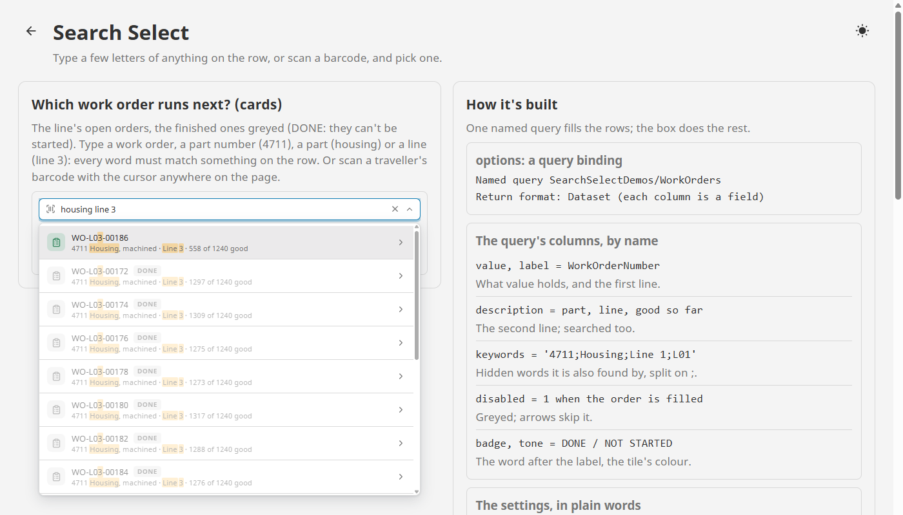
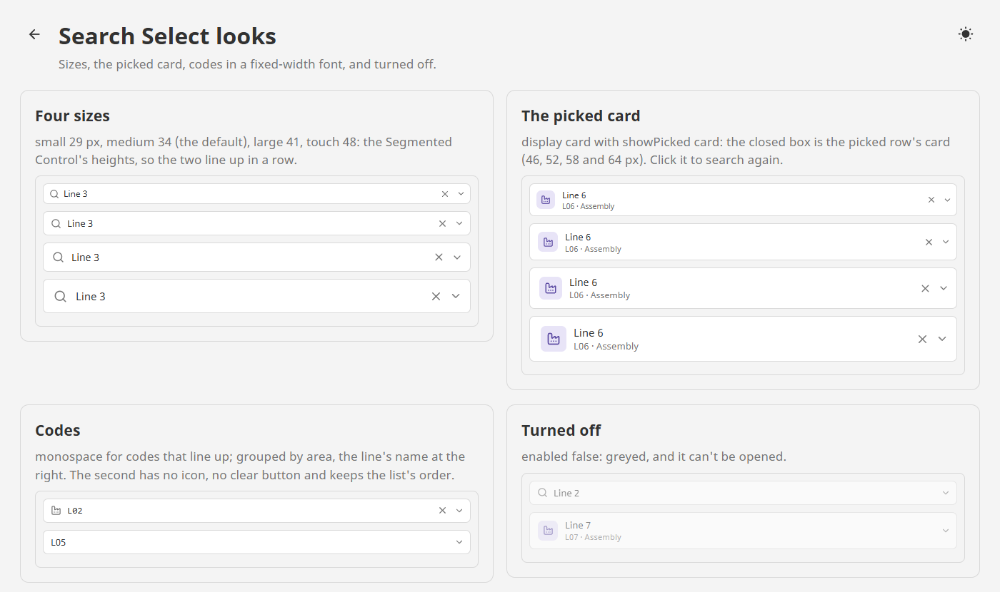

# Search Select

**⬇ [Download the Ectobox Perspective Component Suite](https://github.com/Ectobox/EctoboxIgnitionModules/releases/download/modules/Ectobox-Perspective-Component-Suite-8.3.modl)**, which includes Search Select.

A search box that picks one value from a list. Type a few letters of anything on the row, or scan a barcode, and pick
one. The same control picks the work order a line runs next, codes a stop, puts material in a storage location, or
traces a finished part by its serial number among hundreds of thousands.

- **Every word you type must match something on the row**: its label, its second line, or hidden keywords (a purchase
  order's item numbers and names). The best matches come first: a label that starts with what you typed, then words
  that start with it ("line 3" finds Line 3 before 1360), then the rest. Matches are highlighted.
- **Rows like search results.** One line, or a card with an icon tile, a badge and a second line; headings that group
  rows; disabled rows that can't be picked (a Full location, a finished order).
- **Barcode scanners just work.** A USB scanner types fast and presses Enter. The box tells that from typing, and picks
  the one row the code names. Turn on `scan` page and a scan lands in the box even while the cursor is in another field.
  The scanned keys are taken back out of that field.
- **Too many rows for the browser?** `search` server asks the gateway after a pause in typing: one search per word, not
  per key, and an answer that arrives late is dropped.
- The list opens in a layer above the page, so no container clips it, and above the box when there is no room below.



## Install

Search Select comes in the **[Ectobox Perspective Component Suite](PerspectiveComponentSuite.md)**, one module with all
of Ectobox's Perspective controls.

1. Download **`Ectobox-Perspective-Component-Suite-8.3.modl`** from the [Releases](https://github.com/Ectobox/EctoboxIgnitionModules/releases/download/modules/Ectobox-Perspective-Component-Suite-8.3.modl) list.
2. In the gateway's web interface, open the **Modules** page → **Install or Upgrade a Module** → pick the file (accept
   the Ectobox certificate on first install), and restart the gateway when it asks.
3. Open a project in the Designer; **Search Select** appears in the component palette under the **Ectobox** category,
   twice: as a list of storage locations, and as cards of purchase orders.

## Quick start

### Rows from a named query

Bind `options` to a named query whose columns are named as the row's fields. Return Format can stay at Dataset.

```sql
SELECT w.WorkOrderNumber AS value,
       w.WorkOrderNumber AS label,
       p.PartNumber + N' ' + p.Description + N' · ' + l.Name AS description,
       p.PartNumber + N';' + p.Description + N';' + l.Name AS keywords,
       CAST(CASE WHEN w.Status = 'Closed' THEN 1 ELSE 0 END AS bit) AS disabled
FROM Plant.WorkOrders w
JOIN Plant.Parts p ON p.ID = w.PartID
JOIN Plant.Lines l ON l.ID = w.LineID
```

Bind `value` both ways to a custom property or a tag. It holds the picked row's `value`, or null.

| Row field | What it does |
|---|---|
| `value` | What `value` holds when the row is picked. The only field a row needs. |
| `label` | The first line, and what the box shows once picked. Empty shows the value. |
| `description` | A second line, shown in card display; searched in both. |
| `keywords` | Hidden words the row is also found by: a list, or one text split on `;` `,` or `\|` (a query column). A scan of exactly one of them picks the row. |
| `icon` | An icon before the label in a tile, e.g. `lucide/package`, tinted by `tone`. |
| `tone` | The tile's colour: `neutral`, `accent`, `good`, `warning`, `bad`, `info`, `violet`, `teal`. |
| `badge`, `badgeTone` | A short word after the label, e.g. FULFILLED, and its colour. |
| `trailing`, `trailingTone` | Text at the right, e.g. Available in `good` or Full in `bad`. |
| `group` | A heading the row sits under. Rows of a group stay together while filtering. |
| `disabled` | Greyed: it can't be picked, and the arrow keys skip it. |

Any other columns ride along: `onChange` hands the whole row to your script as `event.option`.

### Searching on the gateway

For lists too big to send to the browser (parts, serial numbers, customers), set `search` to `server`. After a pause in
typing (`debounce`, 250 ms) and from `minChars` characters (2), the box writes `searchText` and fires `onSearch`. Write
the answer to `options`:

```python
# onSearch
params = {'text': event.text}
rows = system.db.runNamedQuery('Parts/Search', params)
# a late answer to an older search is dropped
if self.props.searchText == event.text:
    self.props.options = rows
```

While it waits the list shows **Searching...** over the rows it had. The box sets `options` to null as it asks, so every
answer arrives, even one the same as the last. Server rows are shown in the order the query returns them, with the typed
words highlighted.

### Barcode scanners

A keyboard-wedge scanner types a code a few milliseconds per key and presses Enter. At least `scanLength` (4) keys, each
within `scanGap` (30 ms) of the last, then Enter, make a scan; people type 80 ms apart or more.

| `scan` | What a scan does |
|---|---|
| `off` | Nothing special: it is typing. |
| `box` (default) | A scan into this box fires `onScan` and picks the one row it names exactly (value, label or a keyword). None, or several, open the list on the code for a person to choose. |
| `page` | The same for a scan typed anywhere on the page: with the cursor in another field (a quantity box keeps its 20), or in none. The keys go back into that field if no Enter follows (a fast typist, not a scanner). With several boxes on `page`, the one used last hears it. |

With `search` server, a scan asks the gateway at once and picks when the answer comes.

## Settings

| Property | What it does |
|---|---|
| `display` | `list` (default): one line per row, a tick on the picked one. `card`: two lines per row with a chevron, as search results. |
| `showPicked` | With card display, `card` shows the picked row's card in the closed box; `label` (default) shows its label. |
| `order` | `best` (default): a label that starts with the text, then a word in it, then anywhere, then the second line, then a keyword; rows whose words start a word, or that hold the words side by side, first. `list`: the options' order. |
| `placeholder` | What the empty box says. |
| `icon` | The icon at the left, `lucide/search` by default; empty for none. |
| `clearable` | On (default): an × clears `value`. |
| `monospace` | Labels and typed text in a fixed-width font, for codes that line up (BR01-A1-03). |
| `highlight` | On (default): the typed words are marked in each row. |
| `showKeyword` | On (default): when only a hidden keyword matched, the row says which ("matches SEN-0011 Cobalt Oxide"). |
| `rows` | Rows shown before the list scrolls (8). |
| `size` | Box height: `small` 29 px, `medium` 34 (default), `large` 41, `touch` 48: the Segmented Control's, so the two line up. |
| `enabled` | Off greys the control; it can't be opened. |

The typed text and the icons sit centred on the capitals in the theme's own font; the gaps either side are equal at every
size. Light, dark and custom themes work through Perspective's theme variables; in a dark theme the box is a raised grey,
not black.



## Events

| Event | When | Payload |
|---|---|---|
| `onChange` | The user picked or cleared (not a binding's change) | `value`, `previous`, `option` (the row as written, with every column), `reason` (click, key, scan or clear) |
| `onScan` | A scanner's burst ended in Enter | `text`, `matches` (how many rows it names), `value` (the picked row's when matches is 1), `source` (box or page) |
| `onSearch` | `search` server: a pause in typing with a new text | `text` |

## Keyboard

The list opens when the box takes the focus, showing every row with the picked one marked; the first key filters.
Down and Up move, skipping disabled rows; Page Down and Page Up move a list's height; Enter picks; Escape and Tab close it
and put the picked label back. The chevron opens and closes the list. Screen readers hear a combo box and its list of
options.

## See it working

Every example runs live on the [Public Demo Server](https://proveit.ectobox.com/data/perspective/client/ModuleDemos/searchselect),
each beside exactly how it is built:

| Page | Shows |
|---|---|
| Examples | A plant's: which work order a line runs next (cards from a named query, finished orders greyed, scan a traveller anywhere on the page), what a stop is coded as (grouped reasons, planned or not), and where a finished part was made (a search on the gateway over 140,798 parts). |
| Looks | Four sizes, the picked card at four sizes, codes in a fixed-width font, and turned off. |
