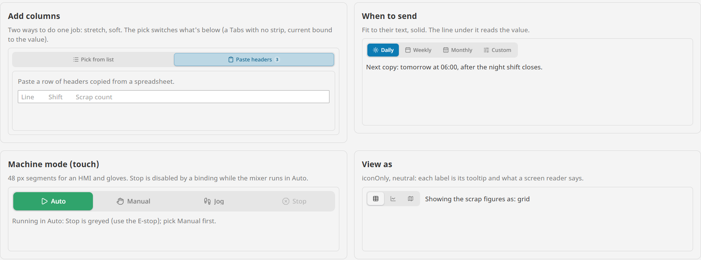
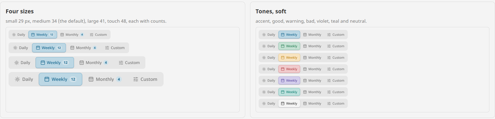

# Segmented Control

**⬇ [Download the Ectobox Perspective Component Suite](https://github.com/Ectobox/EctoboxIgnitionModules/releases/download/modules/Ectobox-Perspective-Component-Suite-8.3.modl)**, which includes the Segmented Control.

One choice from a few, all in view, with a thumb that slides to the one picked. Use it where a dropdown would hide two
to six options a user should see at once: a report's period, a machine's mode, how to view a table.

- **One value.** `value` is the picked option's value; bind it both ways. A user's pick writes it and fires `onChange`;
  a binding's change moves the thumb and fires nothing.
- **Fits any width.** `fit` makes each option as wide as its label; `stretch` shares the width. When it gets too narrow,
  labels end in an ellipsis with the whole label as a tooltip. It never wraps.
- **Built for panels.** A touch size of 48 px, icons from Lucide or any Ignition icon library, counts, and options a
  binding can disable.
- **Moves like it means it.** The thumb travels on a spring, the same at any frame rate.



## Install

The Segmented Control comes in the **[Ectobox Perspective Component Suite](PerspectiveComponentSuite.md)**, one module
with all of Ectobox's Perspective controls.

1. Download **`Ectobox-Perspective-Component-Suite-8.3.modl`** from the [Releases](https://github.com/Ectobox/EctoboxIgnitionModules/releases/download/modules/Ectobox-Perspective-Component-Suite-8.3.modl) list.
2. In the gateway's web interface, open the **Modules** page → **Install or Upgrade a Module** → pick the file (accept
   the Ectobox certificate on first install), and restart the gateway when it asks.
3. Open a project in the Designer; **Segmented Control** appears in the component palette under the **Ectobox**
   category. Dropped on a view, it starts with Daily, Weekly, Monthly and Custom.

## Quick start

```json
"options": [
  { "value": "daily",   "label": "Daily",   "icon": "lucide/sun" },
  { "value": "weekly",  "label": "Weekly",  "icon": "lucide/calendar" },
  { "value": "monthly", "label": "Monthly", "icon": "lucide/calendar-days", "badge": 3 }
],
"value": "weekly"
```

An option needs only a `value`; with no `label` it shows the value. `icon` goes before the label, `badge` (a count or a
short word) after it, `tooltip` shows on hover, and `disabled` greys it out. `tone` puts a coloured status dot before the
label (Open in good, Fully received in warning), and `badgeTone` gives the count its own colour (a count of critical
orders in bad, whichever option is picked); both take `neutral`, `accent`, `good`, `warning`, `bad`, `info`, `violet`
or `teal`. The dot sits on the middle of the label's capitals at every size.

Bind `value` both ways to a custom property or a tag, and read it anywhere else on the page. To switch what's below
with it, put a [Tabs](Tabs.md) with `placement` none under it and bind the Tabs' `current` to the value's tab:

```
if({view.custom.addMode} = "paste", 1, 0)
```

### Values

A value can be text, a number or true/false. A bound value matches an option exactly first; failing that, a number
matches its text (`2` and `"2"`, as a dropdown or a tag may hand either) and true/false match `"true"`/`"false"`.
A value that matches no option picks none, and the thumb hides.

## Looks

| Property | Choices |
|---|---|
| `layout` | `fit` (default): each option as wide as its label. `stretch`: the options share the component's width equally. |
| `size` | Segment height: `small` 29 px, `medium` 34 (default), `large` 41, `touch` 48 for panel screens and gloves. |
| `appearance` | `soft` (default): the thumb is a tint of the colour with a thin ring. `solid`: filled with the colour, its label white (dark on amber). |
| `tone` | `accent` (default, the theme's), `neutral` (a raised white thumb), `good`, `warning`, `bad`, `info`, `violet`, `teal`. |
| `color` | A colour of your own for the thumb, instead of `tone`. |
| `iconOnly` | Icons only; each label becomes its option's tooltip and what a screen reader says. |
| `enabled` | Off greys the whole control and it can't be changed. |

Labels are centred on their capitals and counts on their digits, in the theme's own font. On a solid thumb a count
turns white so it stays readable. Light, dark and custom themes work through Perspective's theme variables. When the
operating system asks for reduced motion, the thumb moves without sliding.



## Events

| Event | When | Payload |
|---|---|---|
| `onChange` | The user picked another option (not a binding) | `value`, `previous`, `index`, `by` (click or key) |

## Keyboard

| Key | Does |
|---|---|
| Tab | Into the control, onto the picked option. |
| Arrows | Pick the next or previous option at once, skipping disabled ones, and wrap round at the ends. |
| Home / End | Pick the first or last option. |
| Space / Enter | Pick the option in focus. |

Screen readers hear it as a group of radio buttons, each option with its label and count.

## See it working

Every example runs live on the [Public Demo Server](https://proveit.ectobox.com/data/perspective/client/ModuleDemos/segmented),
each beside exactly how it is built:

| Page | Shows |
|---|---|
| Examples | Add columns two ways (stretch, switching a Tabs with no strip); when to send a report (solid, a line reading the value); a machine's mode at touch size with Stop disabled while it runs in Auto; view as, icons only; an onChange script. |
| Looks | Four sizes with counts; every tone, soft and solid; counts on a soft and a solid thumb; narrow; turned off. |
