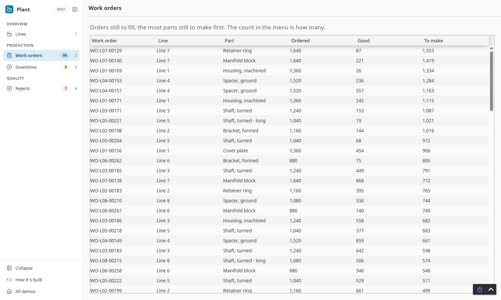
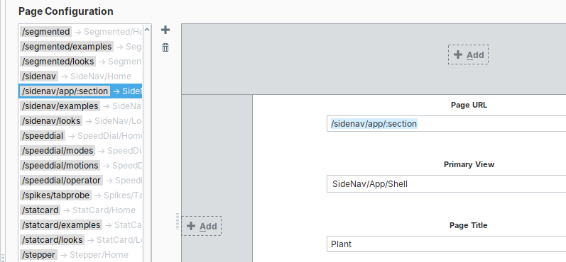
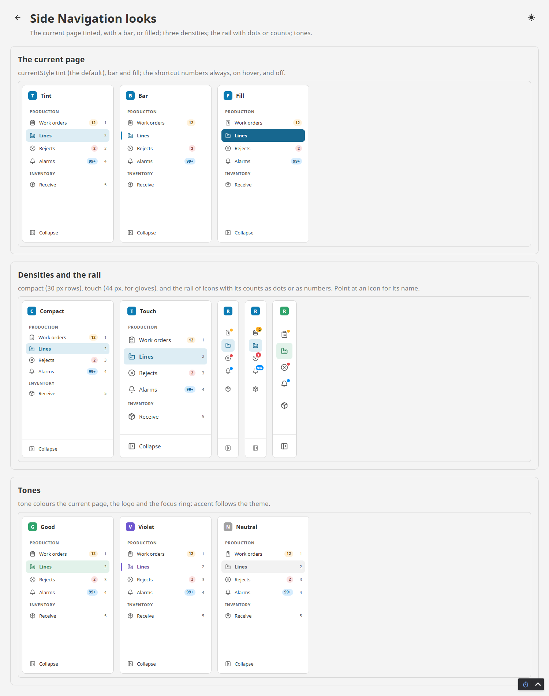

# Side Navigation

**⬇ [Download the Ectobox Perspective Component Suite](https://github.com/Ectobox/EctoboxIgnitionModules/releases/download/modules/Ectobox-Perspective-Component-Suite-8.3.modl)**, which includes Side Navigation.

An app's menu down the left of the page that fits the screen: full, a rail of icons, or hidden behind a hamburger.

- **Fits the screen by itself.** Under 1100 px of window it becomes a rail of icons, under 768 it hides behind a
  hamburger. Collapse at the bottom makes it a rail on any screen, and a click on the app's name hides it to give the
  page all the width; the user's choice is remembered.
- **Two companions, nothing to wire:** a hamburger for your app bar, and an area that shows the current item's view.
- **Opens pages by their URL**, and follows the URL to know which item is current, so Back, refresh and links work.
- **Counts** in a coloured pill (3 orders waiting, 2 alarms), a dot on the icon in the rail.
- **Number keys 1 to 9** open items from anywhere on the page but a field; the arrow keys move in the menu.
- **Dozens of pages stay easy to find:** a search that narrows the menu as you type, sections that fold, section names
  that stay at the top while you scroll, and a rail with one icon per section.
- **Sections and sub-items**, a brand with a site, an environment switcher, footer buttons and the user.
- **Moves on a spring** between its widths, in whole pixels, with every icon in the same column expanded or as a rail.



## Install

Side Navigation comes in the **[Ectobox Perspective Component Suite](PerspectiveComponentSuite.md)**, one module with
all of Ectobox's Perspective controls.

1. Download **`Ectobox-Perspective-Component-Suite-8.3.modl`** from the [Releases](https://github.com/Ectobox/EctoboxIgnitionModules/releases/download/modules/Ectobox-Perspective-Component-Suite-8.3.modl) list.
2. In the gateway's web interface, open the **Modules** page → **Install or Upgrade a Module** → pick the file (accept
   the Ectobox certificate on first install), and restart the gateway when it asks.
3. Open a project in the Designer; under the **Ectobox** category of the component palette are **Side Navigation**
   (twice: a full app menu and a plain one), **Side Navigation Button** and **Side Navigation Content**.

## Build an app with it: a shell page

The menu is a fixture: it stays while the pages beside it change. Build it as a **shell page**: one view holds the menu,
your app bar and the section, and one page entry gives every section its own URL. Three components do it, and they
find each other on the page, so there is nothing to bind between them:

| Component | What it does |
|---|---|
| **Side Navigation** | The menu. |
| **Side Navigation Button** | The hamburger for your app bar. It shows only while the menu is hidden (it takes no room otherwise) and opens it over the page. |
| **Side Navigation Content** | Where the sections show: the current item's view, with the item's `params`. |

1. **Page configuration:** one page, `/app/:section`, opens the view `App/Shell`. (This is the one thing no component
   can do for you.) The colon makes `:section` a placeholder that matches any one part of the URL, so this one entry
   opens the Shell for `/app/lines`, `/app/orders` and every other section: you don't add a page per section, and the
   Shell stays loaded while the user moves between them. The name after the colon is yours to choose, and the Shell
   needs no parameter for it; the menu reads the URL to know which item is current. In the Designer (the demo's entry):

   
2. **`App/Shell`** is a flex row: a **Side Navigation** first (position basis `auto`, so its own width moves the page
   over), then a column with your app bar (a **Side Navigation Button** and a title) and a **Side Navigation Content**
   (grow 1).
3. **Each item** has a `path` and a `view`:

   ```json
   {"id": "orders", "label": "Work orders", "icon": "lucide/clipboard-list", "shortcut": 2,
    "path": "/app/orders", "view": "App/Orders"}
   ```

4. **Optional:** bind your title's text to `{../../../Nav.props.currentItem.label}`.

Picking an item opens its path, so the URL changes, and the menu reads the URL to know which item is current; the
Content shows that item's view. The shell stays mounted from one section to the next: the menu keeps its state, its
counts don't reload, and nothing the user typed in the shell is lost. Back, refresh and a bookmark all land on the right
section. Footer buttons take a `path` too (User Settings, Help), so they need no script.

When the menu is hidden (the window is narrow, or the user hid it), the Button opens it over the page with a shade
behind it and the focus on the current item. Picking an item, Escape or a click on the shade closes it and gives the
focus back to the Button; the pin in its header keeps it open.

**The user's choice is remembered.** Collapsed or hidden stays that way after a reload and on the next visit, kept in
the browser for that menu (`remember`: `browser` by default, or `off`). In `mode` auto it counts in the window band it
was made in: hidden on a wide screen doesn't come back hidden on a phone, where the band decides.

**Two menus on one view?** Give the Button and the Content a `target`: the menu's name. With no target they work with
the first Side Navigation on the page.

### Why not a docked view

A docked view in page configuration keeps the width it is configured with, whatever is inside it: when the menu
collapses to a rail or hides, the dock stays as wide as before and leaves an empty strip. The shell page has no such
gap, because the menu's own width is what moves the page.

### Why not swap a view without a URL

A menu whose items have a `view` but no `path` works (picking one sets `current`, and the Content shows its view), but
the URL never changes: Back leaves the app, refresh returns to the first section, and there is no link to send someone.
Use it only inside a page, for a section's own sub-views.

## Dozens of pages

A plant app's menu can hold fifty pages or more. Four settings keep it easy to use:

| Setting | What the user gets |
|---|---|
| `search`: `filter` | A search field under the brand. Typing narrows the menu to the pages that match, under their section's name, with the matched letters marked. Each word typed must start a word of a page's label, its `keywords`, its parent's label or its section's name: "wo" finds Work orders, not rework; "line 3" finds Line 3 Packing only. Ctrl K from anywhere goes to the field (in the rail, or hidden, it opens the menu over the page). Down arrow into the results, Enter opens the first, Escape clears. |
| `sections`: `fold` | A click on a section's name folds it. A folded section shows its name in the menu's colour when the page shown is inside it, and a dot when a count is waiting inside. The section of the page shown always opens, and the folds are remembered in the browser. `one`: one section open at a time. |
| `stickySections` | On by default: a section's name stays at the top while its pages scroll under it. |
| `railIcons`: `sections` | The rail shows one icon per section, the heading's `icon`. Pointing at it opens a flyout with the section's pages and their counts; it closes when the pointer leaves, and a click keeps it open. |

Give items `keywords` for the words people type that aren't in the label:

```json
{"heading": "Quality", "icon": "lucide/clipboard-check"},
{"id": "ncr", "label": "Nonconformances", "icon": "lucide/triangle-alert", "keywords": ["NCR", "defects"]}
```

A page opened from a bookmark or a link, forty rows down, shows in the middle of the menu: the menu scrolls to the
current page whenever it is out of view.

## Settings

| Property | What it does |
|---|---|
| `items` | The menu, top to bottom. A row with `heading` (and no id) is a section heading. An item has `id`, `label`, `icon`, `badge` (a count: over 99 shows 99+, 0 none), `badgeTone`, `shortcut` (1 to 9), `path`, `view` and `params` (what Side Navigation Content shows), `keywords` (more words the search finds it by), `disabled` and `children` (one level of sub-items). A heading row's `icon` stands for its section in the rail. |
| `current` | The current item's id. Empty (the default) follows the URL: the item whose path is the longest match, so `/app/orders/41` keeps Work orders current. |
| `currentItem` | Written by the menu: the current item's `id`, `label`, `path` and `view`. |
| `mode` | `auto` (default): by the window's width. `expanded`, `rail` or `hidden`: always that. |
| `view` | Written by the menu: the user's own choice (`expanded`, `rail`, `hidden`), or empty to follow `mode`. Set it from a script to change the menu. |
| `remember` | `browser` (default): the user's choice is kept in the browser for this menu. `off`: every visit starts from `mode`. |
| `shown` | Written by the menu: what is on screen now. |
| `open` | While hidden: true shows the menu over the page (`hiddenStyle` over) or beside it (`push`). The Button sets it. |
| `railBelow`, `hiddenBelow` | The window widths for auto: 1100 and 768 px. |
| `expandedWidth` | The expanded menu's width, 248 px by default (plus its 1 px border). The rail is 52, 56 or 64 px by density. |
| `brand` | `name`, `logo` (an icon in a square of the menu's tone, or an image URL) and `site` (a short code in a chip). |
| `allowHide` | The chevron beside the brand, and a click on the brand, hide the menu on any screen. On by default. |
| `environment` | A switcher saying which plant or system this is (`onAction` id `environment`). |
| `search`, `searchAfterPick` | `filter`: the search field (see Dozens of pages); after a pick it clears (default) or `keep`s the results. `action`: a Search button that fires `onAction` id `search` (also Ctrl K), for your own search. `off` (default). |
| `sections`, `stickySections`, `railIcons` | Section headings `fold` (default), `one` open at a time or `fixed`; names stay at the top while scrolling (default); the rail by `items` (default) or `sections`. |
| `collapseButton`, `footerItems`, `user` | Collapse / Expand at the bottom; your own buttons (`id`, `label`, `icon`, and a `path` to open; `onAction` with their id); who is signed in (`onAction` id `user`). |

| `currentStyle` | How the current item shows: `tint` (default), `bar` or `fill`. |
| `shortcuts` | The number keys: `always` shown (default), shown on `hover`, or `off`. |
| `railLabels`, `railBadges` | In the rail: a `tooltip` with the label (default) or a `flyout` with the sub-items too; counts as a `dot` (default) or the `count`. |
| `subItems` | Sub-items open `inline` under their item (default) or in a `flyout` beside it. |
| `density` | `compact` (30 px rows), `comfortable` (34, default) or `touch` (44, for gloves and panel PCs). |
| `tone` | The current item, the logo square and the focus ring: `accent` (the theme's, default), `neutral`, `good`, `warning`, `bad`, `info`, `violet` or `teal`. |
| `animate` | The width moves on a spring (default). Off, or reduced motion in the operating system: at once. |

**Side Navigation Button:** `target` (the menu's name; empty, the first on the page), `label` (what screen readers and
the tooltip say, Menu by default), `icon` (instead of the three lines). In the Designer it stays visible, faint, while
the menu shows, so it can be picked.

**Side Navigation Content:** `target`, and `emptyText`, shown when the current item has no view.

Light, dark and custom themes work through Perspective's theme variables. Every height is a whole number of pixels and
every icon sits in the same column expanded and in the rail, centred in the rail.



## Keys

| Key | Does |
|---|---|
| 1 to 9 | Opens the item with that shortcut, from anywhere on the page but a text field. |
| Up, Down, Home, End | Move in the menu (Up from the first row goes back to the search field). |
| Right, Left | Open an item's sub-items, close them (or go to the parent); open or fold a section on its name; open a section's flyout in the rail. |
| Enter, Space | Open the item. |
| Escape | Clear the search; close the menu open over the page, or a flyout. |
| Ctrl K | The search field (`search` filter), or `onAction` with id `search` (`search` action). |

## Events

| Event | When | Payload |
|---|---|---|
| `onNavigate` | The user picked an item (an item with a path has already opened it). | `id`, `label`, `path`, `how` (`click`, `key`, `shortcut` or `search`: Enter in the search field) |
| `onAction` | Search, the environment, the user, or a footer button. | `id` |

## See it working

Every example runs live on the [Public Demo Server](https://proveit.ectobox.com/data/perspective/client/ModuleDemos/sidenav),
each beside exactly how it is built:

| Page | Shows |
|---|---|
| The plant app | A whole app built as a shell page: Lines, Work orders, Downtime and Rejects with the plant's counts. Collapse it, hide it, make the window narrow, press Back, reload. |
| Dozens of pages | The plant app with all 56 of its pages: search as you type, sections that fold, names that stay at the top, a rail with one icon per section under 1100 px. Opens on Calibration, far down the menu. |
| How it's built | The shell page's three components and its items; the settings behind Dozens of pages; the menu collapsing to icons and hiding behind a hamburger. |
| Looks | Tint, bar and fill; compact and touch; the rail with dots and counts; tones. |
