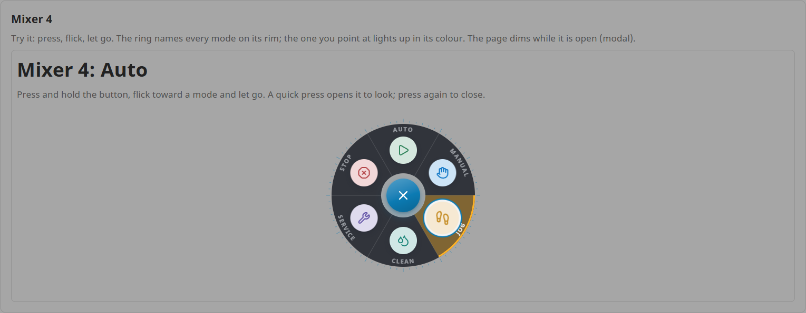
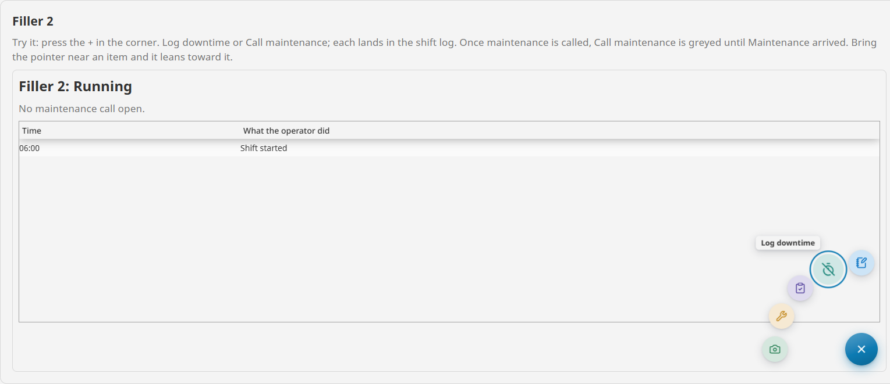
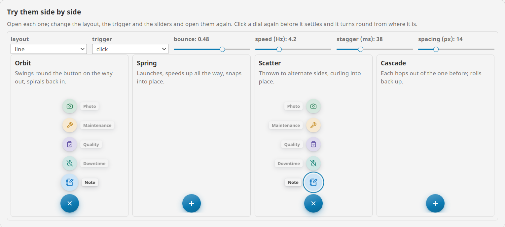
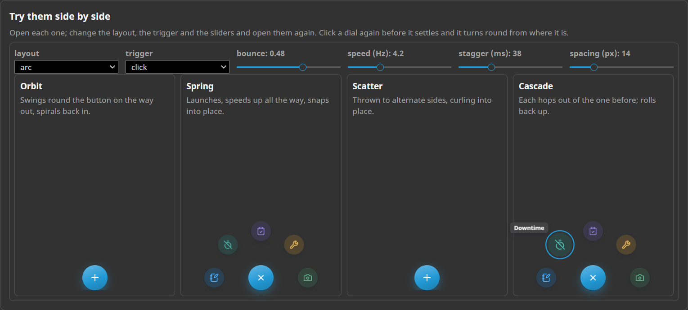

# Speed Dial

**⬇ [Download the Ectobox Perspective Component Suite](https://github.com/Ectobox/EctoboxIgnitionModules/releases/download/modules/Ectobox-Perspective-Component-Suite-8.3.modl)**, which includes the Speed Dial.

One round button that opens into a handful of actions. The items fly out on springs in a line, an arc or a ring,
lean toward the pointer as it comes near, and squash when pressed: a control people press for fun.

- **Real physics.** Every motion is a spring simulation, so a dial clicked again before it settles turns round from
  wherever it is, and it moves the same at any frame rate.
- **Four motions:** orbit, spring, scatter and cascade.
- **Three layouts:** a line, an arc, or a ring all the way round, picked with one press, flick and release, as a
  game's weapon wheel is.
- **One event.** `onItemClick` reports the item picked by its `id`.



It is a component like any other: put it where you want it, usually in a corner of a page or a card. The items fly
out over the page, never clipped by the container the dial is in.

## Install

The Speed Dial comes in the **[Ectobox Perspective Component Suite](PerspectiveComponentSuite.md)**, one module with all
of Ectobox's Perspective controls.

1. Download **`Ectobox-Perspective-Component-Suite-8.3.modl`** from the [Releases](https://github.com/Ectobox/EctoboxIgnitionModules/releases/download/modules/Ectobox-Perspective-Component-Suite-8.3.modl) list.
2. In the gateway's web interface, open the **Modules** page → **Install or Upgrade a Module** → pick the file (accept
   the Ectobox certificate on first install), and restart the gateway when it asks.
3. Open a project in the Designer; **Speed Dial** appears in the component palette under the **Ectobox** category.
   Dropped on a view, it starts with five operator actions to edit.

## Quick start

`items` holds the actions. An item needs only an `id`, a `label` and an `icon`:

```json
"items": [
  { "id": "note", "label": "Add a note", "icon": "lucide/notebook-pen" },
  { "id": "downtime", "label": "Log downtime", "icon": "lucide/timer-off" },
  { "id": "maintenance", "label": "Call maintenance", "icon": "lucide/wrench" }
]
```

Then one `onItemClick` script:

```python
if event.id == 'downtime':
    ...
elif event.id == 'maintenance':
    ...
```

`onItemClick` gets `id`, `label` and `index` (the item's place in `items`, from 0). `onOpenChanged` gets `open` when
the user opens or closes the dial; `open` is bindable both ways.

An item's `color` sets its tint and the shade of its icon; `disabled` greys it and stops it being picked; `visible`
off leaves it out. Any of them can be bound: `items[3].disabled` bound to "a maintenance call is open" greys Call
maintenance until the call is answered.

## Layouts

| `layout` | What it does |
|---|---|
| `line` | In a row from the button, names beside them. |
| `arc` (default) | On a curve round the button, names on hover. |
| `ring` | All the way round, on a dark disc. The item pointed at lights its wedge of the ring, and its name is written along the rim. |

`direction` is `auto` unless you set it, measured each time the dial opens:

- a line goes up when it fits above, else to a side or down;
- an arc opens as a half circle with room all round, away from a top or bottom edge, and as a quarter out of a corner
  or side edge.

`up`, `down`, `left` or `right` fixes it: a line that way, or the half circle facing it.



`spacing` (px) is one gap everywhere: between neighbouring items, and between the button and the first. A sideways
line also leaves room for its widest name.



## Motion

| `motion` | How the items fly |
|---|---|
| `orbit` (default) | They swing round the button on the way out and spiral back in, like water down a drain. |
| `spring` | They launch, speed up all the way and snap into place. |
| `scatter` | They are thrown out to alternate sides and curl into place, tumbling the way they were thrown. |
| `cascade` | Each hops out of the one before it, like dealing cards, and they roll back up one by one. |

| Setting | What it does |
|---|---|
| `bounce` | 0 settles with no overshoot; 0.75 is very bouncy. Default 0.48. |
| `speed` | The springs' frequency in Hz: 2 is lazy, 9 is snappy. Default 4.2. |
| `stagger` | ms between one item leaving and the next. Closing goes twice as fast, last first. Default 38. |
| `magnetic` | Open items lean toward a pointer that comes near them. On by default. |

When the operating system asks for reduced motion, every dial moves plainly: no overshoot, no tumble, all items at
once.



## Opening and picking

| `trigger` | How it opens |
|---|---|
| `click` (default) | A click opens and closes it. |
| `hover` | It opens as the pointer arrives and closes a moment after it leaves. |
| `hold` | Press and hold, flick toward an item, let go to pick it. A quick click opens it to look. Made for the ring. |

- **`closeOnPick`** (on by default) closes the dial once an item is picked.
- **`modal`** dims the page while the dial is open; a click on it closes the dial.
- A press anywhere else closes it too.

## Looks

- **`labels`**: `auto` names a line's items always, an arc's on hover, and a ring's on the rim for the item pointed at.
  `always`, `hover` and `never` do as they say; a ring with `always` writes every name on its rim.
- **`itemColors`**: for items without a `color` of their own. `palette` gives each a colour from the suite's palette,
  `accent` the accent colour, and `neutral` the theme's surface and text.
- **`icon` and `openIcon`**: the button's icon turns as the dial opens (a + becomes an x). `openIcon` gives it another
  icon to turn into instead, for an icon that doesn't read well turned.
- **`size`**: `normal` is a 56 px button with 44 px items; `touch` is 64 px and 52 px, for HMI screens and gloves.
- **`accent`**: the button's colour and focus rings; blank uses the theme's.
- **Themes**: light, dark and custom themes work through Perspective's theme variables, and the ring is a dark disc
  in every theme.

## Keyboard

| Key | Does |
|---|---|
| Enter / Space on the button | Opens the dial on its first item, or closes it. |
| Arrows | The previous or next item. |
| Enter on an item | Picks it. |
| Esc or Tab | Closes the dial. |

## See it working

Every example runs live on the [Public Demo Server](https://proveit.ectobox.com/data/perspective/client/ModuleDemos/speeddial),
each beside exactly how it is built:

| Page | Shows |
|---|---|
| An operator's quick actions | A corner arc on a line screen: a note, downtime, a quality check and a maintenance call, logged by one script, with Call maintenance greyed while a call is open. |
| A machine mode wheel | A ring of six machine modes, picked with one press, flick and release, at touch size. |
| Every motion | Orbit, spring, scatter and cascade side by side, with the layout, trigger and settings live. |
