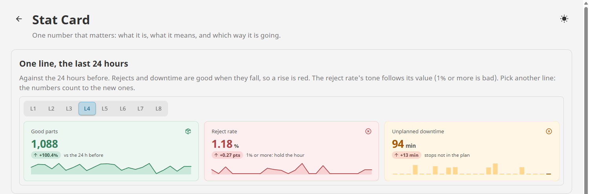
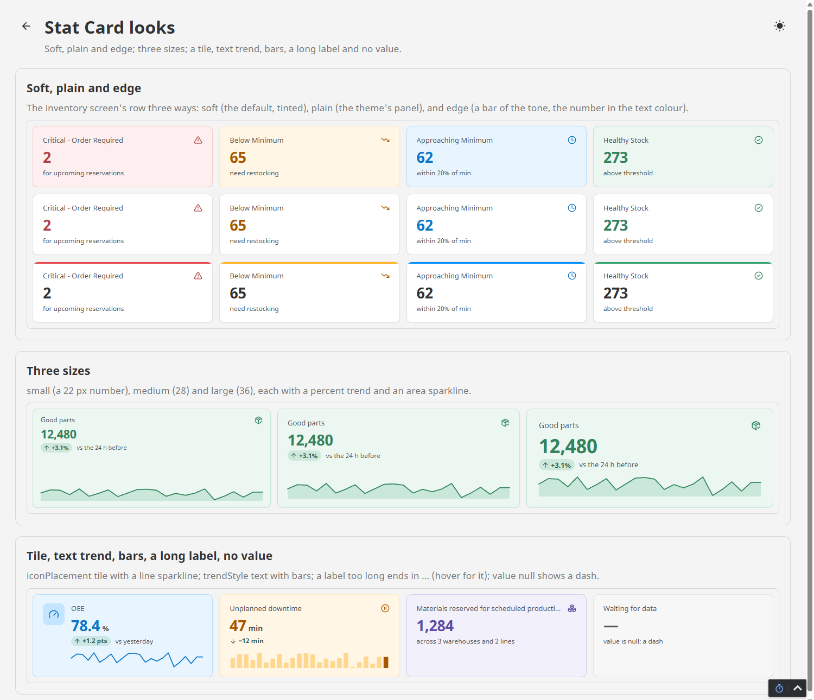

# Stat Card

**⬇ [Download the Ectobox Perspective Component Suite](https://github.com/Ectobox/EctoboxIgnitionModules/releases/download/modules/Ectobox-Perspective-Component-Suite-8.3.modl)**, which includes Stat Card.

One number that matters, with what it is, what it means and which way it is going: good parts in the last 24 hours,
the reject rate, materials below minimum.

- **The number in its tone**, with a label, a unit, a caption and an icon. Bind `tone` to show a state: bad when a
  count is over its limit.
- **The trend**: give it the previous value and it shows the change, as a difference (+1.2 pts) or a percent (+3.1%),
  green or red by **which way is good for this number**: up for good parts, down for rejects and downtime.
- **A sparkline** of recent values (area, line or bars) along the bottom, so cards in a row line theirs up.
- **Counts to a new value** on a spring with one small overshoot, so a change is seen, not just swapped.
- **Clickable**: a card can be a button that filters a table below it, with a ring on the one chosen.



## Install

Stat Card comes in the **[Ectobox Perspective Component Suite](PerspectiveComponentSuite.md)**, one module with all of
Ectobox's Perspective controls.

1. Download **`Ectobox-Perspective-Component-Suite-8.3.modl`** from the [Releases](https://github.com/Ectobox/EctoboxIgnitionModules/releases/download/modules/Ectobox-Perspective-Component-Suite-8.3.modl) list.
2. In the gateway's web interface, open the **Modules** page → **Install or Upgrade a Module** → pick the file (accept
   the Ectobox certificate on first install), and restart the gateway when it asks.
3. Open a project in the Designer; **Stat Card** appears in the component palette under the **Ectobox** category,
   twice: a count with a caption, and a rate with a trend and a sparkline.

## Quick start

```json
"label": "Reject rate",
"value": 1.18,
"decimals": 2,
"unit": "%",
"previous": 0.79,
"trendUnit": " pts",
"trendGood": "down",
"caption": "vs the 24 h before",
"icon": "lucide/circle-x",
"tone": "bad",
"history": [0.8, 0.9, 0.85, 0.7, 1.1, 1.05, 1.2, 1.18]
```

Bind `value` to a tag or a query; when it changes, the card counts to the new number. Text that is a number is read as
one, and null shows a dash. Thousands are grouped in the session's locale (12,480 or 12.480).

### The trend

| Property | What it does |
|---|---|
| `previous` | The value to compare with: the last shift's, the 24 hours before. Null: no trend. |
| `trendAs` | `value` (default): the difference at the value's decimals, then `trendUnit` (+1.2 pts, −12 min). `percent`: the change as a percent of `previous`, one decimal (+3.1%). |
| `trendGood` | `up` (default): a rise is green. `down`: a rise is red (rejects, downtime, late orders). A change too small to show at the value's decimals is grey and flat. |
| `trendStyle` | `pill` (default): the arrow and change in a small tinted pill. `text`: without the pill. `none`: hidden. |

What the change is compared with is yours to say in `caption` ("vs the 24 h before", "vs last shift").

### A row of cards that filters a table

```python
# onClick of each card (its name is the state it filters on)
key = self.meta.name
# clicking the chosen card again shows them all
self.view.custom.state = '' if event.selected else key
```

Turn on `clickable` and bind `selected` to `{view.custom.state} = 'running'` on the Running card (and the same for each).
The table's query takes `{view.custom.state}` as its parameter. A clickable card is a button: Tab reaches it, Enter or
Space presses it, and screen readers hear whether it is pressed.

## Settings

| Property | What it does |
|---|---|
| `label`, `caption` | The line above the number and the line under it. Too long for the card, they end in ... (the whole text shows on hover). |
| `value`, `decimals`, `unit` | The number, its decimal places (0 to 6), and a smaller unit after it (%, min, kg). |
| `icon`, `iconPlacement` | An icon in the tone's colour: `corner` (default, small, top right), `tile` (larger, in a tinted square at the left) or `none`. |
| `tone` | `neutral` (default), `accent`, `good`, `warning`, `bad`, `info`, `violet` or `teal`. |
| `appearance` | `soft` (default): the card tinted by its tone. `plain`: the theme's panel colour. `edge`: plain with a bar of the tone along the top. |
| `numberColor` | `tone` (default): the number in a deep shade of the tone. `text`: in the text colour. |
| `history`, `sparkline` | Recent values, oldest first, drawn as `area` (default), `line` or `bars` along the bottom; `none` hides it. |
| `animate`, `duration` | Count to a new value (on by default) over about `duration` ms (700). Reduced motion in the operating system shows the new number at once. |
| `clickable`, `selected` | A button that fires `onClick`; a ring in the tone on the selected one. |
| `size` | `small` (a 22 px number), `medium` (28, default), `large` (36, for a wall display). |

Cards in a flex row stretch to the same height, with their sparklines along the bottom. Every height inside the card is
a whole number of pixels, and the trend's figures are trimmed to their digits and centred in the pill, so nothing sits
a pixel off wherever the card is on the page or at any browser zoom. Light, dark and custom themes work through
Perspective's theme variables.



## Events

| Event | When | Payload |
|---|---|---|
| `onClick` | `clickable`: the user clicked the card, or pressed Enter or Space on it | `label`, `value`, `selected` (before the click) |

## See it working

Every example runs live on the [Public Demo Server](https://proveit.ectobox.com/data/perspective/client/ModuleDemos/statcard),
each beside exactly how it is built:

| Page | Shows |
|---|---|
| Examples | A plant's: one line's last 24 hours against the 24 before (good parts as a percent, the reject rate with its tone from its own value, unplanned downtime with bars; pick another line and they count to the new numbers), and work orders by state as cards that filter a table. |
| Looks | Soft, plain and edge; three sizes; an icon tile, a text trend, bars, a long label and no value. |
