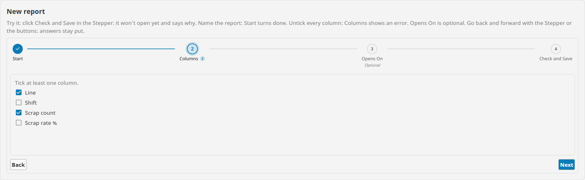
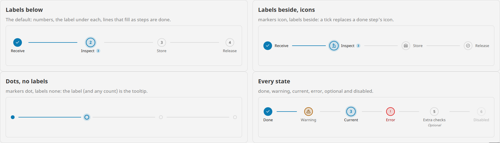

# Stepper

**⬇ [Download the Ectobox Perspective Component Suite](https://github.com/Ectobox/EctoboxIgnitionModules/releases/download/modules/Ectobox-Perspective-Component-Suite-8.3.modl)**, which includes the Stepper.

The steps of a task: where the user is, what is done and what has a problem. A tick replaces a done step's number, the
line to the next step fills, and a step with a problem shows it in red or amber.

- **Navigation only.** The Stepper shows and sets `current`; it holds no forms. Bound to a
  [Tabs](Tabs.md)' `current` (with the Tabs' strip hidden), it makes a wizard whose steps keep their answers.
- **Done is the page's to say.** Bind a step's `state` to whether its answer is there; a step left at `auto` counts as
  done while it is behind the step the user is on, so going back unticks the steps after it.
- **Linear when it matters.** With `navigation` linear, a later step opens only when the ones before it are done, and
  trying says why: "Finish Columns first."
- **Fits any width.** When its labels don't fit, it folds to "Step 2 of 5: Columns" with a progress bar.



## Install

The Stepper comes in the **[Ectobox Perspective Component Suite](PerspectiveComponentSuite.md)**, one module with all of
Ectobox's Perspective controls.

1. Download **`Ectobox-Perspective-Component-Suite-8.3.modl`** from the [Releases](https://github.com/Ectobox/EctoboxIgnitionModules/releases/download/modules/Ectobox-Perspective-Component-Suite-8.3.modl) list.
2. In the gateway's web interface, open the **Modules** page → **Install or Upgrade a Module** → pick the file (accept
   the Ectobox certificate on first install), and restart the gateway when it asks.
3. Open a project in the Designer; **Stepper** appears in the component palette under the **Ectobox** category.
   Dropped on a view, it starts with four steps of a new report to edit.

## Quick start

```json
"steps": [
  { "id": "start",   "label": "Start",   "description": "Name the report" },
  { "id": "columns", "label": "Columns", "description": "What the table shows" },
  { "id": "opens",   "label": "Opens On", "optional": true },
  { "id": "save",    "label": "Check and Save" }
]
```

A step needs only an `id` and a `label`. `description` shows beside a vertical stepper's steps and in the tooltip;
`icon` shows in the marker with `markers` icon; `badge` takes a count or a short word, and `badgeTone` gives it its own colour (`bad` for a count of problems);
`caption` is a small line above the label (Optional, or Step 1); `optional` marks it Optional.

### A wizard

1. Put a Stepper above a [Tabs](Tabs.md) with `placement` none, one Flex per step in the Tabs.
2. Bind **both** `current`s, both ways, to one custom property, e.g. `view.custom.step`.
3. Add Back and Next buttons that change `view.custom.step`.
4. Bind each step's `state` to whether its answer is there:

```
if(len(trim({../Tabs/FlexStart/Name.props.text})) > 0, "done", "auto")
```

Clicking a step, Back or Next now moves both; each step's answers stay put when the user goes back, because the
Tabs keeps them.

## Steps and their states

| `state` | Shows |
|---|---|
| `auto` (default) | Done (a tick) while it is behind the step the user is on; going back to an earlier step unticks it again. |
| `done` | A tick, and the line to the next step filled. |
| `error` | A red mark, even on the step the user is on. With `navigation` linear, later steps say "Fix … first." |
| `warning` | An amber mark: worth a look, not blocking. |

`disabled` greys a step out; it can't be opened and the keys skip it.

## Moving between steps

| `navigation` | What a click does |
|---|---|
| `free` (default) | Opens any step. |
| `linear` | Opens any earlier step; a later one only when every step before it is done (optional and disabled ones aside). Otherwise it shakes, shows why under it, and fires `onStepBlocked`. |
| `none` | Nothing: the steps aren't buttons, and Back and Next (or a script) move it. |

## Looks

| Property | Choices |
|---|---|
| `orientation` | `horizontal` (default): steps in a row, joined by lines. `vertical`: down the side, with each step's description. |
| `labels` | Where a horizontal stepper's labels go: `below` (default), `beside`, or `none` (the label is the tooltip). |
| `markers` | `number` (default), `icon` or `dot`. A done step shows a tick; error and warning their own sign. |
| `captions` | `none` (default): only the steps' own captions. `number`: Step 1, Step 2 ... above every label without its own. With labels beside, the marker centres on the caption and label together. |
| `look` | `plain` (default), or `boxed`: the current step also sits in a tinted box, as in a receiving app's step bar. |
| `size` | Markers `small` 24 px, `medium` 32 (default), `large` 40, `touch` 48 for panel screens and gloves. |
| `fold` | `auto` (default): when a horizontal stepper's labels don't fit, it becomes "Step 2 of 5: Columns" with a progress bar and dots, and unfolds when there is room again. `always` or `never`. |
| `color` | The colour of done and current steps and the lines. Blank uses the theme's accent. |

Numbers and counts are centred on their digits, in the theme's own font. Light, dark and custom themes work through
Perspective's theme variables. When the operating system asks for reduced motion, nothing animates.



## Events

| Event | When | Payload |
|---|---|---|
| `onStepChange` | The user opened another step (not a binding) | `from`, `to`, `fromId`, `toId`, `by` (click or key) |
| `onStepBlocked` | `navigation` linear: the user tried to open a step they can't yet | `index`, `id`, `reason` |

## Keyboard

| Key | Does |
|---|---|
| Tab | Into the Stepper, onto the current step. |
| Arrows (Up and Down when vertical) | Move between steps, skipping disabled ones; they stop at the ends. |
| Home / End | The first or last step. |
| Enter / Space | Opens the step in focus. |

Screen readers hear each step as "Step 2 of 4: Columns, current step" (or done, has a problem, needs a look, not
started), and the current step is marked as the current one.

## See it working

Every example runs live on the [Public Demo Server](https://proveit.ectobox.com/data/perspective/client/ModuleDemos/stepper),
each beside exactly how it is built:

| Page | Shows |
|---|---|
| A new report, step by step | A Stepper and a Tabs sharing one current, each step's state bound to its answer; later steps closed until earlier ones are done, Columns in error when nothing is ticked. |
| Looks | Labels below, beside or none; numbers, icons or dots; vertical; four sizes; every state; the fold; display only. |

The [Tabs](Tabs.md) wizard page uses a Stepper too: logging a stop on the line in four steps.
