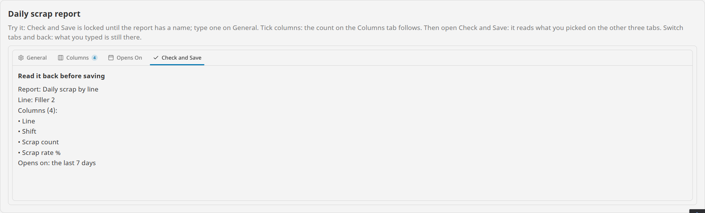
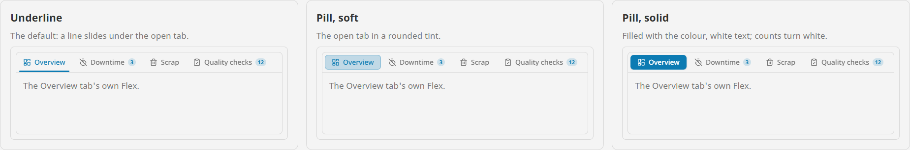
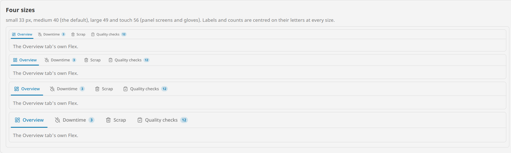
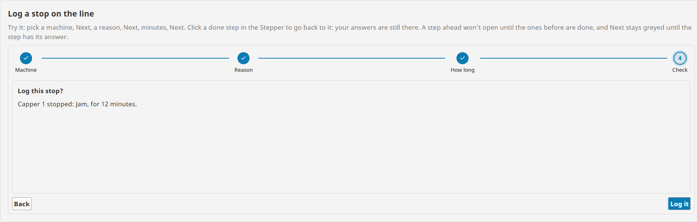

# Tabs

**⬇ [Download the Ectobox Perspective Component Suite](https://github.com/Ectobox/EctoboxIgnitionModules/releases/download/modules/Ectobox-Perspective-Component-Suite-8.3.modl)**, which includes the Tabs.

A container that shows its contents one tab at a time. Every tab's components sit in the same view, so a component on
one tab binds straight to a component on another: no message handlers or session properties to carry what was picked
on the first tab to the third.

- **Labels never cut mid-letter.** Tabs are as wide as their labels; when they don't fit, the rest go under a
  **More** menu (or the strip scrolls), and the open tab always stays in view.
- **Counts and icons on tabs**, a **lock** with a reason for a tab that can't be opened yet, and a line or fill that
  slides to the open tab on a spring.
- **Typed input survives switching away**: a tab's contents keep running once they have been shown.
- **Keyboard and screen readers** work: real tab roles, arrow keys, Home and End.
- **Wizards**: hide the strip and drive `current` from Back and Next buttons (or a stepper).



## Install

The Tabs comes in the **[Ectobox Perspective Component Suite](PerspectiveComponentSuite.md)**, one module with all of
Ectobox's Perspective controls.

1. Download **`Ectobox-Perspective-Component-Suite-8.3.modl`** from the [Releases](https://github.com/Ectobox/EctoboxIgnitionModules/releases/download/modules/Ectobox-Perspective-Component-Suite-8.3.modl) list.
2. In the gateway's web interface, open the **Modules** page → **Install or Upgrade a Module** → pick the file (accept
   the Ectobox certificate on first install), and restart the gateway when it asks.
3. Open a project in the Designer; **Tabs** appears in the component palette under the **Ectobox** category.

## Quick start

1. Drop a **Tabs** on a view. It starts with three tabs to rename in `tabs`.
2. **Deep-select** the Tabs (double-click it, as for any container) and drop components onto it. A component dropped
   on an empty tab arrives inside a new column **Flex**, the tab's own container; the next one goes into that Flex.
   A Flex, Column or Coordinate container, or a view from the Project Browser, becomes the tab's container as it is.
3. Click the tabs in the Designer to switch between them and fill each.

Each child of the Tabs names its tab in its **Position**, as `tabId`: the tab's `id`. That is how a tab finds its
contents, so renaming, reordering or closing tabs never pairs a tab with the wrong contents. To move a container to
another tab, change its `tabId`.

```json
"tabs": [
  { "id": "general", "label": "General", "icon": "lucide/settings" },
  { "id": "columns", "label": "Columns", "icon": "lucide/columns-3", "badge": 12 },
  { "id": "check",   "label": "Check and Save", "locked": true, "lockedReason": "Name the report on General first." }
]
```

A tab needs only an `id` and a `label`. `icon` takes any icon path (`lucide/…`, `material/…`); `badge` a number or a
short word, and is made to be bound to a count; `badgeTone` gives that count its own colour (`bad` for critical orders,
`warning` for below minimum; empty uses the tabs' colour); `tooltip` shows when the pointer rests on it.

### Tabs that talk to each other

Because every tab's contents are in one view, bindings simply reach across. On a Check tab, a label reading the report
name typed on the General tab:

```
{../../FlexGeneral/Name.props.text}
```

`../../` climbs from the label to its Flex and on to the Tabs; `FlexGeneral/Name` goes down into the General tab's Flex
to the text field. The Columns count above is the same idea: `tabs[1].badge` bound to the ticked boxes on the Columns
tab, and `tabs[3].locked` bound to "the name is blank".

## Choosing a tab

| Property | What it does |
|---|---|
| `current` | The index of the open tab. Bind it both ways to drive the Tabs from elsewhere; a binding's change fires no event. |
| `selection` | `auto` (default): a click opens the tab. `controlled`: a click only fires `onTabRequest`, and your script opens the tab by setting `current`, for checks only the gateway can make. |
| `keepAlive` | `visited` (default): a tab's contents start the first time it is opened and keep running after, so typing survives switching away. `all`: every tab from the start. `none`: only the open tab's (they restart each time). |

A tab's own settings:

- **`disabled`**: greyed out; it can't be opened and the arrow keys skip it.
- **`locked`**: shown with a lock. Opening it is refused at once, with `lockedReason` shown under it, and
  `onTabBlocked` fires. For a step that needs an earlier one finished; bind it.
- **`hidden`**: not shown; its contents are kept.

## Looks

| Property | Choices |
|---|---|
| `look` | `underline` (default): a line under the open tab. `pill`: the open tab in a rounded fill. `boxed`: folder tabs joined to their contents. |
| `appearance` | `soft` (default): the open pill or box is a tint of the colour. `solid`: filled with the colour and white text, counts in white. An underline is solid either way. |
| `placement` | `top` (default), `bottom`, `left`, `right`, or `none` (no strip: Back and Next, or a stepper, set `current`). |
| `size` | `small` 33 px, `medium` 40 (default), `large` 49, `touch` 56 for panel screens and gloves. |
| `sizing` | `fit` (default): each tab as wide as its label. `fill`: the tabs share the width equally. `fixed`: every tab `tabWidth` wide, a long label ending in "…" with the whole label as its tooltip. |
| `overflow` | When the tabs don't fit: `menu` (default) puts the rest under **More**; `scroll` scrolls the strip, with arrows. |
| `color` | The colour of the open tab's line, fill or text. Blank uses the theme's accent. |

Labels and counts are centred on their letters at every size, in the theme's own font. Light, dark and custom themes
work through Perspective's theme variables. When the operating system asks for reduced motion, the line moves at once.





## Closing and moving tabs

- **`closable`**: each tab shows an x, and Delete closes the focused tab. The tab leaves `tabs` and `onTabClose` fires;
  its contents are kept for if it comes back. A tab's own `closable` false pins it. Closing the open tab opens its
  right-hand neighbour (or the left one).
- **`reorderable`**: tabs can be dragged along the strip (the others slide out of the way), or moved with Alt and an
  arrow key. `tabs` is rewritten in the new order and `onTabReorder` fires.

## Events

| Event | When | Payload |
|---|---|---|
| `onTabChange` | The user opened another tab (not a binding) | `from`, `to`, `fromId`, `toId`, `by` (click, key, menu or close) |
| `onTabRequest` | `selection` controlled: the user asked for a tab | `index`, `id`, `by` |
| `onTabBlocked` | The user tried to open a locked tab | `index`, `id`, `reason` |
| `onTabClose` | The user closed a tab | `index`, `id`, `by` |
| `onTabReorder` | The user moved a tab | `id`, `from`, `to`, `by`, `order` (every id in the new order) |

## A wizard

Set `placement` to `none`, bind `current` both ways to a custom property, and let Back and Next change it. Put a
[Stepper](Stepper.md) above it with its `current` bound to the same property, and each step's `state` bound to whether
its answer is there: the user sees where they are, clicks back to any step, and can't skip ahead.

```python
# Next's onActionPerformed
lastStep = 3
if self.view.custom.step < lastStep:
	self.view.custom.step = self.view.custom.step + 1
```

Each step's answers stay where they were when the user goes back, and the last step binds to all of them.



## Keyboard

| Key | Does |
|---|---|
| Tab | Into the strip, onto the open tab. |
| Arrows (Up and Down when the tabs are on a side) | Open the previous or next tab, skipping disabled ones. |
| Home / End | The first or last tab. |
| Delete | Closes the focused tab (`closable`). |
| Alt + arrow | Moves the focused tab (`reorderable`). |
| Down or Enter on More | Opens the menu of tabs that don't fit. |

## See it working

Every example runs live on the [Public Demo Server](https://proveit.ectobox.com/data/perspective/client/ModuleDemos/tabs),
each beside exactly how it is built:

| Page | Shows |
|---|---|
| A report's settings | Four tabs whose contents bind to each other: a lock until the report is named, a live count of ticked columns, and a read-back of every tab. |
| A wizard | A Stepper over Tabs with no strip, driven by the Stepper, Back and Next: log a stop on the line in four steps. |
| Looks and behaviour | Underline, pill and boxed, soft and solid, on the left, four sizes, a More menu, and tabs to close and drag. |
