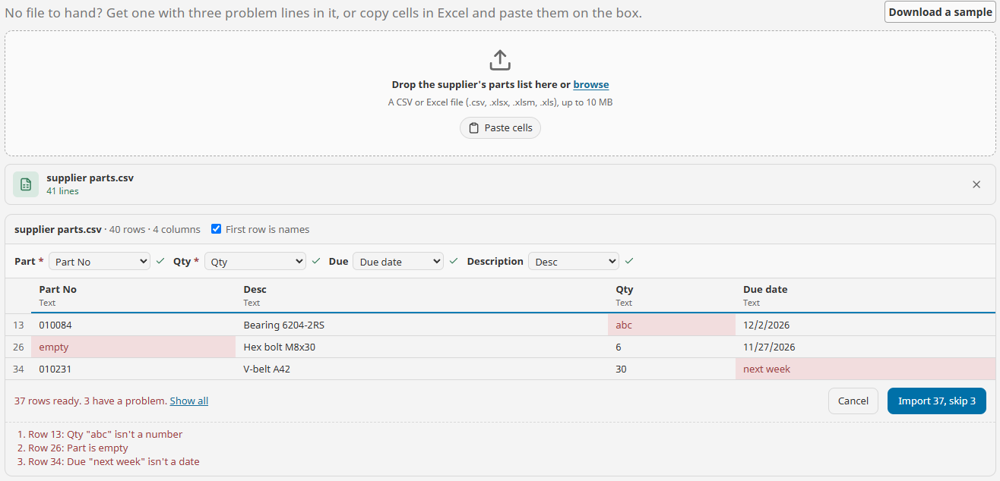
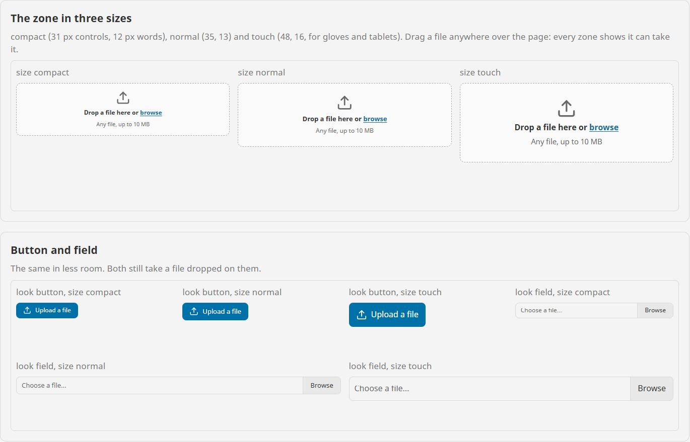

# Upload

**⬇ [Download the Ectobox Perspective Component Suite](https://github.com/Ectobox/EctoboxIgnitionModules/releases/latest/download/Ectobox-Perspective-Component-Suite-8.3.modl)**, which includes Upload.

Files from a person to the gateway: a supplier's parts list, a lab's recipe sheet, photos of a fault from a tablet.
Upload checks a file before a byte is sent, checks it again by its content when it arrives, and then does one of three
things with it:

- **memory**: your script gets the file (`event.file`) in the gateway's memory. Nothing is written to disk unless your
  script writes it.
- **rows**: a CSV or Excel file becomes rows. The person sees the first rows and any problems (*Row 15: Qty "abc"
  isn't a number*) before they press **Import**, and your script gets a Dataset of the good rows, in the columns your
  screen expects.
- **folder**: saved in a folder on the gateway under its own name.



Also:

- **Three looks**: a zone to drop files on, a button, or a field with Browse. Every look takes a file dropped on it,
  and a file dragged anywhere over the page lights them all up.
- **Paste**: Ctrl+V pastes a copied file; with rows, cells copied straight from Excel.
- **Take a photo** opens a camera: a phone's or tablet's own camera app, or on a computer with a camera, a viewfinder
  over the page. Where there is no camera there is no button.
- **Each file has its own progress** (*12.8 MB of 30 MB · 42% · 6 s left*), Stop, and Try again.
- **Three sizes**: compact (31 px), normal (35 px) and touch (48 px, for gloves).



## Install

Upload comes in the **[Ectobox Perspective Component Suite](PerspectiveComponentSuite.md)**, one module with all of
Ectobox's Perspective controls.

1. Download **`Ectobox-Perspective-Component-Suite-8.3.modl`** from the [Releases](https://github.com/Ectobox/EctoboxIgnitionModules/releases/latest/download/Ectobox-Perspective-Component-Suite-8.3.modl) list.
2. In the gateway's web interface, open the **Modules** page → **Install or Upgrade a Module** → pick the file (accept
   the Ectobox certificate on first install), and restart the gateway when it asks.
3. Open a project in the Designer. **Upload** appears in the component palette under the **Ectobox** category three
   times: a plain upload, rows from a spreadsheet, and photos sized for touch.

## Quick start: a file to a script

Drop an Upload on a view and add a script to **onFileReceived**. It runs on the gateway with the file in memory:

```python
# onFileReceived: event.file is the file as it arrived
f = event.file
system.util.getLogger('upload').info('{0}: {1} bytes, a {2}'.format(f.name, f.size, f.kind))
# a spreadsheet: read it straight from the file
if f.kind in ('xlsx', 'xls', 'csv'):
	parts = system.ectobox.excel.Read(f)
```

`event.file` has:

| | |
|---|---|
| `name` | the file's name, as the browser gave it |
| `size` | its size in bytes |
| `kind` | from its first bytes: `xlsx`, `xls`, `csv`, `picture` or `file` |
| `extension` | the name's extension, lowercase, without the dot |
| `path` | with destination folder, where it was saved; otherwise None |
| `getBytes()` | the bytes (for a database blob, `system.file.writeFile`, `system.ectobox.excel.Read`) |
| `getString(encoding)` | the file as text, UTF-8 unless you name another encoding |
| `getInputStream()` | the bytes as a stream |

## Rows from a client's spreadsheet

Set `destination` to `rows` and list the columns your screen needs in `rows.columns`:

```json
"destination": "rows",
"rows": {
  "columns": [
    { "name": "Part", "required": true, "type": "text", "aliases": ["Part No", "Item number"] },
    { "name": "Qty", "required": true, "type": "number" },
    { "name": "Due", "type": "date" },
    { "name": "Description", "type": "text" }
  ]
}
```

The person drops their file (or pastes cells from Excel) and sees:

- **the sheets**, as tabs, for a workbook with more than one;
- **which of the file's columns is which**: each expected column finds the file's own by name, ignoring case and
  spaces (*Part No* for Part), by one name starting the other (*Desc* for Description, *Due date* for Due), by a short
  form within one word (*Qty* finds *Quantity*), or by an alias. When a short form would fit two columns it doesn't
  guess. The person can change any of them;
- **the first rows**, each column with its type, and how many rows have a problem. **Show them** lists those rows with
  the bad cell marked. A row has a problem when a `required` column is empty, or a value isn't the column's `type`
  (a number, a date, true or false). Rows are numbered as Excel numbers them, blank rows included.

**Import** fires **onRowsAccepted** with the good rows:

```python
# onRowsAccepted: event.rows is a Dataset of Part, Qty, Due, Description
for r in range(event.rows.getRowCount()):
	system.db.runPrepUpdate(
		'INSERT INTO Parts (Part, Qty, Due) VALUES (?, ?, ?)',
		[event.rows.getValueAt(r, 'Part'), event.rows.getValueAt(r, 'Qty'),
		 event.rows.getValueAt(r, 'Due')])
```

| | |
|---|---|
| `event.rows` | a Dataset of the good rows, the expected columns in their order (an optional column the file hasn't is empty) |
| `event.fileName` | the file's name, or *Pasted cells* |
| `event.sheet` | the sheet the rows came from (None for a CSV) |
| `event.skipped` | how many rows had a problem and were left out |
| `event.problems` | the first 200 problems, e.g. *Row 15: Qty "abc" isn't a number*, to send back to the supplier |

Columns are typed as **[system.ectobox.excel.Read](EctoboxIgnitionLibrary.md)** types them: `00123` stays text with its
zeros, an ID too long for a number stays text, and slash dates take the order the column shows (*3/14/2026* is month
first). With no `rows.columns`, every column is taken as Read types it.

The file stays in the gateway's memory until Import, Cancel, another file, or 30 minutes without use. The browser only
ever sees the first rows.

## A folder on the gateway

Set `destination` to `folder` and `folder.path` to a folder that exists on the gateway (written as the gateway sees it).
Each file is saved directly in it under its own name, cleaned of anything that isn't a plain file name: a name can
never reach outside the folder. When a file of that name is there, `folder.existing` decides: `rename` saves it as
*name (2).ext*, `replace` overwrites it, `refuse` turns the new one down. onFileReceived then has `event.file.path`.

## What it takes, and the limits

- `accept`: `any`, `spreadsheets` (.csv .tsv .txt .xlsx .xlsm .xltx .xltm .xls) or `pictures` (.jpg .png .gif .webp
  .heic .bmp). `extensions` narrows it (`["xlsx"]`, or `["pdf", "docx"]` with any).
- A file is checked by its name and size **before it is sent**, and by its **first bytes when it arrives**: a program
  renamed *parts.csv* is refused, whatever its name says. **onFileRefused** tells your script each time (name, size,
  reason).
- `maxSizeMb`: 10 by default, at most 100. `multiple` with `maxFiles` (10 by default, at most 50). A control sends four
  files at once; the rest show *Waiting to send* and go as others finish.
- The gateway holds at most 256 MB of uploads at once across every session, takes 8 at a time, and refuses more than 30
  files a minute from one control. A file over a limit is refused before it is sent.

## Security

- The props that decide where a file goes and what is taken (`destination`, `accept`, `extensions`, `multiple`,
  `maxFiles`, `maxSizeMb`, `enabled`, `folder`, `rows`) are read **as the view sets them**. A browser that changes them
  changes nothing on the gateway, and the gateway log says so once.
- A file is sent only with a ticket the gateway gave that control for that file's size: good once, for two minutes,
  for that Perspective session only.
- memory and rows never write to disk: the bytes go straight into memory, not through temporary files.
- A rows sheet is held as rows until Import: at most 2,000,000 cells, and its rows count against the 256 MB.

## Properties

| Property | Default | |
|---|---|---|
| `destination` | `memory` | `memory`, `rows` or `folder` |
| `accept` | `any` | `any`, `spreadsheets` or `pictures` |
| `extensions` | `[]` | narrows what is taken |
| `multiple` / `maxFiles` | `false` / `10` | several files at a time (rows takes one) |
| `maxSizeMb` | `10` | the largest file, up to 100 |
| `look` | `zone` | `zone`, `button` or `field` |
| `size` | `normal` | `compact`, `normal` or `touch` |
| `camera` | `true` | Take a photo, only where it opens a camera (pictures: any device with one; any: phones and tablets) |
| `paste` | `true` | Ctrl+V pastes a file, or with rows, cells |
| `enabled` | `true` | false greys it and the gateway refuses files |
| `text` | | `prompt`, `hint` and `button` words instead of the automatic ones |
| `folder` | | `path` and `existing` (`rename`, `replace`, `refuse`) |
| `rows` | | `columns`, `sheet`, `header`, `dayFirst`, `delimiter`, `maxRows` (100,000), `previewRows` (8) |
| `files` | `[]` | written by the gateway: each file and what became of it (name, size, kind, status, message, path, at) |
